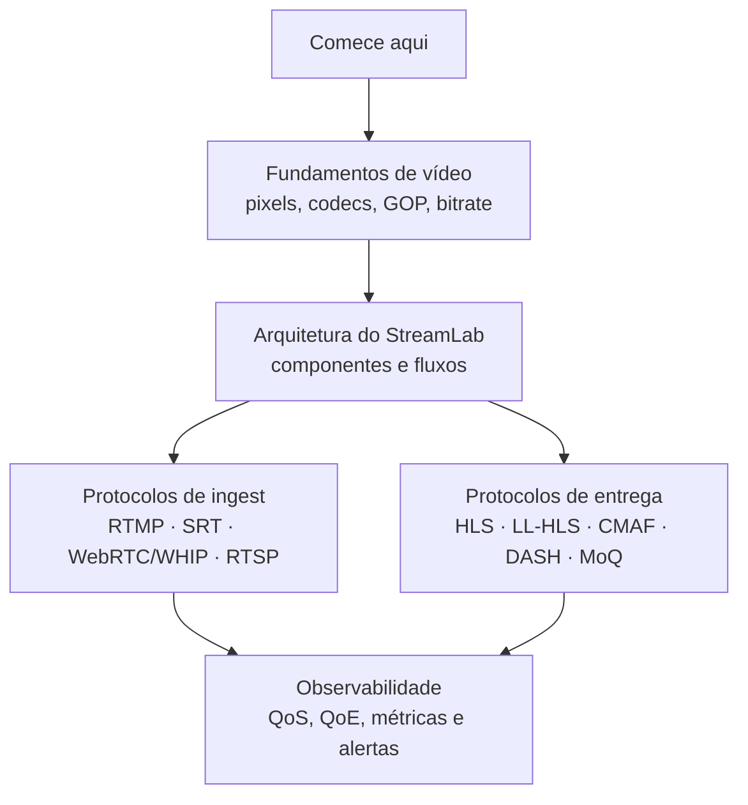
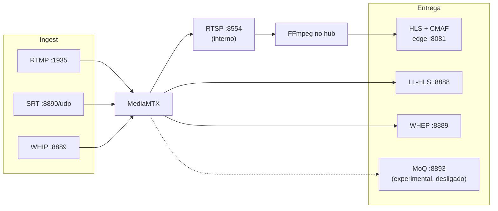

# Documentação técnica do StreamLab

O [README principal](../README.md) mostra como subir e usar o projeto. Esta pasta explica **como as coisas
funcionam por dentro**: cada componente, cada protocolo, o formato dos arquivos e como observar tudo.

## Por onde começar

## Índice

| Documento | Conteúdo |
|---|---|
| [Fundamentos de vídeo](fundamentos-video.md) | YUV, bitrate bruto, I/P/B frames, GOP, PTS/DTS, codecs, rate control, escada ABR, VMAF |
| [Arquitetura](arquitetura.md) | componentes, autenticação da stream key, reconciliation loop do transcoder, CDN, chat, QoE, portas |
| [Observabilidade](observabilidade.md) | QoS × QoE, catálogo de métricas, alertas, logs, cardinalidade |
| **Ingest** | |
| [RTMP e Enhanced RTMP](protocolos/rtmp.md) | handshake, chunk stream, mensagens AMF, tags FLV, E-RTMP |
| [SRT](protocolos/srt.md) | handshake, ARQ, TSBPD e latência, criptografia, streamid |
| [WebRTC, WHIP e WHEP](protocolos/webrtc-whip-whep.md) | SDP, ICE, DTLS-SRTP, RTP/RTCP, controle de congestionamento, WHIP/WHEP |
| [RTSP](protocolos/rtsp.md) | métodos, transporte RTP sobre TCP/UDP |
| **Entrega** | |
| [HLS](protocolos/hls.md) | playlists, tags, janela ao vivo, ABR, CDN, CMCD |
| [LL-HLS](protocolos/ll-hls.md) | partes, blocking reload, preload hints, delta updates |
| [CMAF e fMP4](protocolos/cmaf-fmp4.md) | caixas MP4, init e media segments, codecs string |
| [MPEG-DASH](protocolos/dash.md) | MPD, SegmentTemplate, LL-DASH |
| [MoQ (Media over QUIC)](protocolos/moq.md) | QUIC, tracks/groups/objects, relays, estado da padronização |

## Mapa dos protocolos no StreamLab

Todos os desenhos desta documentação são [Mermaid](https://mermaid.js.org/) e são renderizados pelo GitHub.
