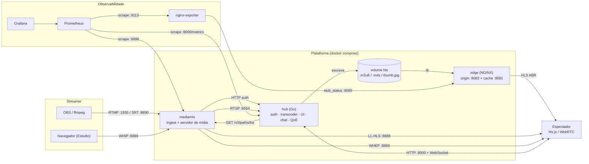
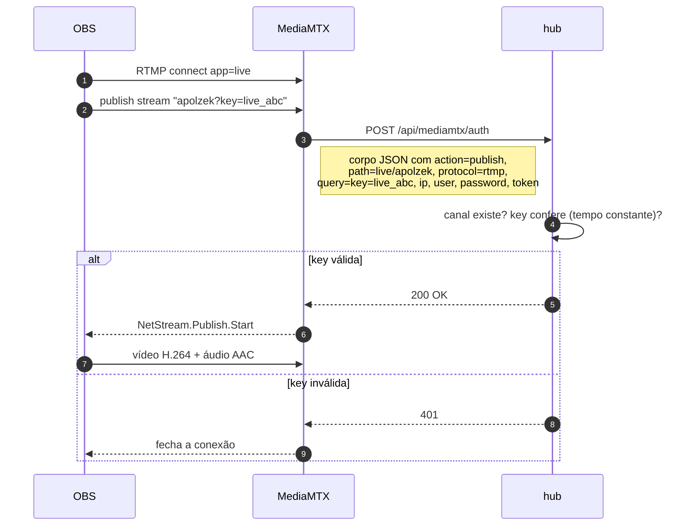
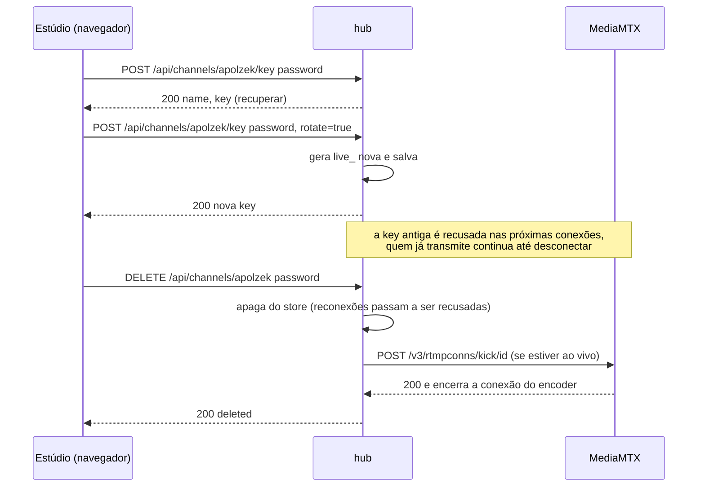
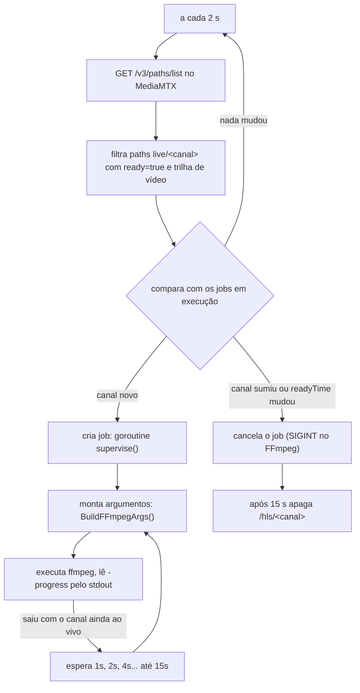
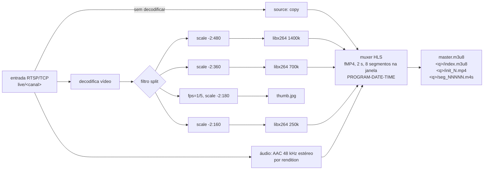
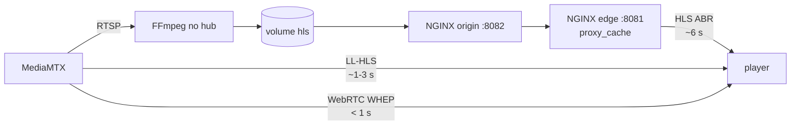
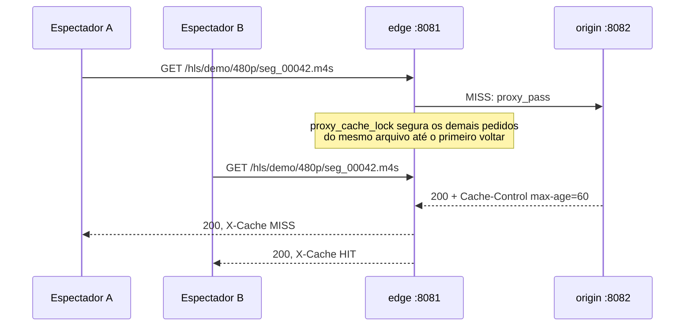
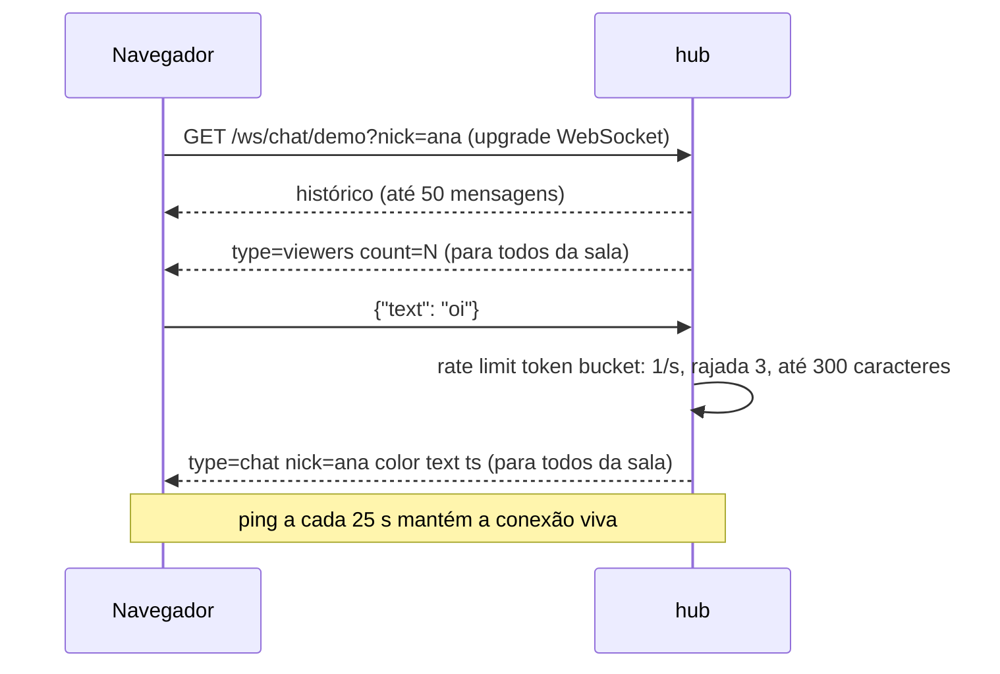
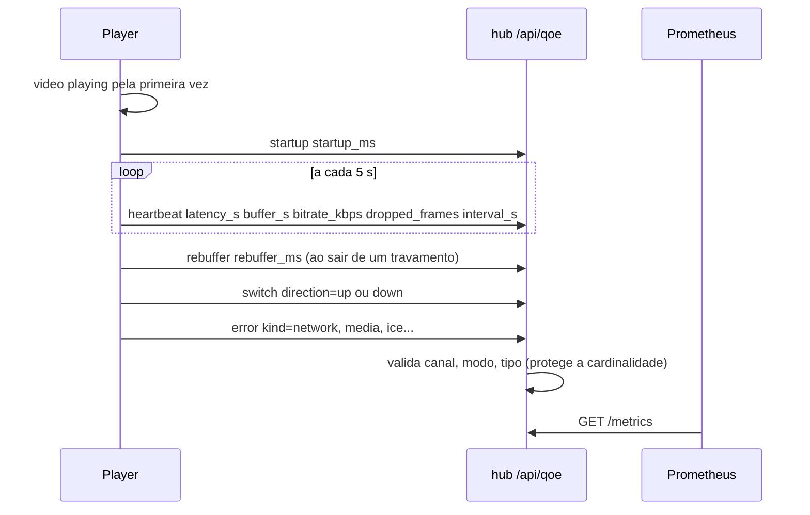

# Arquitetura do StreamLab

Este documento descreve cada componente, como eles conversam e o que acontece, passo a passo, desde o
momento em que o streamer aperta "Iniciar transmissão" até o quadro aparecer na tela de quem assiste.

## Visão geral

## Componentes

| Serviço | Responsabilidade | Entradas | Saídas |
|---|---|---|---|
| `mediamtx` | Recebe o sinal (RTMP, SRT, WHIP, RTSP) e o redistribui convertendo protocolo sem re-encode | encoder do streamer | RTSP para o transcoder, LL-HLS e WebRTC para os espectadores, API :9997, métricas :9998 |
| `hub` | Plano de controle: decide quem pode publicar, liga um FFmpeg por canal, serve a UI, o chat e recebe QoE | pedidos de auth do MediaMTX, navegadores | arquivos HLS no volume `hls`, `/metrics` |
| `edge` | Mini CDN: origin (arquivos) e edge (cache) no mesmo NGINX | volume `hls` (somente leitura) | HLS para os players, logs JSON com CMCD |
| `prometheus` | Coleta e guarda séries temporais, avalia alertas | MediaMTX, hub, nginx-exporter | consultas PromQL |
| `grafana` | Dashboard provisionado | Prometheus | painéis |
| `nginx-exporter` | Converte o `stub_status` do NGINX em métricas | edge :8085 | :9113 |
| `demo-streamer` | Simula o OBS (perfil `demo`) | — | RTMP para o MediaMTX |

## Fluxo 1: publicar (ingest + autenticação)

O MediaMTX não conhece stream keys. Ele usa a autenticação HTTP externa: a cada ação (publicar, ler, usar a API)
faz um `POST` para o hub com quem está pedindo e o quê. Resposta 2xx libera; qualquer outra coisa bloqueia.

Onde a key pode vir, por protocolo (implementado em `hub/api.go`, função `decide`):

| Protocolo | Formato | Campo que o hub lê |
|---|---|---|
| RTMP | `rtmp://host:1935/live` + chave `<canal>?key=<key>` | `query` |
| SRT | `streamid=publish:live/<canal>:<canal>:<key>` | `password` |
| WHIP | `POST /live/<canal>/whip` com `Authorization: Bearer <key>` | `token` |

Regras para as outras ações: `read`/`playback` são liberadas (assistir é público); `api`/`metrics`/`pprof` só a
partir de IPs privados (a rede interna do compose). Toda decisão vira a métrica
`streamlab_auth_requests_total{action,protocol,result}`.

## Fluxo 1b: recuperar, regenerar e excluir canal

O lab não tem login. As ações de dono do canal são protegidas pela senha do Estúdio (`STUDIO_PASSWORD`),
comparada em tempo constante, com 500 ms de espera a cada erro para frear tentativas de adivinhação.

O canal `demo` não pode ser excluído porque é recriado a cada início do hub (desligue com `DEMO_CHANNEL=`).
As ações viram a métrica `streamlab_stream_key_requests_total{result="recovered|rotated|deleted|denied"}`.

## Fluxo 2: transcodificação (reconciliation loop)

O hub não recebe "eventos" do MediaMTX. Ele usa o padrão de **reconciliação** (o mesmo dos controllers do
Kubernetes): a cada 2 s compara o estado desejado (canais prontos no MediaMTX) com o estado atual (FFmpegs
rodando) e corrige a diferença. É simples e se recupera sozinho de qualquer falha.

Detalhes importantes:

- **readyTime**: se o streamer reconecta, o MediaMTX gera um novo `readyTime`; o hub reinicia o FFmpeg porque
  codec, resolução ou trilhas podem ter mudado.
- **Fonte copiada ou re-codificada**: se o vídeo de entrada é H.264 e não veio de WebRTC, a qualidade `source`
  é copiada (`-c:v:0 copy`). Navegadores (WHIP) mandam keyframes só quando pedidos, então nesse caso a
  `source` também é re-codificada para manter segmentos de 2 s.
- **Velocidade**: o `speed=` do FFmpeg é uma média desde o início. O hub calcula a velocidade numa janela de
  ~5 s com `out_time_us` (segundos de mídia produzidos ÷ segundos de relógio) e publica em
  `streamlab_transcoder_speed_ratio`. Abaixo de 1.0 o transcoder está ficando para trás.

### O comando FFmpeg

Todas as qualidades re-codificadas usam `-force_key_frames expr:gte(t,n_forced*2)` e `-sc_threshold 0`: um
keyframe exatamente a cada 2 s, alinhado entre as qualidades. É isso que permite ao player trocar de qualidade
na fronteira de qualquer segmento sem engasgar.

## Fluxo 3: entrega

Há três rotas, que o player escolhe pelo botão de protocolo:

### O edge como CDN

| Arquivo | `Cache-Control` no origin | Por quê |
|---|---|---|
| `*.m3u8` | `max-age=1` | muda a cada segmento novo |
| `*.m4s`, `*.mp4` | `max-age=60` | imutável depois de escrito |
| `thumb.jpg` | `max-age=4` | atualizado a cada 5 s |

A chave de cache é `$scheme$host$uri`, **sem** a query string: o hls.js anexa `?CMCD=...` diferente em cada
requisição, e incluí-la na chave zeraria o cache.

## Fluxo 4: chat e audiência

O número de espectadores é o número de conexões WebSocket abertas na sala (`streamlab_viewers`). Cliente lento
não trava a sala: se o buffer de envio (64 mensagens) enche, a mensagem é descartada para aquele cliente.

## Fluxo 5: QoE

Os beacons vão em lote (array JSON) a cada 5 s, e com `navigator.sendBeacon` quando a página fecha.

## Portas

| Porta | Protocolo | Serviço | Uso |
|---|---|---|---|
| 1935/tcp | RTMP | mediamtx | ingest (OBS) |
| 8890/udp | SRT | mediamtx | ingest e leitura SRT |
| 8888/tcp | HTTP | mediamtx | LL-HLS |
| 8889/tcp | HTTP | mediamtx | WHIP/WHEP (sinalização) |
| 8189/udp+tcp | ICE/SRTP | mediamtx | mídia WebRTC |
| 8554/tcp | RTSP | mediamtx | interno (transcoder) |
| 9997/tcp | HTTP | mediamtx | API (interna) |
| 9998/tcp | HTTP | mediamtx | métricas (interna) |
| 8000/tcp | HTTP/WS | hub | UI, API, chat, `/metrics` |
| 8081/tcp | HTTP | edge | HLS ABR com cache (`EDGE_PORT`) |
| 8082/tcp | HTTP | edge | origin (interna) |
| 9090/tcp | HTTP | prometheus | `PROMETHEUS_PORT` |
| 3000/tcp | HTTP | grafana | `GRAFANA_PORT` |

## Decisões de projeto

| Decisão | Alternativa | Por quê |
|---|---|---|
| MediaMTX como ingest | nginx-rtmp, SRS | um binário com RTMP, SRT, WebRTC, LL-HLS, RTSP, API e métricas |
| Transcoder dentro do hub | serviço separado / fila | menos peças para estudar; em produção seriam workers com GPU |
| Reconciliação por polling | webhooks `runOnReady` | auto-recuperável e sem estado perdido se o hub reiniciar |
| HLS com fMP4 (CMAF) | MPEG-TS | formato único para HLS e DASH, padrão atual |
| Segmentos de 2 s | 4–6 s | menor latência mantendo poucas requisições |
| Chat em memória | Redis/NATS | uma réplica só; ver [o README](../README.md#11-do-laboratório-para-a-produção) |
| JSON em volume para canais | banco | suficiente para um lab |
