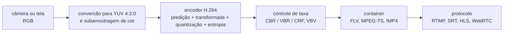
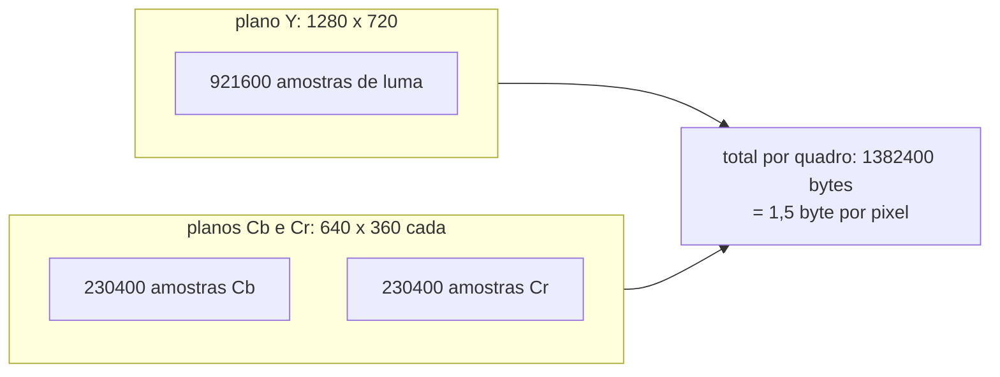
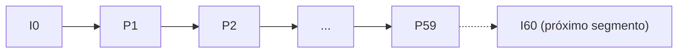
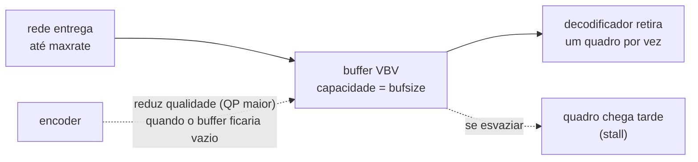
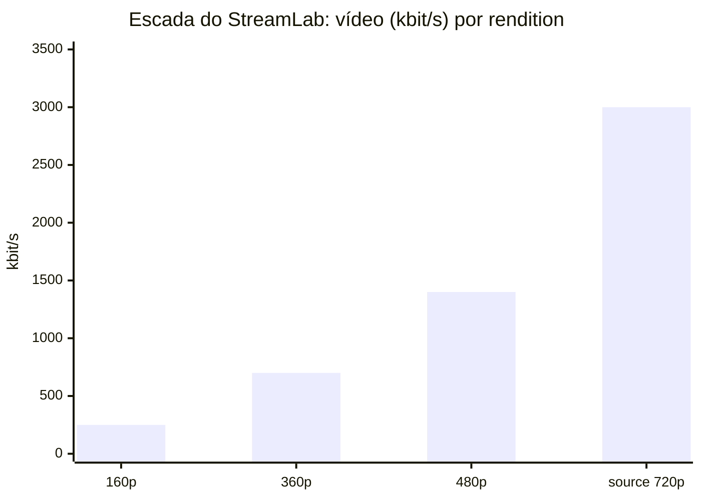

# Fundamentos de vídeo digital

Antes de protocolos, existe o sinal: pixels, quadros, compressão. Este documento explica os conceitos que
aparecem no comando FFmpeg do StreamLab ([`hub/transcoder.go`](../hub/transcoder.go), função `BuildFFmpegArgs`) e
no streamer de demonstração ([`demo/publish.sh`](../demo/publish.sh)), sempre com números medidos nos arquivos
reais do projeto.

## Visão geral



| Camada | Pergunta que responde | No StreamLab |
|---|---|---|
| Amostragem | quantos pixels e quantas cores por segundo? | 1280×720, 30 fps, YUV 4:2:0, 8 bits |
| Codec | como reduzir de centenas de Mbit/s para poucos? | H.264 Main (x264) e AAC-LC |
| Controle de taxa | quantos bits gastar em cada quadro? | ~CBR com `maxrate`/`bufsize` |
| GOP | de quanto em quanto tempo um quadro independente? | keyframe a cada 2 s |
| Escada ABR | quais qualidades oferecer? | source + 480p/360p/160p |

## Como funciona

### Pixels, YUV e subamostragem de cor

Telas trabalham em RGB, mas o olho humano é muito mais sensível a variações de **brilho** do que de **cor**. Por
isso vídeo é armazenado em **Y'CbCr** (chamado informalmente de YUV): um plano de luma (Y) e dois de croma (Cb, Cr),
com a conversão definida por uma matriz (BT.709 para HD; BT.601 para SD; BT.2020 para UHD/HDR). Em vídeo "limited
range" de 8 bits, Y vai de 16 a 235 e croma de 16 a 240.

A **subamostragem de croma** guarda menos amostras de cor do que de brilho:

| Esquema | Croma por bloco 2×2 de luma | Bytes por pixel (8 bits) | Uso |
|---|---|---|---|
| 4:4:4 | 4 Cb + 4 Cr | 3 | captura de tela com texto fino, pós-produção |
| 4:2:2 | 2 Cb + 2 Cr (meia resolução horizontal) | 2 | broadcast profissional, contribuição |
| **4:2:0** | 1 Cb + 1 Cr (meia resolução horizontal e vertical) | **1,5** | praticamente toda distribuição: H.264, HEVC, AV1 na web |



O `ffprobe` nos segmentos do StreamLab mostra `pix_fmt=yuv420p`: 4:2:0, 8 bits, planar. O streamer de demo força
isso com `-pix_fmt yuv420p` (alguns players não decodificam 4:4:4 ou 4:2:2 em H.264).

### Quanto pesa vídeo sem compressão

```
bitrate bruto = largura × altura × bytes_por_pixel × 8 × fps
```

| Formato | Conta | Bitrate bruto |
|---|---|---|
| 720p30 4:2:0 8 bits (o sinal do demo) | 1280 × 720 × 1,5 × 8 × 30 | **331,8 Mbit/s** |
| 1080p60 4:2:0 8 bits | 1920 × 1080 × 1,5 × 8 × 60 | 1,49 Gbit/s |
| 2160p60 4:2:0 10 bits | 3840 × 2160 × 1,875 × 8 × 60 | 7,46 Gbit/s |
| 480p30 4:2:0 (a rendition 480p) | 854 × 480 × 1,5 × 8 × 30 | 147,6 Mbit/s |

O demo publica 720p30 a 3000 kbit/s: compressão de **~110:1**. A 480p do transcoder sai a ~1,41 Mbit/s de vídeo
(`bit_rate=1410260` no `ffprobe`): ~105:1. (Para 10 bits, 1,875 byte/pixel supõe empacotamento sem desperdício;
na memória o mais comum é 2 bytes por amostra, ou 3 bytes/pixel.)

### Como o encoder comprime

Um encoder H.264 divide cada quadro em **macroblocos** de 16×16 (HEVC e AV1 usam blocos maiores e variáveis) e, para
cada bloco:

1. **prediz** o conteúdo a partir de pixels vizinhos no mesmo quadro (intra) ou de blocos de outros quadros
   deslocados por um **vetor de movimento** (inter);
2. calcula o **resíduo** (original − predição);
3. aplica uma **transformada** (DCT inteira) que concentra a energia em poucos coeficientes;
4. **quantiza** os coeficientes (divide e arredonda: é aqui que a informação é perdida e que o QP atua);
5. codifica tudo com **codificação de entropia** (CAVLC, ou CABAC no Main/High).

Um **filtro de deblocking** suaviza as bordas entre blocos, e o quadro decodificado vira referência para os próximos.

### Tipos de quadro: I, P e B

| Tipo | Referencia | Tamanho relativo | Papel |
|---|---|---|---|
| **I** (intra) | nada, só ele mesmo | grande | ponto de entrada; um **IDR** é um I que também zera as referências |
| **P** (predito) | quadros anteriores | médio | a maior parte do vídeo ao vivo |
| **B** (bipredito) | anteriores **e** posteriores | pequeno | economiza bits, mas exige reordenação (mais latência) |



Segmento real da 480p: o `ffprobe` contou **1 I e 59 P** em 60 quadros, e `has_b_frames=0`. Não há B-frames
porque o transcoder usa `-tune zerolatency` (veja abaixo).

### GOP e keyframes a cada 2 s

O **GOP** (*Group of Pictures*) é a sequência entre dois keyframes. Ele define:

- **onde um player pode começar** a decodificar (entrar na live, trocar de qualidade, buscar);
- **onde um segmento pode ser cortado**: um segmento HLS de 2 s só é independente se começar num keyframe;
- **quanto custa um erro**: um quadro corrompido se propaga até o próximo keyframe.

No StreamLab:

| Onde | Opções | Efeito |
|---|---|---|
| Streamer de demo | `-g 60 -keyint_min 60 -sc_threshold 0` | a 30 fps: keyframe exatamente a cada 60 quadros = 2 s; sem keyframes extras em mudança de cena |
| Transcoder | `-force_key_frames expr:gte(t,n_forced*2) -sc_threshold 0` | força um keyframe sempre que o tempo passa de 2 × (keyframes já forçados), independente do fps; alinhado em todas as variantes re-codificadas |
| OBS (recomendação do README) | intervalo de quadro-chave = 2 s | a variante `source` é copiada, então o GOP do streamer **é** o GOP da `source` |

**GOP fechado versus aberto**: num GOP fechado nenhum quadro referencia o GOP anterior, então cada segmento é
decodificável sozinho (o que `EXT-X-INDEPENDENT-SEGMENTS` promete). GOPs abertos economizam alguns bits, mas os
B-frames do início dependem do GOP anterior; evite em streaming segmentado.

### PTS e DTS

Cada quadro tem dois timestamps:

- **DTS** (*decoding time stamp*): quando deve ser **decodificado**;
- **PTS** (*presentation time stamp*): quando deve ser **exibido**.

Sem B-frames, os dois são iguais. Com B-frames, o encoder envia o quadro "do futuro" antes:

| Ordem de exibição (PTS) | I0 | B1 | B2 | P3 |
|---|---|---|---|---|
| Ordem de transmissão (DTS) | I0 | P3 | B1 | B2 |

O decodificador precisa de P3 antes de B1 e B2, e isso exige um buffer de reordenação, o que acrescenta latência.
Em fMP4, a diferença PTS − DTS vai no campo *composition time offset* do `trun` (bit 0x800), ausente nos segmentos
do StreamLab. O `ffprobe -show_entries frame=pts_time,pkt_dts_time` na 480p mostra os dois sempre iguais
(`134.021029,134.021029`, `134.054362,134.054362`, ...: 33,3 ms entre quadros = 30 fps).

### Codecs de vídeo

| Codec | Ano | Eficiência vs H.264 (mesma qualidade, aproximado) | Licença | Onde aparece |
|---|---|---|---|---|
| **H.264 / AVC** | 2003 | referência | patentes (pools) | universal; ingest RTMP; todas as renditions do StreamLab |
| **HEVC / H.265** | 2013 | ~40-50% menos bits | patentes, licenciamento fragmentado | Apple, TVs, E-RTMP; navegadores com suporte desigual |
| **VP9** | 2013 | ~30-40% menos | royalty-free (Google) | YouTube, WebRTC |
| **AV1** | 2018 | ~30-50% menos | royalty-free (AOMedia) | YouTube, Netflix, Twitch; encode em hardware nas GPUs recentes |
| **VVC / H.266** | 2020 | ~30-50% menos que HEVC | patentes | broadcast, pouco na web |

Os percentuais variam muito com conteúdo, resolução e encoder; trate como ordem de grandeza.

**Profiles** dizem quais ferramentas o decodificador precisa suportar; **levels** limitam resolução, taxa de
macroblocos e bitrate:

| Profile H.264 | Ferramentas | Uso |
|---|---|---|
| Constrained Baseline | sem B-frames, sem CABAC | WebRTC, dispositivos muito antigos |
| **Main** | B-frames, CABAC | o StreamLab usa (`-profile:v main`) |
| High | + transformada 8×8, matrizes de quantização | padrão do x264; melhor compressão |
| High 10 / High 4:2:2 | 10 bits, 4:2:2 | produção; pouco suporte em decodificadores de hardware |

| Level H.264 | Exemplo de limite | Visto no StreamLab |
|---|---|---|
| 1.2 | até ~352×288 a 15 fps | 160p (`avc1.4d400c`) |
| 3.0 | 720×480 a 30 fps | 360p (`avc1.4d401e`) |
| 3.1 | 1280×720 a 30 fps | source e 480p (`avc1.4d401f`) |
| 4.0 / 4.1 | 1920×1080 a 30 fps | — |
| 4.2 | 1920×1080 a 60 fps | — |

O x264 escolhe o level automaticamente a partir da resolução, fps e VBV, por isso cada rendition tem um level
diferente. Detalhes da string de codec em [protocolos/cmaf-fmp4.md](protocolos/cmaf-fmp4.md).

### Codecs de áudio

| Codec | Característica | Onde |
|---|---|---|
| **AAC-LC** | padrão de fato em HLS, RTMP e MP4; boa qualidade a 128-160 kbit/s estéreo | todas as renditions do StreamLab (`-c:a aac -ac 2 -ar 48000`) |
| HE-AAC v1/v2 | AAC + SBR (+ PS): bom em bitrates muito baixos (32-64 kbit/s) | rádio, renditions móveis |
| **Opus** | baixa latência (frames de 2,5 a 60 ms), excelente em qualquer bitrate | WebRTC (obrigatório), MoQ, WebM |
| AC-3 / E-AC-3 | multicanal (5.1, Atmos em E-AC-3) | TV, streaming premium |

Um frame AAC tem 1024 amostras: a 48 kHz, 21,33 ms. Por isso segmentos de áudio raramente têm exatamente 2 s
(93 frames = 1,984 s no segmento real da 480p).

### Controle de taxa: CBR, VBR, CRF e VBV

| Modo | Opção no FFmpeg/x264 | Comportamento | Uso |
|---|---|---|---|
| **CQP** | `-qp 23` | quantizador fixo; bitrate imprevisível | testes |
| **CRF** | `-crf 23` | qualidade perceptual constante; bitrate varia com a complexidade | VOD, arquivo |
| **ABR** (média) | `-b:v 1400k` | acerta a média no longo prazo, picos livres | raramente sozinho |
| **VBR com teto** | `-b:v` + `-maxrate` + `-bufsize` | média alvo, picos limitados pelo modelo VBV | **live e streaming** |
| **CBR** | `-b:v X -maxrate X -bufsize ...` (+ `nal-hrd=cbr` no x264) | taxa constante, com enchimento se preciso | ingest RTMP, broadcast |

O **VBV** (*Video Buffering Verifier*) modela um buffer no decodificador que enche a `maxrate` e esvazia a cada
quadro. O encoder não pode gerar quadros que façam esse buffer transbordar. `bufsize` é o tamanho do buffer:
pequeno = bitrate quase constante quadro a quadro; grande = mais liberdade para gastar bits em cenas difíceis.



No StreamLab, para cada rendition re-codificada:

| Rendition | `-b:v` | `-maxrate` (1,07×) | `-bufsize` (1,5×) | Medido num segmento de 2 s |
|---|---|---|---|---|
| 480p | 1400k | 1498k | 2100k | 398508 bytes = 1,59 Mbit/s (vídeo + áudio) |
| 360p | 700k | 749k | 1050k | 210994 bytes = 0,84 Mbit/s |
| 160p | 250k | 267k | 375k | 85977 bytes = 0,34 Mbit/s |

Com `bufsize` de 1,5 s de `maxrate`, o bitrate por segmento fica muito próximo do alvo, o que deixa o `BANDWIDTH` da
master previsível e o ABR estável. O streamer de demo usa `-b:v 3000k -maxrate 3000k -bufsize 6000k`
(praticamente CBR, com 2 s de buffer).

### Presets do x264 e `-tune zerolatency`

Os **presets** trocam velocidade de encode por eficiência (qualidade por bit), mudando dezenas de parâmetros
internos (busca de movimento, subdivisões, número de referências, *lookahead*...):

`ultrafast` → `superfast` → **`veryfast`** → `faster` → `fast` → `medium` (padrão) → `slow` → `slower` → `veryslow` → `placebo`

Para o mesmo bitrate, cada passo para a direita melhora um pouco a qualidade e custa bem mais CPU. Em live, o
encoder **tem** de acompanhar o tempo real em todas as renditions ao mesmo tempo; `veryfast` é o compromisso
usado pelo StreamLab e recomendado pelas plataformas para x264 em ingest. Se a *velocidade do transcoder* no
Grafana cai abaixo de 1,0x, o preset (ou a escada) é pesado demais para a máquina.

`-tune zerolatency` desliga tudo que acumula quadros antes de emitir o primeiro:

| Ajuste | Efeito |
|---|---|
| `bframes=0` | sem B-frames, sem reordenação (por isso `has_b_frames=0`) |
| `rc-lookahead=0`, `sync-lookahead=0` | o controle de taxa não olha quadros à frente |
| `no-mbtree` | desliga a otimização que depende de lookahead |
| `sliced-threads` | paraleliza dentro do quadro (slices) em vez de entre quadros, para não segurar quadros |
| `force-cfr` | taxa de quadros constante |

O custo é eficiência: para a mesma qualidade, mais bits. Em VOD nunca se usa `zerolatency`.

### Escada ABR e per-title encoding

A **escada** (*bitrate ladder*) é o conjunto de pares resolução/bitrate oferecidos ao player. A do StreamLab
(`TRANSCODE_LADDER`, padrão `480p:480:1400:128,360p:360:700:96,160p:160:250:64`) mais a `source`:



(A `source` aqui é o bitrate do streamer de demo, 3000 kbit/s; com OBS, é o que o streamer configurar.)

Regras práticas de uma boa escada:

- degraus com razão de ~1,5× a 2× entre bitrates vizinhos (menos que isso é desperdício de armazenamento e CPU,
  mais que isso faz o ABR oscilar);
- o degrau mais baixo precisa caber em redes ruins (o 160p a 250 kbit/s);
- resolução e bitrate andam juntos: muito bitrate numa resolução baixa satura, pouco bitrate numa alta vira blocos.

**Per-title encoding** (popularizado pela Netflix em 2015): em vez de uma escada fixa, codifica-se cada conteúdo em
várias resoluções e bitrates, mede-se a qualidade e escolhe-se a **envoltória convexa** (os pontos que dão a melhor
qualidade para cada bitrate). Um desenho animado atinge qualidade alta com poucos bits; um jogo de tiro com
partículas precisa de muito mais. Evoluções: *per-shot* (por cena) e *context-aware* (considera também o
dispositivo e a rede da audiência). Em live, como não dá para analisar o conteúdo inteiro antes, usa-se
classificação por categoria (jogo, conversa, esporte) ou ajuste dinâmico.

### VMAF

**VMAF** (*Video Multi-method Assessment Fusion*, Netflix, open source) estima a qualidade percebida numa escala
de 0 a 100, combinando métricas elementares (VIF, DLM, movimento) com um modelo treinado em notas de pessoas.
Diferenças de ~2 a 6 pontos costumam ser perceptíveis; há modelos para TV/1080p (`vmaf_v0.6.1`, o padrão),
celular e 4K. É uma métrica **com referência**: compara o vídeo processado com o original.

Medimos as renditions do StreamLab contra a `source` (que já é H.264 a 3 Mbit/s, então os números são relativos a
ela, não a um original perfeito), escalando cada uma de volta para 1280×720, em 49 quadros alinhados pelo
contador gravado no vídeo de demo:

| Rendition | VMAF vs source |
|---|---|
| 480p (1400k) | 89,7 |
| 360p (700k) | 84,3 |
| 160p (250k) | 46,3 |

O padrão de teste (`testsrc2` com texto e ruído) é difícil de comprimir; em conteúdo real os números variam muito.

## Detalhes de baixo nível: o comando FFmpeg do StreamLab

Comando montado por `BuildFFmpegArgs` para a escada padrão com uma entrada H.264 + áudio, copiado do processo em
execução no contêiner `hub` (lido de `/proc/<pid>/cmdline`) e só quebrado em linhas e com aspas adicionadas:

```bash
ffmpeg -hide_banner -loglevel error -nostats -progress pipe:1 \
  -rtsp_transport tcp -i rtsp://mediamtx:8554/live/demo \
  -filter_complex "[0:v]split=4[v0][v1][v2][vthumb];[v0]scale=-2:480[o0];[v1]scale=-2:360[o1];[v2]scale=-2:160[o2];[vthumb]fps=1/5,scale=-2:180[thumb]" \
  -map 0:v:0 -map 0:a:0  -map [o0] -map 0:a:0  -map [o1] -map 0:a:0  -map [o2] -map 0:a:0 \
  -c:v:0 copy -b:v:0 4500k \
  -c:v:1 libx264 -b:v:1 1400k -maxrate:v:1 1498k -bufsize:v:1 2100k \
  -c:v:2 libx264 -b:v:2 700k  -maxrate:v:2 749k  -bufsize:v:2 1050k \
  -c:v:3 libx264 -b:v:3 250k  -maxrate:v:3 267k  -bufsize:v:3 375k \
  -preset:v:1 veryfast -tune:v:1 zerolatency -profile:v:1 main \
  -preset:v:2 veryfast -tune:v:2 zerolatency -profile:v:2 main \
  -preset:v:3 veryfast -tune:v:3 zerolatency -profile:v:3 main \
  -force_key_frames "expr:gte(t,n_forced*2)" -sc_threshold 0 \
  -c:a aac -ac 2 -ar 48000 -b:a:0 160k -b:a:1 128k -b:a:2 96k -b:a:3 64k \
  -f hls -hls_time 2 -hls_list_size 8 \
  -hls_flags delete_segments+independent_segments+program_date_time \
  -hls_segment_type fmp4 -hls_fmp4_init_filename init.mp4 -master_pl_name master.m3u8 \
  -var_stream_map "v:0,a:0,name:source v:1,a:1,name:480p v:2,a:2,name:360p v:3,a:3,name:160p" \
  -hls_segment_filename /hls/demo/%v/seg_%05d.m4s /hls/demo/%v/index.m3u8 \
  -map [thumb] -c:v mjpeg -q:v 6 -update 1 -f image2 /hls/demo/thumb.jpg
```

| Trecho | Conceito deste documento |
|---|---|
| `split` + `scale=-2:480` | um decode, vários redimensionamentos; `-2` mantém a proporção com largura par (exigência do 4:2:0) |
| `-c:v:0 copy` | a `source` não é re-codificada: mesmo GOP, profile e bitrate do streamer |
| `-b:v:0 4500k` | só uma dica para o `BANDWIDTH` (o FFmpeg não sabe o bitrate de um stream copiado) |
| `-maxrate` / `-bufsize` | VBV: VBR com teto |
| `-preset veryfast -tune zerolatency -profile main` | velocidade, sem B-frames, compatibilidade |
| `-force_key_frames` + `-sc_threshold 0` | GOP de 2 s alinhado entre as variantes re-codificadas |
| `-c:a aac -ac 2 -ar 48000` | AAC-LC estéreo 48 kHz, um encoder de áudio por rendition |
| `-hls_time 2` | segmentos de 2 s (só cortados em keyframe) |

## Na prática no StreamLab

```bash
# o sinal original: codec, profile, resolução, fps
ffprobe -hide_banner rtmp://localhost:1935/live/demo

# tipos de quadro e timestamps de um segmento da 480p
B=localhost:8081/hls/demo/480p
curl -s -o init.mp4 $B/init_1.mp4
curl -s -o seg.m4s $B/$(curl -s $B/index.m3u8 | grep m4s | tail -1)
cat init.mp4 seg.m4s > full.mp4
ffprobe -v error -select_streams v -show_entries frame=pict_type,key_frame,pts_time,pkt_dts_time -of csv full.mp4 | head
ffprobe -v error -select_streams v -show_entries frame=pict_type -of csv=p=0 full.mp4 | sort | uniq -c

# VMAF de uma rendition contra outra (precisa de FFmpeg com libvmaf; alinhe os quadros antes!)
ffmpeg -i rendition.mp4 -i referencia.mp4 \
  -lavfi "[0:v]setpts=PTS-STARTPTS,scale=1280:720:flags=bicubic[d];[1:v]setpts=PTS-STARTPTS[r];[d][r]libvmaf" \
  -f null -
```

No player e no Grafana:

- *Stats para nerds*: resolução e bitrate da rendition atual; quadros perdidos (decodificação lenta).
- Aba *Como o vídeo chega até você*: bitrate do ingest e fps/velocidade do transcoder.
- Grafana: *Velocidade do transcoder* (`streamlab_transcoder_speed_ratio`) e fps (`streamlab_transcoder_fps`). O
  experimento 5 do README (escada com 1080p e 720p) mostra a CPU perdendo para o tempo real.
- Experimento 7 do README: GOP de 10 s no OBS faz os segmentos da `source` ficarem com 10 s.

## Armadilhas comuns

- **GOP do streamer diferente de 2 s.** A `source` é copiada, então o GOP dela é o do OBS. Um GOP de 4 s vira
  segmentos de 4 s na `source` (maiores que a duração-alvo das outras) e entrada mais lenta no player.
- **Keyframes desalinhados entre `source` e renditions re-codificadas.** Mesmo com GOP de 2 s dos dois lados, os
  keyframes da `source` caem onde o streamer decidiu; os das renditions, onde o `force_key_frames` decidiu.
  Observamos segmentos de mesmo número com cerca de 49 quadros de diferença de conteúdo (detalhes em
  [protocolos/hls.md](protocolos/hls.md)). Plataformas que querem alinhamento perfeito re-codificam todas as
  renditions, inclusive a mais alta.
- **Detecção de mudança de cena ligada.** Sem `-sc_threshold 0`, o x264 insere keyframes extras em cortes de cena e
  o tamanho dos segmentos fica irregular.
- **Resolução ímpar com 4:2:0.** A croma tem metade da resolução; larguras e alturas ímpares quebram encoders. Use
  `scale=-2:N`.
- **`-tune zerolatency` em VOD.** Gasta mais bits sem nenhum benefício.
- **CRF em live.** O bitrate fica imprevisível e o `BANDWIDTH` declarado deixa de ser confiável. Se usar CRF, sempre
  com `-maxrate`/`-bufsize`.
- **Preset lento demais.** Velocidade < 1,0x significa segmentos atrasando e todos os espectadores travando ao mesmo
  tempo; o alerta `TranscoderAtrasado` existe para isso.
- **Comparar VMAF sem alinhar quadros.** Um deslocamento de alguns quadros derruba a nota (no nosso teste, comparar
  segmentos desalinhados deu ~45 em vez de ~90 para a 480p).
- **Level baixo demais para a resolução.** Forçar `-level 3.0` em 1080p gera erro ou stream inválido; deixe o x264
  escolher ou calcule pelo maior degrau.

## Referências

- ITU-T H.264 / ISO/IEC 14496-10 (AVC): https://www.itu.int/rec/T-REC-H.264
- ITU-T H.265 (HEVC): https://www.itu.int/rec/T-REC-H.265
- ITU-T H.266 (VVC): https://www.itu.int/rec/T-REC-H.266
- AV1 Bitstream Specification (AOMedia): https://aomediacodec.github.io/av1-spec/
- VP9 Bitstream Specification: https://www.webmproject.org/vp9/
- ITU-R BT.709: https://www.itu.int/rec/R-REC-BT.709
- RFC 6716, Opus: https://www.rfc-editor.org/rfc/rfc6716
- x264, opções e presets (`x264 --fullhelp`): https://code.videolan.org/videolan/x264
- FFmpeg, guia de H.264: https://trac.ffmpeg.org/wiki/Encode/H.264
- FFmpeg, muxer HLS: https://ffmpeg.org/ffmpeg-formats.html#hls-2
- Netflix, Per-Title Encode Optimization (2015): https://netflixtechblog.com/per-title-encode-optimization-7e99442b62a2
- VMAF: https://github.com/Netflix/vmaf
- Apple, HLS Authoring Specification (escadas recomendadas): https://developer.apple.com/documentation/http-live-streaming/hls-authoring-specification-for-apple-devices
