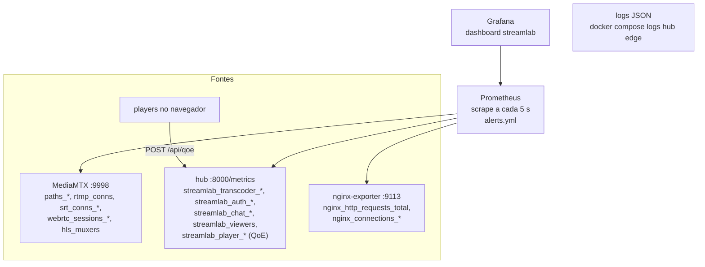
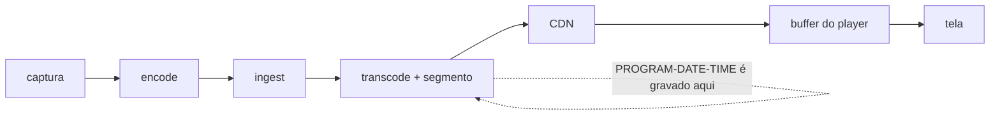
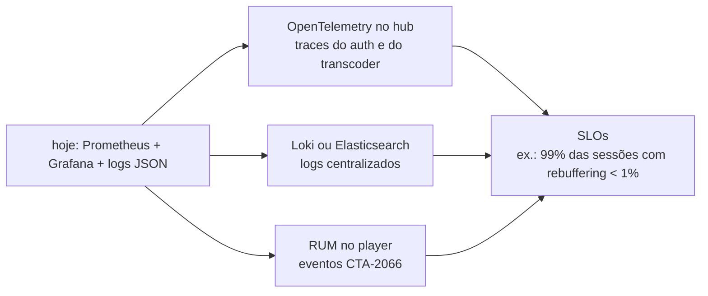

# Observabilidade de live streaming

Uma live passa por várias peças independentes. Se o espectador reclama "está travando", o problema pode estar
na internet do streamer, na CPU do transcoder, no cache do CDN ou no Wi-Fi do próprio espectador. Observabilidade
é conseguir responder **onde** em minutos, não em horas.

## O modelo: um sinal por etapa da pipeline

```mermaid
flowchart LR
  subgraph ingest["1. Ingest"]
    i1["bitrate recebido"]
    i2["RTT e perda (SRT)"]
    i3["auth allow/deny"]
  end
  subgraph tc["2. Transcode"]
    t1["velocidade x tempo real"]
    t2["fps"]
    t3["restarts"]
  end
  subgraph ent["3. Entrega"]
    e1["req/s no edge"]
    e2["cache HIT/MISS"]
    e3["bytes enviados"]
  end
  subgraph qoe["4. Espectador (QoE)"]
    q1["tempo de início"]
    q2["rebuffering ratio"]
    q3["latência"]
    q4["bitrate assistido"]
  end
  ingest --> tc --> ent --> qoe
```



O dashboard do Grafana segue exatamente essa ordem, de cima para baixo. Quando a QoE piora, você sobe pelas
linhas até achar a primeira etapa anormal.

## QoS × QoE

| | QoS (Quality of Service) | QoE (Quality of Experience) |
|---|---|---|
| Pergunta | o sistema está saudável? | a pessoa está tendo uma boa experiência? |
| Quem mede | servidores (MediaMTX, hub, NGINX) | o player, no navegador |
| Exemplos | CPU, bitrate de ingest, cache hit, 5xx | startup time, travamentos, latência, qualidade |
| Ponto cego | não vê a rede do espectador | não sabe *por que* algo piorou |

As duas se completam. O StreamLab coleta QoS por scrape e QoE por beacons do player.

## De onde vem cada métrica



## Catálogo de métricas do hub

| Métrica | Tipo | Labels | Significado |
|---|---|---|---|
| `streamlab_channel_live` | gauge | channel, ingest | 1 se o canal está ao vivo |
| `streamlab_auth_requests_total` | counter | action, protocol, result | decisões de autenticação |
| `streamlab_transcoder_up` | gauge | channel | FFmpeg rodando |
| `streamlab_transcoder_fps` | gauge | channel | quadros por segundo processados |
| `streamlab_transcoder_speed_ratio` | gauge | channel | velocidade em janela de 5 s (1.0 = tempo real) |
| `streamlab_transcoder_dropped_frames` | gauge | channel | quadros descartados pelo FFmpeg |
| `streamlab_transcoder_restarts_total` | counter | channel | reinícios do FFmpeg |
| `streamlab_transcoder_renditions` | gauge | channel | qualidades geradas |
| `streamlab_viewers` | gauge | channel | conexões de chat abertas |
| `streamlab_chat_messages_total` | counter | channel | mensagens aceitas |
| `streamlab_chat_messages_rejected_total` | counter | channel, reason | rate limit, tamanho |
| `streamlab_player_sessions` | gauge | channel, mode | sessões com heartbeat nos últimos 20 s |
| `streamlab_player_startup_seconds` | histograma | mode | clique até o primeiro quadro |
| `streamlab_player_latency_seconds` | histograma | mode | distância do "agora" |
| `streamlab_player_buffer_seconds` | histograma | mode | mídia no buffer |
| `streamlab_player_bitrate_kbps` | histograma | mode | bitrate da qualidade assistida |
| `streamlab_player_rebuffer_events_total` | counter | channel, mode | travamentos |
| `streamlab_player_rebuffer_seconds_total` | counter | channel, mode | tempo travado |
| `streamlab_player_watch_seconds_total` | counter | channel, mode | tempo assistido |
| `streamlab_player_quality_switches_total` | counter | channel, direction | trocas de qualidade |
| `streamlab_player_errors_total` | counter | mode, kind | erros do player |
| `streamlab_player_dropped_frames_total` | counter | mode | quadros descartados no navegador |
| `streamlab_http_requests_total` | counter | route, code | requisições ao hub |
| `streamlab_http_request_duration_seconds` | histograma | route | latência das requisições |

## As métricas de QoE, uma a uma

### Tempo de início (Video Start Time)
Do momento em que o player começa a carregar até o evento `playing`. Em HLS soma: master, playlist da
qualidade, init, primeiro segmento e decodificação. Cada segundo a mais aumenta o abandono.

### Rebuffering ratio
`tempo travado ÷ tempo assistido`. A métrica de QoE mais correlacionada com abandono. Um travamento é um evento
`waiting` depois que o vídeo já começou; termina no próximo `playing`.

```promql
sum by (channel) (rate(streamlab_player_rebuffer_seconds_total[5m]))
  / sum by (channel) (rate(streamlab_player_watch_seconds_total[5m]))
```

### Latência ao vivo
No HLS/LL-HLS o hls.js calcula `hls.latency` comparando o `EXT-X-PROGRAM-DATE-TIME` do segmento com o relógio
local. Como o FFmpeg grava a data ao escrever o segmento, essa medida **não inclui** encode e ingest. No WebRTC a
página estima `jitterBufferDelay / jitterBufferEmittedCount + RTT/2`, que também ignora captura e encode. Para
a latência total (glass-to-glass), compare o relógio desenhado no vídeo de demo com o relógio da página.



### Bitrate assistido e trocas de qualidade
Mostram o ABR trabalhando. Bitrate baixo com banda alta indica player conservador; muitas trocas por minuto
indicam oscilação (pior que ficar estável numa qualidade menor).

## Alertas

| Alerta | Expressão (resumo) | Ação |
|---|---|---|
| `TranscoderAtrasado` | `speed_ratio < 0.95` por 30 s | reduzir escada ABR, preset mais rápido, mais CPU/GPU |
| `TranscoderReiniciando` | mais de 2 restarts em 5 min | ver `docker compose logs hub` (codec, sinal corrompido) |
| `IngestSemDados` | transcoder up com fps 0 | streamer congelou ou rede caiu sem desconectar |
| `RebufferingAlto` | ratio > 2% por 1 min | olhar ingest, transcoder e cache, nessa ordem |
| `LatenciaAltaHLS` | p50 > 15 s por 2 min | player acumulando atraso, conferir `liveSyncDurationCount` |

## Logs

O hub e o edge logam em JSON. Exemplos:

```bash
# decisões de autenticação
docker compose logs hub | grep '"msg":"auth"'

# o que cada player conta ao CDN (CMCD) e se veio do cache
docker compose logs -f edge | grep demo

# erros do FFmpeg
docker compose logs hub | grep '"msg":"ffmpeg"'
```

Um registro do edge tem `uri`, `status`, `bytes`, `rt` (tempo de resposta), `cache` (HIT/MISS/EXPIRED/UPDATING),
`upstream_rt` e `cmcd`. No CMCD, `sid` é o mesmo id de sessão dos beacons de QoE: dá para ligar uma reclamação de
um espectador às requisições exatas que ele fez ao CDN.

## Cardinalidade: o erro clássico

Labels vindas do cliente são perigosas. Se `session_id` ou o IP virassem label, cada espectador criaria séries
novas e o Prometheus explodiria em memória. Por isso `hub/qoe.go`:

- aceita só `mode` em `hls`, `llhls`, `webrtc`;
- aceita só nomes de canal que batem com `^[a-z0-9_]{3,25}$`;
- reduz `kind` de erro a um conjunto fechado;
- guarda a sessão só em memória (para contar sessões ativas e calcular deltas), nunca como label.

## Para onde ir depois


