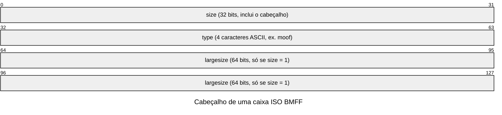
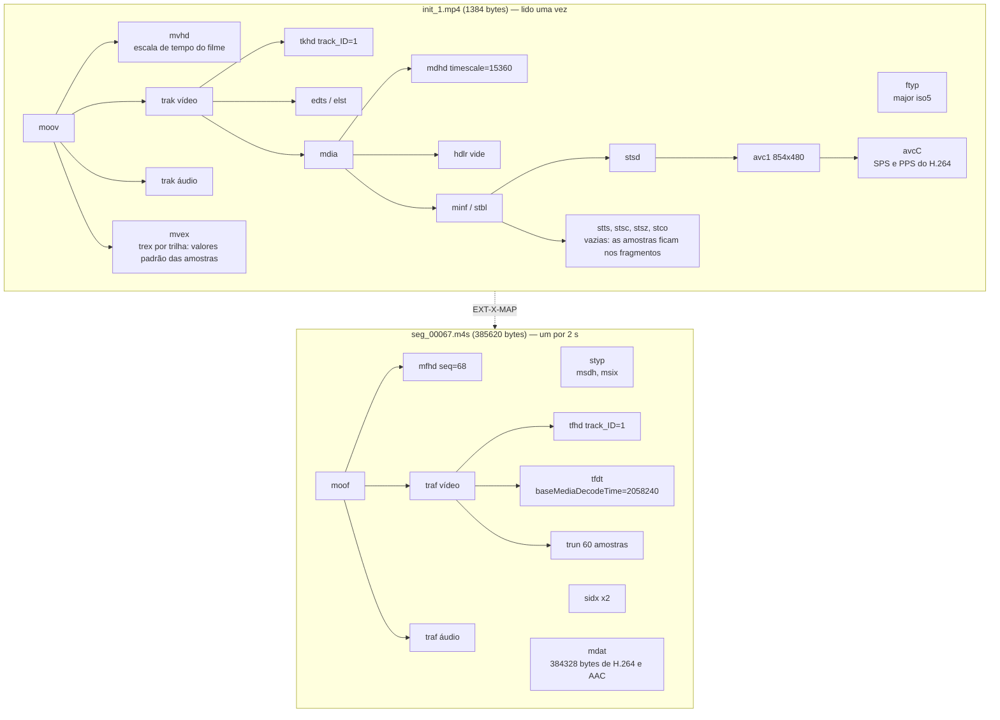
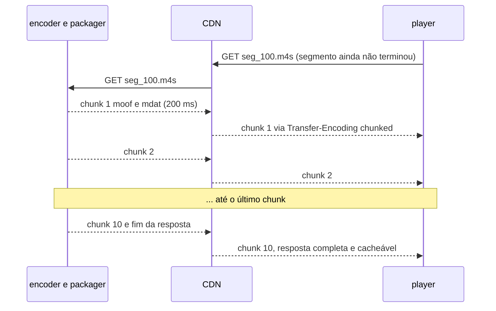
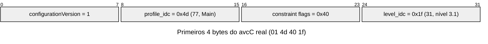

# Containers: MPEG-TS, fMP4 e CMAF

O codec (H.264, AAC) diz **como** a imagem e o som foram comprimidos. O container diz **como** essas amostras
comprimidas são embaladas, com timestamps, descrição das trilhas e metadados. Este documento abre os arquivos que
o StreamLab realmente gera e mostra caixa por caixa.

## Visão geral

| | MPEG-TS (`.ts`) | fMP4 / CMAF (`.m4s`, `.mp4`) |
|---|---|---|
| Origem | MPEG-2 Systems (ISO/IEC 13818-1), feito para broadcast | ISO Base Media File Format (ISO/IEC 14496-12); CMAF é ISO/IEC 23000-19 |
| Unidade | pacotes fixos de 188 bytes (PAT, PMT, PES) | caixas (*boxes*) de tamanho variável |
| Inicialização | cada segmento é autocontido (PAT/PMT se repetem) | `init` separado (`ftyp` + `moov`), referenciado por `EXT-X-MAP` |
| Overhead típico | maior: cabeçalho de 4 bytes a cada 184 de carga, mais PES e adaptation fields; costuma ficar na faixa de alguns % até ~10-15% em bitrates baixos | menor: algumas centenas de bytes por fragmento |
| HLS | desde a primeira versão | a partir do protocolo versão 6/7 |
| DASH | possível (perfil TS), pouco usado | formato padrão |
| HEVC no HLS da Apple | não suportado | obrigatório usar fMP4 |
| DRM comum (CENC) | não | sim |
| Robustez a corte arbitrário | alta (pode começar em qualquer pacote) | precisa do init e de um fragmento inteiro |

**CMAF** (Common Media Application Format) é um **perfil restrito do fMP4** criado (Apple + Microsoft, padronizado
pela ISO em 2018) para que **os mesmos segmentos** sirvam HLS e DASH. Ele define: uma trilha por arquivo de
segmento, fragmentos que começam com amostra sincronizada (keyframe) no início do segmento, *brands* `cmfc`/`cmf2`,
regras para codecs e para criptografia comum (`cbcs`).

O StreamLab diz "HLS com segmentos CMAF", e a ideia é essa, mas tecnicamente a saída do FFmpeg é **fMP4
compatível com HLS**, não CMAF estrito: o `ftyp` não traz o brand `cmfc` e áudio e vídeo vêm **muxados no mesmo
fragmento** (CMAF exige uma trilha por fragmento). O MediaMTX, por outro lado, separa áudio e vídeo em playlists
diferentes, o que está mais próximo do modelo CMAF.

## Como funciona

### Caixas

Todo arquivo ISO BMFF é uma sequência de caixas. Cada caixa começa com tamanho e tipo:



Se `size` = 0, a caixa vai até o fim do arquivo. Caixas "full box" (`mvhd`, `tfhd`, `trun`...) têm mais 1 byte de
versão e 3 bytes de flags logo depois do tipo. Algumas caixas são contêineres (`moov`, `trak`, `moof`, `traf`) e
outras são folhas com dados.

### Init segment versus media segment



- O **init** contém tudo o que o decodificador precisa saber antes da primeira amostra: codecs, resolução,
  SPS/PPS (`avcC`), configuração do AAC (`esds`), escala de tempo. As tabelas de amostras do `stbl` ficam
  **vazias**, porque em MP4 fragmentado as amostras são descritas em cada fragmento.
- O **media segment** contém um ou mais **fragmentos** (`moof` + `mdat`). O `moof` diz onde cada amostra está no
  `mdat`, quanto dura, quanto pesa e se é keyframe; o `mdat` tem os bytes.

O player (via Media Source Extensions) faz `appendBuffer(init)` uma vez e depois `appendBuffer(segmento)` para
cada segmento. Trocar de variante significa anexar o init da nova variante antes dos segmentos dela.

### Chunks CMAF e chunked transfer

Um **segmento CMAF** pode ser dividido em vários **chunks**, cada um um `moof` + `mdat` com algumas amostras.
O encoder pode enviar cada chunk assim que ele fica pronto, em vez de esperar os 2 s do segmento:



Essa é a base do **LL-DASH** (uma única requisição longa por segmento, com HTTP/1.1 *chunked transfer encoding*
ou o enquadramento equivalente do HTTP/2). O **LL-HLS** usa os mesmos chunks, mas dá a cada um uma URI própria
(`EXT-X-PART`). No MediaMTX do StreamLab isso é visível: cada parte LL-HLS é **exatamente um chunk** com 6 quadros
(200 ms a 30 fps) e o segmento inteiro é a concatenação de 10 chunks (veja a listagem em [ll-hls.md](ll-hls.md)).

## Detalhes de baixo nível

### Listagem real do init (`480p/init_1.mp4`)

Gerada com um script Python de ~40 linhas que percorre as caixas (o tamanho entre colchetes inclui o cabeçalho):

```
ftyp [28] major=iso5 minor=512 compat=['iso5', 'iso6', 'mp41']
moov [1356]
  mvhd [108]
  trak [563]
    tkhd [92] track_ID=1
    edts [48]
      elst [40]
    mdia [415]
      mdhd [32] timescale=15360
      hdlr [45] handler=vide
      minf [330]
        vmhd [20]
        dinf [36]
          dref [28]
        stbl [266]
          stsd [190]
            avc1 [174]
              (854x480)
              avcC [52]
              pasp [16]
              btrt [20]
          stts [16]
          stsc [16]
          stsz [20]
          stco [16]
  trak [483]
    tkhd [92] track_ID=2
    edts [36]
      elst [28]
    mdia [347]
      mdhd [32] timescale=48000
      hdlr [45] handler=soun
      minf [262]
        smhd [16]
        dinf [36]
          dref [28]
        stbl [202]
          stsd [126]
            mp4a [110]
              esds [54]
              btrt [20]
          stts [16]
          stsc [16]
          stsz [20]
          stco [16]
  mvex [72]
    trex [32] track_ID=1
    trex [32] track_ID=2
  udta [122]
    meta [114]
```

| Caixa | Função |
|---|---|
| `ftyp` | *brands* que dizem quais especificações o arquivo segue. `iso5`/`iso6` indicam ISO BMFF com recursos de fragmentação |
| `mvhd` | cabeçalho do "filme": escala de tempo global, duração (zero em live) |
| `tkhd` | cabeçalho da trilha: ID, dimensões de apresentação |
| `edts`/`elst` | *edit list*: mapeia o tempo da mídia para o tempo de apresentação (compensa atraso inicial, *priming* do AAC) |
| `mdhd` | escala de tempo da trilha: 15360 ticks/s no vídeo (o FFmpeg usa um múltiplo da taxa de quadros), 48000 no áudio |
| `hdlr` | tipo da trilha: `vide`, `soun` |
| `stsd` | *sample description*: a entrada `avc1` (H.264 com parâmetros fora da banda) ou `mp4a` |
| `avcC` | AVCDecoderConfigurationRecord: perfil, nível, tamanho do prefixo NAL, SPS e PPS |
| `esds` | descritor MPEG-4 do áudio, com o AudioSpecificConfig |
| `btrt` | bitrate máximo e médio declarados |
| `mvex`/`trex` | anuncia que o arquivo é fragmentado e define valores padrão por trilha (duração, tamanho e flags de amostra) |

### Listagem real de um segmento (`480p/seg_00067.m4s`)

```
styp [24]
sidx [52]
sidx [52]
moof [1164]
  mfhd [16] seq=68
  traf [320]
    tfhd [28] track_ID=1 flags=0x020038
    tfdt [20] baseMediaDecodeTime=2058240
    trun [264] flags=0x000205 sample_count=60
  traf [820]
    tfhd [28] track_ID=2 flags=0x020038
    tfdt [20] baseMediaDecodeTime=6433775
    trun [764] flags=0x000301 sample_count=93
mdat [384328]
```

| Caixa | Função | Leitura deste arquivo |
|---|---|---|
| `styp` | tipo do segmento (como o `ftyp`) | brands `msdh`, `msix` (segmento de mídia indexado) |
| `sidx` | índice do segmento: duração e tamanho dos subsegmentos de uma trilha | um por trilha, timescale 15360 no de vídeo |
| `mfhd` | número de sequência do fragmento | 68 |
| `tfhd` | cabeçalho do fragmento da trilha e valores padrão | flags abaixo |
| `tfdt` | *baseMediaDecodeTime*: tempo de decodificação da primeira amostra | vídeo 2058240 / 15360 = **134,0 s**; áudio 6433775 / 48000 = 134,04 s |
| `trun` | tabela de amostras: tamanho, duração, flags, deslocamento de composição | 60 quadros de vídeo (2 s a 30 fps), 93 frames AAC (93 × 1024 / 48000 = 1,98 s) |
| `mdat` | os bytes das amostras | 384 KB, ~1,54 Mbit/s em 2 s |

Flags decodificadas:

| Valor | Bits ligados |
|---|---|
| `tfhd` 0x020038 | 0x020000 *default-base-is-moof* (offsets relativos ao `moof`), 0x000008 duração padrão, 0x000010 tamanho padrão, 0x000020 flags padrão |
| `trun` vídeo 0x000205 | 0x001 *data-offset*, 0x004 *first-sample-flags* (marca o primeiro quadro como keyframe), 0x200 tamanho por amostra |
| `trun` áudio 0x000301 | 0x001 *data-offset*, 0x100 duração por amostra, 0x200 tamanho por amostra |
| `trun` MediaMTX 0x000701 | *data-offset*, duração, tamanho e flags por amostra |

Nenhum `trun` tem o bit 0x800 (*sample-composition-time-offset*): sem B-frames, o tempo de apresentação é igual
ao de decodificação. O `ffprobe` confirma 1 I-frame e 59 P-frames no segmento (veja
[../fundamentos-video.md](../fundamentos-video.md)).

### A string `CODECS`

A master playlist do StreamLab diz `CODECS="avc1.4d401f,mp4a.40.2"`. O formato vem da RFC 6381.

**`avc1.PPCCLL`** (três bytes em hexadecimal, copiados do SPS / `avcC`):



| String no StreamLab | profile_idc | constraint | level_idc | Leitura |
|---|---|---|---|---|
| `avc1.4d401f` (source, 480p) | 0x4d = 77 Main | 0x40 (`constraint_set1_flag`) | 0x1f = 31 | Main, nível 3.1 |
| `avc1.4d401e` (360p) | Main | 0x40 | 0x1e = 30 | Main, nível 3.0 |
| `avc1.4d400c` (160p) | Main | 0x40 | 0x0c = 12 | Main, nível 1.2 |

Outros perfis comuns: `42` Baseline (`avc1.42e01e`), `64` High (`avc1.640028` = High 4.0). `avc1` versus `avc3`:
no `avc3` o SPS/PPS pode vir dentro das amostras em vez de só no `avcC`.

**`mp4a.40.2`**: `40` é o *Object Type Indication* hexadecimal de "Audio ISO/IEC 14496-3" (MPEG-4 Audio) e `2` é
o *Audio Object Type* AAC-LC. Outros: `mp4a.40.5` HE-AAC (SBR), `mp4a.40.29` HE-AACv2, `mp4a.40.34` MP3 (raro).
O `esds` real termina com o AudioSpecificConfig `11 90`:

| Bits | Valor | Significado |
|---|---|---|
| 5 bits | 00010 = 2 | AAC-LC |
| 4 bits | 0011 = 3 | índice de frequência 3 = 48000 Hz |
| 4 bits | 0010 = 2 | 2 canais (estéreo) |

Outros codecs, para reconhecer:

| String | Codec |
|---|---|
| `hvc1.1.6.L93.B0` | HEVC Main, nível 3.1 (`hvc1`: parâmetros só no `hvcC`; `hev1`: também em banda) |
| `av01.0.04M.08` | AV1 Main, nível 3.0 (`04`), tier Main, 8 bits |
| `vp09.00.10.08` | VP9 perfil 0, nível 1.0, 8 bits |
| `Opus`, `ec-3`, `ac-3`, `fLaC` | Opus, Dolby Digital Plus, Dolby Digital, FLAC em MP4 |

### Criptografia comum: `cenc` e `cbcs`

O **Common Encryption** (ISO/IEC 23001-7) define como cifrar as amostras de um fMP4 de modo que qualquer sistema de
DRM (Widevine, PlayReady, FairPlay) possa entregar a chave. Os dois esquemas que importam:

| Esquema | Cifra | Padrão | Suporte |
|---|---|---|---|
| `cenc` | AES-128 CTR | subamostras: cabeçalhos NAL em claro, *slice data* cifrado inteiro | Widevine, PlayReady; não FairPlay |
| `cbcs` | AES-128 CBC com *pattern* | normalmente 1 bloco de 16 bytes cifrado a cada 10 (1:9), IV constante | FairPlay, e Widevine/PlayReady em dispositivos recentes |

Por isso o caminho moderno é **um único conjunto de segmentos CMAF `cbcs`** servindo os três DRMs, em HLS e DASH.
Caixas envolvidas: no init, `pssh` (dados do sistema de DRM), a entrada de amostra vira `encv`/`enca` com `sinf` →
`schm` (esquema) + `schi`/`tenc` (KID padrão, IV); nos fragmentos, `senc` (IVs e mapa de subamostras), `saiz`/`saio`.
Na playlist HLS, `EXT-X-KEY:METHOD=SAMPLE-AES` (cbcs) ou `SAMPLE-AES-CTR` (cenc), com `KEYFORMAT` do sistema de DRM.
O StreamLab não usa DRM.

## Na prática no StreamLab

```bash
mkdir -p /tmp/cmaf && cd /tmp/cmaf
B=localhost:8081/hls/demo/480p
curl -s -o init.mp4 $B/init_1.mp4
SEG=$(curl -s $B/index.m3u8 | grep m4s | tail -1)
curl -s -o seg.m4s $B/$SEG

# o segmento sozinho não é tocável: precisa do init na frente
cat init.mp4 seg.m4s > full.mp4
ffprobe -v error -show_entries stream=codec_name,profile,level,width,height,has_b_frames,sample_rate -of compact full.mp4
ffprobe -v error -select_streams v -show_entries frame=pict_type -of csv=p=0 full.mp4 | sort | uniq -c

# árvore de caixas: com GPAC (MP4Box -diso), Bento4 (mp4dump) ou um script Python
mp4dump seg.m4s       # se tiver Bento4 instalado
```

Saída real do `ffprobe`:

```
stream|codec_name=h264|profile=Main|width=854|height=480|has_b_frames=0|pix_fmt=yuv420p|level=31|r_frame_rate=30/1|bit_rate=1410260
stream|codec_name=aac|profile=LC|sample_rate=48000|channels=2|r_frame_rate=0/0|bit_rate=128044
      1 I
     59 P
```

O que observar:

- No player, a aba *Requisições* mostra o `init_N.mp4` uma vez e depois os `.m4s`; ao trocar de qualidade, aparece o
  init da nova variante.
- O `init` é pequeno (1,4 KB) e muito cacheado; o `X-Cache` dele vira `HIT` rapidamente.
- Compare o tamanho de um segmento de cada variante (no mesmo instante: 786 KB source, 399 KB 480p, 211 KB 360p,
  86 KB 160p) com o `BANDWIDTH` da master.

## Armadilhas comuns

- **Tocar um `.m4s` sozinho.** Sem o `moov` não há SPS/PPS nem escala de tempo; ferramentas dizem
  "trun track id unknown, no tfhd" ou "Invalid data". Concatene com o init.
- **Init errado.** O nome do init no StreamLab é `init_<índice da variante>.mp4` (`init_0` source, `init_1` 480p...).
  Anexar segmentos de uma variante depois do init de outra corrompe a imagem.
- **Chamar de CMAF o que não é.** Áudio e vídeo muxados num fragmento funcionam no HLS, mas não são CMAF estrito e
  complicam o reaproveitamento em DASH e o CMCD (`bl` não aparece; veja [hls.md](hls.md)). Para CMAF, gere uma trilha
  por playlist (áudio em `EXT-X-MEDIA`).
- **Escalas de tempo diferentes.** `tfdt` é em ticks da escala da trilha (`mdhd`): 2058240 em 15360 Hz e 6433775 em
  48000 Hz representam praticamente o mesmo instante. Comparar ticks crus de trilhas diferentes não faz sentido.
- **`tfdt` igual não significa conteúdo igual.** No StreamLab, a `source` copiada e as variantes re-codificadas
  têm segmentos com o mesmo número e o mesmo `tfdt` mas quadros diferentes (cerca de 49 quadros de diferença; veja
  as armadilhas de [hls.md](hls.md)).
- **`avc3` em player que só aceita `avc1`.** Alguns players e dispositivos rejeitam a variante com SPS em banda; a
  string `CODECS` precisa refletir exatamente a entrada de amostra.
- **`cenc` para Apple.** FairPlay só aceita `cbcs`.

## Referências

- ISO/IEC 14496-12, ISO Base Media File Format: https://www.iso.org/search.html?q=14496-12
- ISO/IEC 23000-19, CMAF: https://www.iso.org/search.html?q=23000-19
- ISO/IEC 23001-7, Common Encryption: https://www.iso.org/search.html?q=23001-7
- ISO/IEC 14496-15, transporte de NAL (avcC, hvcC): https://www.iso.org/search.html?q=14496-15
- RFC 6381, parâmetros `codecs`: https://www.rfc-editor.org/rfc/rfc6381
- AV1 Codec ISO Media File Format Binding: https://aomediacodec.github.io/av1-isobmff/
- MP4 Registration Authority (lista de brands e caixas): https://mp4ra.org/
- DASH-IF, Low-latency Modes for DASH: https://dashif.org/guidelines/
- Apple, HLS Authoring Specification (fMP4, HEVC, cbcs): https://developer.apple.com/documentation/http-live-streaming/hls-authoring-specification-for-apple-devices
