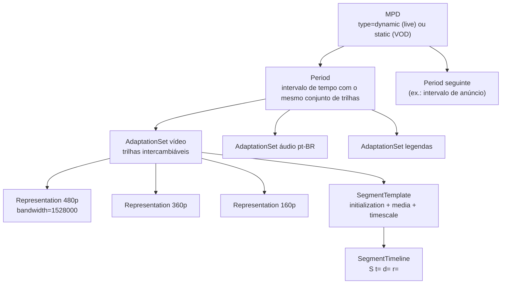
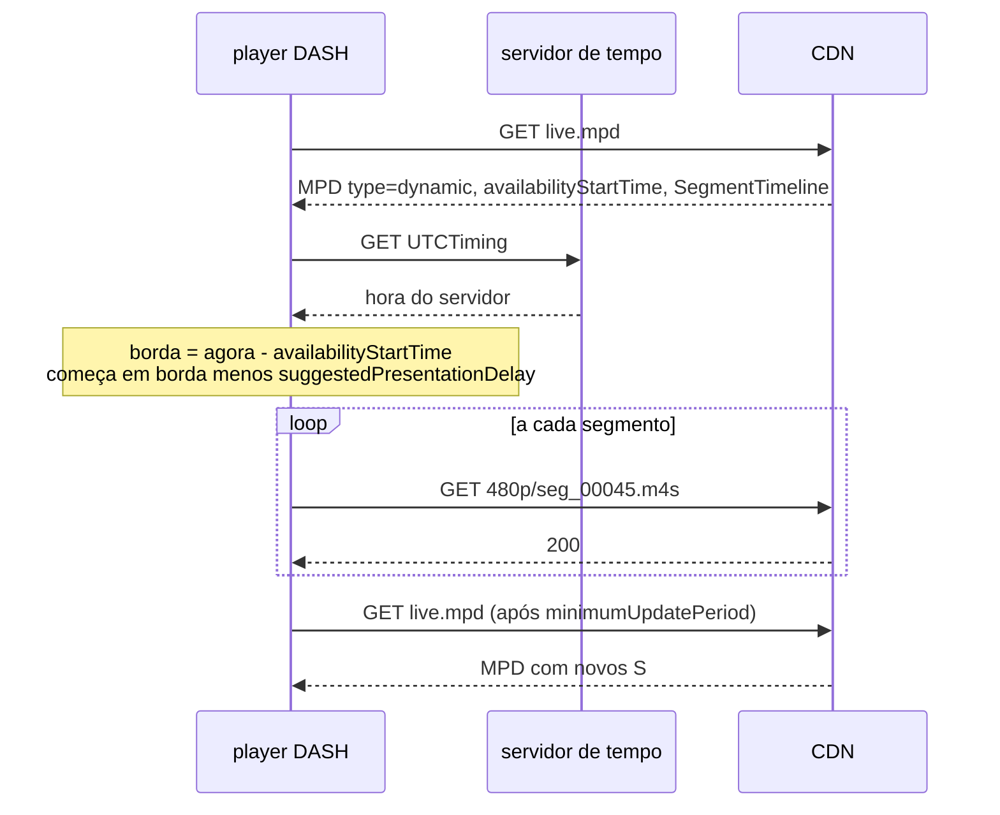
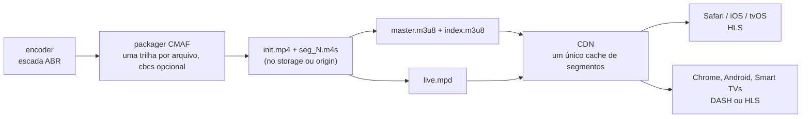

# MPEG-DASH

O StreamLab entrega HLS, não DASH. Este documento curto existe porque DASH é o outro grande protocolo de streaming
HTTP adaptativo, e porque entender o MPD ajuda a ver que, com segmentos CMAF, a diferença entre os dois é quase só
o manifesto.

## Visão geral

**MPEG-DASH** (Dynamic Adaptive Streaming over HTTP, ISO/IEC 23009-1, primeira edição em 2012) é o padrão aberto
equivalente ao HLS: o servidor publica um manifesto XML (**MPD**, Media Presentation Description) e segmentos; o
player escolhe e baixa por HTTP. É agnóstico de codec e de container (na prática, fMP4/CMAF). Na web roda via MSE
com **dash.js** (referência do DASH-IF) ou **Shaka Player**; no Android, ExoPlayer/Media3. Não tem suporte nativo
no Safari/iOS, o que é o principal motivo de o HLS continuar obrigatório.

O **DASH-IF** (DASH Industry Forum) publica as *Interoperability Points* (IOP) e guias de baixa latência, que na
prática definem o subconjunto do padrão que os players realmente suportam.

## Como funciona

### Hierarquia do MPD



| Elemento | Equivalente em HLS |
|---|---|
| `MPD` | master playlist + todas as media playlists juntas |
| `Period` | trecho entre descontinuidades (`EXT-X-DISCONTINUITY`), ou intervalos de anúncio |
| `AdaptationSet` | grupo de variantes intercambiáveis (vídeo) ou um `EXT-X-MEDIA` (áudio, legenda) |
| `Representation` | uma variante (`EXT-X-STREAM-INF`) |
| `SegmentTemplate` + `SegmentTimeline` | a lista de segmentos da media playlist, descrita como fórmula |
| `@bandwidth` | `BANDWIDTH` |
| `@codecs` | `CODECS` (mesma sintaxe RFC 6381) |

### Endereçando segmentos

Em vez de listar URIs, o MPD dá um **modelo** e o player calcula as URLs:

- `$Number$`: número do segmento (com formatação, ex. `$Number%05d$` gera `00039`);
- `$Time$`: tempo de início do segmento em ticks de `@timescale`;
- `$RepresentationID$`, `$Bandwidth$`.

Com `SegmentTemplate@duration`, todos os segmentos têm a mesma duração e o número do segmento é calculado a partir
do relógio (`availabilityStartTime`). Com `SegmentTimeline`, cada `<S t="..." d="..." r="..."/>` descreve um
segmento (ou `r` repetições) com tempo e duração exatos, o que tolera segmentos de tamanho variável.

### Exemplo: como seria o MPD dos arquivos do StreamLab

O MPD abaixo é **ilustrativo** (o projeto não gera DASH). Ele descreve os segmentos reais da `480p`
(`init_1.mp4`, `seg_00039.m4s`..., timescale 15360, 2 s = 30720 ticks):

```xml
<?xml version="1.0" encoding="UTF-8"?>
<MPD xmlns="urn:mpeg:dash:schema:mpd:2011"
     profiles="urn:mpeg:dash:profile:isoff-live:2011"
     type="dynamic"
     availabilityStartTime="2026-11-17T16:50:38Z"
     publishTime="2026-11-17T16:52:08Z"
     minimumUpdatePeriod="PT2S"
     minBufferTime="PT2S"
     timeShiftBufferDepth="PT16S"
     suggestedPresentationDelay="PT6S">
  <Period id="0" start="PT0S">
    <AdaptationSet mimeType="video/mp4" segmentAlignment="true" startWithSAP="1">
      <SegmentTemplate timescale="15360" startNumber="39"
                       initialization="$RepresentationID$/init_1.mp4"
                       media="$RepresentationID$/seg_$Number%05d$.m4s">
        <SegmentTimeline>
          <S t="1198080" d="30720" r="7"/>
        </SegmentTimeline>
      </SegmentTemplate>
      <Representation id="480p" bandwidth="1528000" width="854" height="480"
                      frameRate="30" codecs="avc1.4d401f,mp4a.40.2"/>
    </AdaptationSet>
  </Period>
  <UTCTiming schemeIdUri="urn:mpeg:dash:utc:http-iso:2014"
             value="https://time.akamai.com/?iso"/>
</MPD>
```

Observações honestas sobre esse exemplo:

- Os inits do StreamLab têm nomes diferentes por variante (`init_0`, `init_1`...), então um único
  `SegmentTemplate` compartilhado não funciona para todas as `Representation`; seria preciso um template por
  `Representation` ou renomear os inits.
- Os segmentos têm áudio e vídeo muxados. DASH permite isso, mas as diretrizes do DASH-IF recomendam um
  `AdaptationSet` de áudio separado. Com CMAF estrito (uma trilha por arquivo), isso sai naturalmente.
- O valor de `t` precisa bater com o `tfdt` real do primeiro segmento; o número acima é só coerente com o exemplo.

### Live: a linha do tempo



O DASH depende de **relógio sincronizado** entre player e servidor: a disponibilidade de cada segmento é
calculada a partir de `availabilityStartTime`. Por isso o elemento `UTCTiming` é praticamente obrigatório; sem
ele, um relógio local adiantado faz o player pedir segmentos que ainda não existem (404).

### LL-DASH

O modo de baixa latência do DASH não cria URIs para as partes (diferente do LL-HLS). Ele usa **chunked
transfer**: o player pede o segmento que está sendo produzido e recebe os chunks CMAF à medida que saem do
encoder (veja [cmaf-fmp4.md](cmaf-fmp4.md)). Elementos envolvidos:

| Recurso | Para quê |
|---|---|
| `availabilityTimeOffset` | quanto antes do fim do segmento ele já pode ser pedido (ex.: 1.8 para segmento de 2 s) |
| `availabilityTimeComplete="false"` | avisa que o segmento pedido cedo chega aos poucos |
| `ServiceDescription` / `Latency target=...` | latência alvo, mínima e máxima que o player deve perseguir |
| `PlaybackRate min/max` | quanto o player pode acelerar ou desacelerar para manter o alvo |
| `Resync` | pontos dentro do segmento onde o player pode começar a decodificar |
| `UTCTiming` | ainda mais crítico do que no DASH normal |

O ABR fica mais difícil: com chunked transfer, o tempo de download de um segmento é dominado pela espera do
encoder, não pela rede, então a conta `bytes / tempo` subestima a banda. O dash.js tem algoritmos próprios para
isso (L2A-LL, LoL+), que medem o throughput só nos intervalos em que dados estão chegando.

## Comparação com HLS

| | HLS | DASH |
|---|---|---|
| Dono | Apple; RFC 8216 e draft 8216bis | ISO/IEC 23009-1; guias do DASH-IF |
| Manifesto | texto `.m3u8`, uma playlist por variante | XML `.mpd`, um arquivo para tudo |
| Lista de segmentos | URIs explícitas | modelo (`SegmentTemplate`) + linha do tempo |
| Container | MPEG-TS ou fMP4/CMAF | fMP4/CMAF (TS possível, raro) |
| Safari / iOS | nativo | não suportado nativamente |
| Baixa latência | LL-HLS: partes com URI, blocking reload, preload hints | LL-DASH: chunked transfer, `availabilityTimeOffset` |
| Relógio | `PROGRAM-DATE-TIME` opcional | `availabilityStartTime` + `UTCTiming`, essencial |
| DRM | FairPlay (cbcs); Widevine/PlayReady via CMAF | Widevine/PlayReady, `ContentProtection`; cbcs serve todos |
| Anúncios | `EXT-X-DATERANGE`, interstitials | múltiplos `Period`, eventos SCTE-35 |
| Multi-CDN | Content Steering | Content Steering (especificação do DASH-IF) |

### O mesmo CMAF para os dois



O ganho é no **armazenamento e no cache**: os segmentos são os mesmos bytes, então o CDN guarda uma cópia só e o
hit ratio é somado entre os dois protocolos. Só os manifestos diferem. Ferramentas como Shaka Packager, GPAC e
Bento4, além do próprio FFmpeg (muxer `dash` com `-hls_playlist 1`), geram os dois manifestos para o mesmo conjunto
de segmentos.

## Na prática no StreamLab

O projeto não gera DASH, mas dá para experimentar fora dele com os mesmos componentes:

```bash
# gera DASH + HLS a partir do sinal do canal demo (via RTSP do MediaMTX, rede interna do compose)
docker compose exec hub ffmpeg -rtsp_transport tcp -i rtsp://mediamtx:8554/live/demo \
  -map 0:v -map 0:a -c:v libx264 -preset veryfast -tune zerolatency -g 60 -keyint_min 60 -sc_threshold 0 \
  -b:v 1400k -c:a aac -b:a 128k \
  -f dash -seg_duration 2 -window_size 8 -streaming 1 -ldash 1 -hls_playlist 1 \
  -utc_timing_url "https://time.akamai.com/?iso" /tmp/dash/live.mpd
```

Isso é um experimento: o comando não faz parte do projeto. A leitura via RTSP passa pela autenticação do hub
(`authMethod: http`), mas a ação `read` é liberada para todos ("assistir é público", em `hub/api.go`). Crie
`/tmp/dash` antes (`docker compose exec hub mkdir -p /tmp/dash`). Os arquivos ficam
dentro do contêiner (copie com `docker compose cp hub:/tmp/dash ./dash` e sirva com qualquer servidor HTTP para
testar no player de referência do dash.js). As opções do muxer `dash` mudam entre versões do FFmpeg; confira com
`ffmpeg -h muxer=dash`.

Rodamos esse comando por 15 s no `hub` (FFmpeg 8.0.1). Trecho real do `live.mpd` gerado (encurtado). Ele aparece
como `type="static"` porque o FFmpeg finaliza o MPD ao sair; durante a execução ele é `dynamic`:

```xml
<MPD profiles="urn:mpeg:dash:profile:isoff-live:2011" type="static"
     mediaPresentationDuration="PT15.4S" maxSegmentDuration="PT2.0S" minBufferTime="PT2.0S">
  <Period id="0" start="PT0.0S">
    <AdaptationSet id="0" contentType="video" startWithSAP="1" segmentAlignment="true" frameRate="30/1">
      <Representation id="0" mimeType="video/mp4" codecs="avc1.64001f" bandwidth="1400000" width="1280" height="720">
        <SegmentTemplate timescale="15360" initialization="init-stream$RepresentationID$.m4s"
                         media="chunk-stream$RepresentationID$-$Number%05d$.m4s" startNumber="1">
          <SegmentTimeline>
            <S t="0" d="30720" r="6" />
            <S d="22016" />
          </SegmentTimeline>
        </SegmentTemplate>
      </Representation>
    </AdaptationSet>
    <AdaptationSet id="1" contentType="audio" startWithSAP="1" segmentAlignment="true">
      <Representation id="1" mimeType="audio/mp4" codecs="mp4a.40.2" bandwidth="128000" audioSamplingRate="48000">
        <SegmentTemplate timescale="48000" ...>
          <SegmentTimeline>
            <S t="0" d="95264" />
            <S d="96240" r="1" />
            <S d="96288" />
            ...
          </SegmentTimeline>
        </SegmentTemplate>
      </Representation>
    </AdaptationSet>
  </Period>
  <UTCTiming schemeIdUri="urn:mpeg:dash:utc:http-xsdate:2014" value="https://time.akamai.com/?iso"/>
</MPD>
```

O que observar:

- áudio e vídeo em `AdaptationSet` separados (um arquivo por trilha, como pede o CMAF), ao contrário do HLS do
  StreamLab, que muxa os dois;
- `<S t="0" d="30720" r="6"/>`: 7 segmentos de exatamente 2 s (30720 / 15360), e o último mais curto porque o
  processo foi interrompido;
- no áudio, as durações variam (95264, 96240, 96288 ticks): segmentos de AAC só podem terminar na fronteira de um
  frame de 1024 amostras, então não cabem exatamente em 2 s. É o tipo de caso que exige `SegmentTimeline` em vez
  de `@duration`;
- `codecs="avc1.64001f"` (High 3.1) porque este experimento não passou `-profile:v main`;
- os `.m4s` têm a mesma estrutura de caixas dos segmentos HLS (veja [cmaf-fmp4.md](cmaf-fmp4.md)).

## Armadilhas comuns

- **Relógio fora de sincronia.** Sem `UTCTiming`, um cliente com relógio adiantado gera 404 em sequência; um
  atrasado fica com latência alta.
- **`SegmentTemplate@duration` com segmentos de tamanho variável.** Se o encoder não corta exatamente a cada 2 s
  (keyframes no lugar errado), a fórmula aponta para segmentos errados. Use `SegmentTimeline` ou garanta GOP fixo.
- **Esperar Safari.** DASH não toca nativamente no Safari/iOS; serviços com público Apple precisam de HLS.
- **Muitos `Period`.** Cada troca de `Period` pode reinicializar o pipeline de decodificação no player; use com
  parcimônia (anúncios, troca real de conteúdo).
- **ABR clássico em LL-DASH.** Medir `bytes / tempo` com chunked transfer subestima a banda; use algoritmos
  específicos de baixa latência.

## Referências

- ISO/IEC 23009-1, MPEG-DASH: https://www.iso.org/search.html?q=23009-1
- DASH-IF, guias e Interoperability Points: https://dashif.org/guidelines/
- DASH-IF, Low-latency Modes for DASH: https://dashif.org/docs/CR-Low-Latency-Live-r8.pdf
- DASH-IF, Content Steering for DASH (listado em https://dashif.org/guidelines/)
- dash.js (player de referência): https://github.com/Dash-Industry-Forum/dash.js
- Shaka Packager: https://github.com/shaka-project/shaka-packager
- FFmpeg, muxer `dash`: https://ffmpeg.org/ffmpeg-formats.html#dash-2
