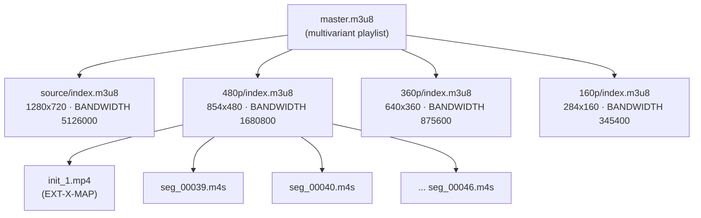
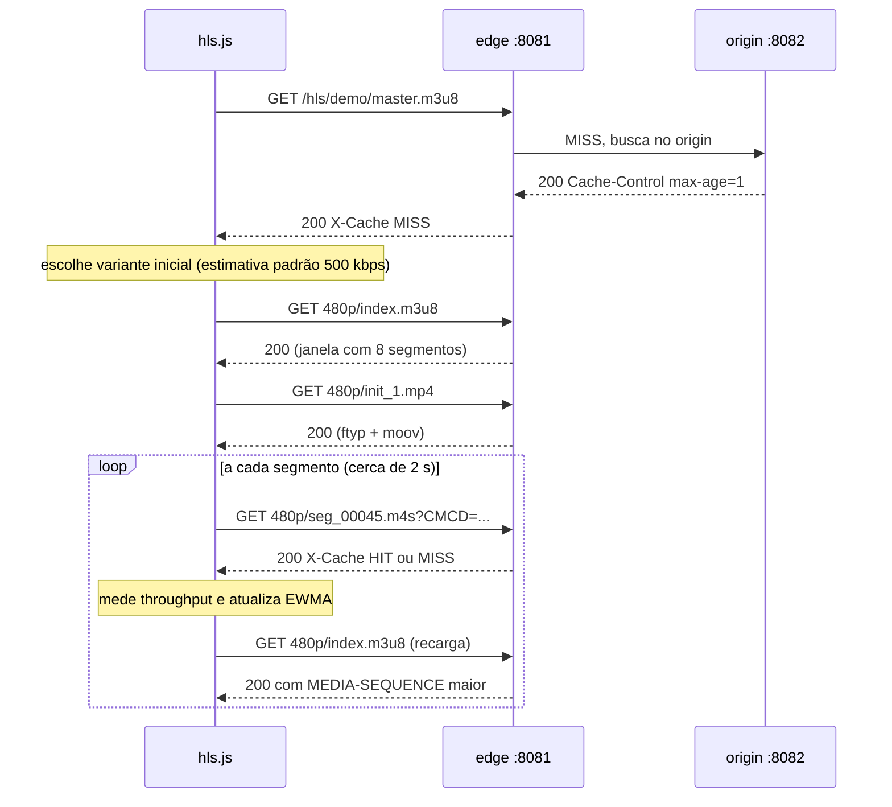
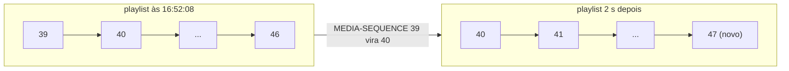
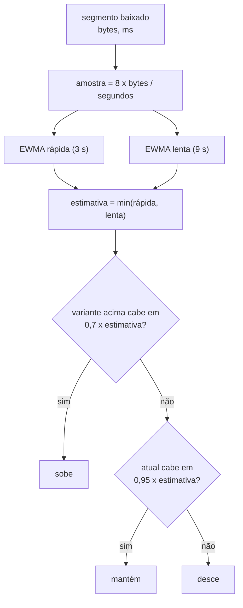
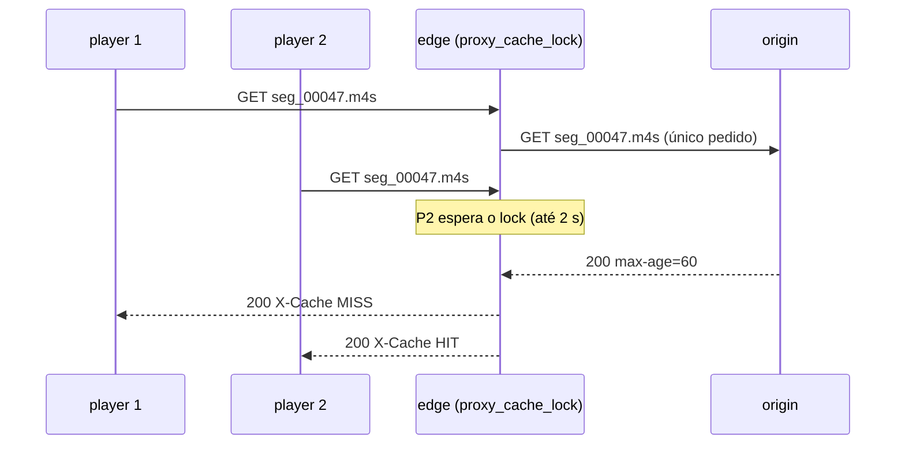
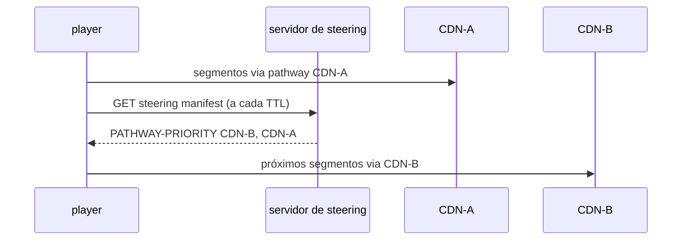

# HLS (HTTP Live Streaming)

Este documento explica o HLS do jeito que ele aparece no StreamLab: o FFmpeg do `hub` gera playlists e
segmentos fMP4 de 2 s, o `edge` (NGINX) faz o papel de CDN e o hls.js 1.6.15 toca no navegador.
Para a variante de baixa latência servida pelo MediaMTX, veja [ll-hls.md](ll-hls.md). Para o formato dos
segmentos, veja [cmaf-fmp4.md](cmaf-fmp4.md).

## Visão geral

HLS é um protocolo de entrega de vídeo sobre **HTTP comum**. Não existe conexão de mídia com estado: o
servidor só publica arquivos e o player decide o que baixar. São dois tipos de arquivo:

| Arquivo | O que é | No StreamLab |
|---|---|---|
| **Playlist** (`.m3u8`) | texto UTF-8, uma linha por tag ou URI | `master.m3u8` e `<qualidade>/index.m3u8` |
| **Segmento de mídia** | pedaço de áudio/vídeo com alguns segundos | `seg_00039.m4s` (fMP4), 2 s cada |
| **Seção de inicialização** (fMP4) | cabeçalho com a descrição das trilhas | `init_N.mp4`, referenciado por `EXT-X-MAP` |

Especificações:

- **RFC 8216** (2017, informacional) descreve o protocolo até a versão 7.
- **draft-pantos-hls-rfc8216bis** é a revisão em andamento ("8216bis"). Ela incorpora LL-HLS, delta updates,
  `EXT-X-GAP`, `EXT-X-CONTENT-STEERING`, `EXT-X-DEFINE` e outras extensões. Ainda é um *Internet-Draft*: o
  número da revisão muda com frequência, então confira a versão mais recente antes de citar detalhes.

Por que o HLS domina a entrega: usa a mesma infraestrutura de qualquer site (HTTP, cache, CDN, TLS), atravessa
firewall e proxy, e todo dispositivo relevante sabe tocar (nativo no Safari/iOS/tvOS, via MSE com hls.js nos
demais navegadores). O preço é latência: o player só baixa segmentos que já foram fechados.

## Como funciona

### Master playlist e media playlist



- A **master playlist** (no 8216bis o nome oficial é *multivariant playlist*) lista as **variantes**
  (*variant streams*): mesma programação em qualidades diferentes. Ela não tem segmentos.
- Cada **media playlist** lista os segmentos de uma variante (ou de uma trilha alternativa, como um áudio em
  outro idioma). Em uma live ela é reescrita a cada segmento novo.

### O ciclo de reprodução ao vivo



Regras de recarga da playlist (RFC 8216, seção 6.3.4):

- depois de carregar uma playlist que mudou, o cliente espera **pelo menos a duração-alvo**
  (`EXT-X-TARGETDURATION`) antes de pedir de novo, contada a partir do início do carregamento anterior;
- se a playlist veio **igual**, espera **metade** da duração-alvo antes de tentar de novo.

Com segmentos de 2 s, o hls.js pede `index.m3u8` aproximadamente a cada 2 s, e é isso que aparece no log do edge.

### A janela deslizante

Numa live sem `EXT-X-ENDLIST`, a media playlist é uma **janela**: segmentos novos entram no fim, os antigos saem
do começo e `EXT-X-MEDIA-SEQUENCE` aumenta 1 para cada segmento removido.



No StreamLab: `-hls_list_size 8` (8 × 2 s = 16 s de janela) e `-hls_flags delete_segments` (o FFmpeg apaga do
disco os arquivos que saíram da janela, mantendo alguns a mais por segurança). A RFC exige que o servidor não
remova um segmento enquanto a playlist, sem ele, tiver menos de três durações-alvo; 16 s cumpre com folga.

### Onde o player começa e como calcula latência

A RFC 8216 recomenda que, sem `EXT-X-ENDLIST`, o cliente **não comece num segmento que termina a menos de três
durações-alvo do fim** da playlist. O 8216bis formaliza isso com `HOLD-BACK` (padrão: 3 × duração-alvo).

O hls.js implementa isso no `LatencyController`. Lendo o código da versão 1.6.15:

| Grandeza | Fórmula no hls.js | Valor no StreamLab (modo HLS) |
|---|---|---|
| `targetLatency` | `liveSyncDurationCount × targetduration` (ou `HOLD-BACK`/`PART-HOLD-BACK` quando não configurado) | 3 × 2 s = **6 s** (`watch.js` fixa `liveSyncDurationCount: 3`) |
| borda estimada | `levelDetails.edge + levelDetails.age` (fim da última playlist + tempo desde que ela foi carregada) | — |
| `hls.latency` | `borda estimada − video.currentTime` | ~6 s em localhost |
| `liveSyncPosition` | `borda − targetLatency`, limitado à janela | onde o player faz o *seek* inicial |

Dois detalhes importantes:

1. O `hls.latency` mede a distância até a **borda da playlist**, não até o relógio de parede. Ele não inclui o
   tempo de captura, encode, ingest e transcode. Para uma latência em relação ao relógio real, use
   `Date.now() - hls.playingDate` (o `playingDate` vem do `EXT-X-PROGRAM-DATE-TIME`), e mesmo assim o PDT do
   StreamLab é o relógio do FFmpeg ao **empacotar**, não o da câmera.
2. A cada travamento o hls.js soma `liveSyncOnStallIncrease` (1 s) ao alvo, até no máximo uma duração-alvo.
   Depois de um rebuffer a latência fica maior de propósito.

### ABR: escolhendo a qualidade

O player troca de variante na fronteira de segmentos. Para isso funcionar sem "pulos", todas as variantes
precisam ter keyframes nos mesmos instantes (no StreamLab, `-force_key_frames expr:gte(t,n_forced*2)`; veja a
armadilha sobre a `source` mais abaixo).

#### Estimativa de banda por EWMA (hls.js)

Cada download de segmento vira uma amostra `bits / duração do download`. O hls.js mantém duas médias móveis
exponenciais e usa a **menor** delas (conservador para subir, rápido para descer):

| Parâmetro | Padrão (1.6.15) | Significado |
|---|---|---|
| `abrEwmaFastLive` | 3 | meia-vida da média rápida, em segundos de download |
| `abrEwmaSlowLive` | 9 | meia-vida da média lenta |
| `abrEwmaDefaultEstimate` | 500000 | estimativa antes da primeira amostra (bps) |
| `abrBandWidthFactor` | 0.95 | fração da estimativa usada para manter/descer |
| `abrBandWidthUpFactor` | 0.7 | fração usada para subir de qualidade |

O peso de cada amostra é a **duração do download** (não o número de segmentos): `alpha = exp(ln(0.5) / meiaVida)`,
`estimativa = valor × (1 − alpha^peso) + alpha^peso × estimativa`. Download muito rápido (localhost) pesa pouco.
Além disso, enquanto um segmento baixa, o hls.js verifica se ele vai terminar antes de o buffer acabar e pode
**abandonar** o download e pedir uma qualidade menor.



Esse fluxograma é uma simplificação: o `findBestLevel` real do hls.js também considera o buffer disponível, o
tempo até o primeiro byte (TTFB) e o `BANDWIDTH`/`AVERAGE-BANDWIDTH` declarados.

#### Algoritmos baseados em buffer

| Família | Ideia | Onde aparece |
|---|---|---|
| Throughput (rate-based) | escolhe a maior taxa abaixo da banda estimada | hls.js, ExoPlayer (com ajustes) |
| Buffer-based (BBA) | buffer alto permite qualidade alta, buffer baixo força qualidade baixa; ignora a estimativa | Huang et al., SIGCOMM 2014 |
| **BOLA** | maximiza uma função de utilidade (qualidade − penalidade por rebuffer) usando só o nível do buffer (otimização de Lyapunov) | dash.js (regra BOLA), Shaka |
| Híbridos / MPC | combinam previsão de banda e buffer olhando alguns segmentos à frente | dash.js `DYNAMIC`, Model Predictive Control |

Algoritmos só de buffer funcionam mal em live de baixa latência, porque o buffer é pequeno por definição.
Por isso players de baixa latência usam variantes específicas (L2A-LL, LoL+ no dash.js).

### Cache e CDN

HLS escala porque a mesma URL serve todos os espectadores. O `edge/nginx.conf` mostra os pontos principais:

| Objeto | Muda? | Cache-Control no origin | Por quê |
|---|---|---|---|
| `master.m3u8` | raramente | `max-age=1` | aqui é tratado como playlist; poderia ser maior |
| `index.m3u8` | a cada 2 s | `max-age=1` | TTL deve ser no máximo ~metade da duração-alvo, senão o player vê a janela atrasada |
| `seg_*.m4s`, `init_*.mp4` | nunca | `max-age=60` | conteúdo imutável; em produção use TTL longo e `immutable` |

Outros mecanismos da config:

- **Chave de cache sem query string** (`proxy_cache_key $scheme$host$uri`): o CMCD muda a cada requisição;
  incluí-lo na chave zeraria o hit ratio.
- **Request coalescing** (`proxy_cache_lock on`): se mil players pedem o mesmo segmento no mesmo instante, só
  um pedido vai ao origin, os outros esperam o cache encher. Sem isso, cada segmento novo gera uma "manada" no
  origin (*thundering herd*).
- **`proxy_cache_use_stale updating`**: enquanto a playlist é atualizada, quem chega recebe a versão anterior
  em vez de esperar.
- **Cache de 404 por 1 s**: players adiantados pedem segmentos que ainda não existem; o 404 curto protege o origin.



Em produção ainda entram **origin shield** (uma camada intermediária que concentra os MISS de todos os POPs),
**multi-CDN** e **URLs assinadas**.

### CMCD (Common Media Client Data, CTA-5004)

CMCD é um padrão da CTA (CTA-5004, 2020) para o player enviar ao CDN o próprio estado em cada requisição, por
query string (`?CMCD=...`), por cabeçalhos (`CMCD-Object`, `CMCD-Request`, `CMCD-Session`, `CMCD-Status`) ou em
JSON. O CDN passa a correlacionar logs com sessões e pode até priorizar quem está com buffer baixo.

| Chave | Tipo | Significado |
|---|---|---|
| `br` | inteiro, kbps | bitrate codificado do objeto pedido |
| `bl` | inteiro, ms | buffer à frente no momento do pedido |
| `bs` | booleano | houve *buffer starvation* (travou) desde o último pedido |
| `cid` | string | ID do conteúdo |
| `d` | inteiro, ms | duração do objeto |
| `dl` | inteiro, ms | prazo até o buffer acabar (deadline) |
| `mtp` | inteiro, kbps | throughput medido pelo player |
| `nor` / `nrr` | string | próximo objeto / próximo range que o player vai pedir (permite prefetch no CDN) |
| `ot` | token | tipo: `m` manifesto, `a` áudio, `v` vídeo, `av` muxado, `i` init, `c` legenda, `tt` timed text, `k` chave, `o` outro |
| `pr` | decimal | velocidade de reprodução |
| `rtp` | inteiro, kbps | throughput máximo solicitado (para o CDN limitar) |
| `sf` | token | formato: `h` HLS, `d` DASH, `s` Smooth, `o` outro |
| `sid` | string | ID da sessão de reprodução |
| `st` | token | `v` VOD, `l` live |
| `su` | booleano | o pedido é de *startup* (ou após seek/rebuffer) |
| `tb` | inteiro, kbps | bitrate mais alto disponível |
| `v` | inteiro | versão do CMCD (omitida na v1) |

Uma CMCD v2 está em elaboração na CTA (com novas chaves e modo de reporte por eventos); o hls.js 1.6 envia v1.

## Detalhes de baixo nível: as tags

### Tags que aparecem no StreamLab

Master playlist real (`curl -s localhost:18081/hls/demo/master.m3u8`):

```
#EXTM3U
#EXT-X-VERSION:7
#EXT-X-STREAM-INF:BANDWIDTH=5126000,RESOLUTION=1280x720,CODECS="avc1.4d401f,mp4a.40.2"
source/index.m3u8

#EXT-X-STREAM-INF:BANDWIDTH=1680800,RESOLUTION=854x480,CODECS="avc1.4d401f,mp4a.40.2"
480p/index.m3u8

#EXT-X-STREAM-INF:BANDWIDTH=875600,RESOLUTION=640x360,CODECS="avc1.4d401e,mp4a.40.2"
360p/index.m3u8

#EXT-X-STREAM-INF:BANDWIDTH=345400,RESOLUTION=284x160,CODECS="avc1.4d400c,mp4a.40.2"
160p/index.m3u8
```

Media playlist real (`curl -s localhost:18081/hls/demo/480p/index.m3u8`, encurtada):

```
#EXTM3U
#EXT-X-VERSION:7
#EXT-X-TARGETDURATION:2
#EXT-X-MEDIA-SEQUENCE:39
#EXT-X-INDEPENDENT-SEGMENTS
#EXT-X-MAP:URI="init_1.mp4"
#EXTINF:2.000000,
#EXT-X-PROGRAM-DATE-TIME:2026-11-17T16:51:52.815+0000
seg_00039.m4s
#EXTINF:2.000000,
#EXT-X-PROGRAM-DATE-TIME:2026-11-17T16:51:54.815+0000
seg_00040.m4s
...
#EXTINF:2.000000,
#EXT-X-PROGRAM-DATE-TIME:2026-11-17T16:52:06.815+0000
seg_00046.m4s
```

| Tag | Onde | O que significa | Observação no StreamLab |
|---|---|---|---|
| `EXTM3U` | ambas | assinatura; primeira linha obrigatória | — |
| `EXT-X-VERSION` | ambas | versão de compatibilidade do protocolo exigida pelo arquivo | 7 (FFmpeg); o MediaMTX usa 10 |
| `EXT-X-STREAM-INF` | master | descreve a variante cuja URI vem na linha seguinte | uma por qualidade |
| `BANDWIDTH` | atributo | **pico** de bitrate (bits/s) de qualquer segmento, incluindo áudio e overhead do container. Obrigatório | o FFmpeg calcula (vídeo + áudio) × 1,1: 480p = (1400k + 128k) × 1,1 = 1680800 |
| `AVERAGE-BANDWIDTH` | atributo | média de bitrate da variante | o FFmpeg não emite aqui; o MediaMTX emite |
| `CODECS` | atributo | lista de codecs no formato RFC 6381 | `avc1.4d401f` = H.264 Main nível 3.1; `mp4a.40.2` = AAC-LC. Detalhes em [cmaf-fmp4.md](cmaf-fmp4.md) |
| `RESOLUTION` | atributo | largura × altura do vídeo | — |
| `FRAME-RATE` | atributo | fps máximo | ausente na saída do FFmpeg |
| `EXT-X-TARGETDURATION` | media | duração máxima de segmento; cada `EXTINF` arredondado para o inteiro mais próximo não pode passar disso | 2 |
| `EXT-X-MEDIA-SEQUENCE` | media | número de sequência do primeiro segmento da lista | 39 e subindo |
| `EXT-X-INDEPENDENT-SEGMENTS` | ambas | cada segmento pode ser decodificado sozinho (começa com keyframe) | vem de `-hls_flags independent_segments` |
| `EXT-X-MAP` | media | seção de inicialização (init) para segmentos fMP4 | `init_1.mp4` (o índice é o da variante no `-var_stream_map`) |
| `EXTINF` | media | duração do próximo segmento, em segundos (decimal a partir da versão 3) | 2.000000 |
| `EXT-X-PROGRAM-DATE-TIME` | media | associa o primeiro quadro do próximo segmento a uma data/hora absoluta (ISO 8601) | vem de `-hls_flags program_date_time`; o FFmpeg escreve depois do `EXTINF`, o que é válido porque a tag vale para a próxima URI |

### Outras tags importantes

| Tag | Para quê |
|---|---|
| `EXT-X-MEDIA` | trilhas alternativas (áudio, legendas, closed captions, vídeo de outro ângulo). Atributos `TYPE`, `GROUP-ID`, `NAME`, `LANGUAGE`, `DEFAULT`, `AUTOSELECT`, `URI`. A variante aponta para o grupo com `AUDIO="..."` ou `SUBTITLES="..."`. O LL-HLS do MediaMTX usa: `#EXT-X-MEDIA:TYPE=AUDIO,GROUP-ID="audio",NAME="audio2",...` |
| `EXT-X-DISCONTINUITY` | o próximo segmento quebra a continuidade (timestamps, codec, resolução, encoder diferente). Obrigatória quando o streamer reconecta e os timestamps recomeçam, ou na inserção de anúncio |
| `EXT-X-DISCONTINUITY-SEQUENCE` | contador de descontinuidades que já saíram da janela; mantém variantes sincronizadas |
| `EXT-X-ENDLIST` | a playlist não vai mais crescer. Em live, aparece quando a transmissão termina e transforma a janela em VOD |
| `EXT-X-PLAYLIST-TYPE` | `EVENT` (só cresce, nada sai: permite DVR desde o início) ou `VOD` (imutável) |
| `EXT-X-GAP` | (8216bis) o segmento não existe; o player deve pular. O MediaMTX emite `gap.mp4` quando o muxer recomeça |
| `EXT-X-KEY` | criptografia: `METHOD=AES-128` (segmento inteiro), `SAMPLE-AES` (amostras, usado com FairPlay/cbcs) |
| `EXT-X-I-FRAME-STREAM-INF` | playlist só de keyframes, para *trick play* e miniaturas de *scrubbing* |
| `EXT-X-DATERANGE` | metadados com tempo (anúncios SCTE-35, capítulos, interstitials) |
| `EXT-X-SERVER-CONTROL`, `EXT-X-PART`, ... | LL-HLS; veja [ll-hls.md](ll-hls.md) |
| `EXT-X-CONTENT-STEERING` | multi-CDN dirigido pelo servidor (abaixo) |

### Content steering

Definido no 8216bis (e, para DASH, pelo DASH-IF), permite que o serviço mude **durante a sessão** qual CDN o
player usa, sem recarregar o vídeo:

```
#EXTM3U
#EXT-X-CONTENT-STEERING:SERVER-URI="https://steer.exemplo.com/v1?video=demo",PATHWAY-ID="CDN-A"
#EXT-X-STREAM-INF:BANDWIDTH=1680800,PATHWAY-ID="CDN-A",CODECS="avc1.4d401f,mp4a.40.2"
https://cdn-a.exemplo.com/hls/demo/480p/index.m3u8
#EXT-X-STREAM-INF:BANDWIDTH=1680800,PATHWAY-ID="CDN-B",CODECS="avc1.4d401f,mp4a.40.2"
https://cdn-b.exemplo.com/hls/demo/480p/index.m3u8
```

O player busca periodicamente o *steering manifest* (JSON com `VERSION`, `TTL`, `RELOAD-URI` e
`PATHWAY-PRIORITY: ["CDN-B", "CDN-A"]`) e passa a usar o primeiro *pathway* da lista. O hls.js tem um
`ContentSteeringController` para isso. O StreamLab não usa content steering (só existe um edge); o exemplo
acima é ilustrativo.



## Na prática no StreamLab

```bash
# 1) master e media playlist (repita a segunda e veja MEDIA-SEQUENCE subir)
curl -s localhost:8081/hls/demo/master.m3u8
curl -s localhost:8081/hls/demo/480p/index.m3u8

# 2) cabeçalhos de cache: playlist max-age=1, segmento max-age=60
curl -sI localhost:8081/hls/demo/480p/index.m3u8 | grep -iE 'cache-control|x-cache'
SEG=$(curl -s localhost:8081/hls/demo/480p/index.m3u8 | grep m4s | tail -1)
curl -sI localhost:8081/hls/demo/480p/$SEG | grep -i x-cache   # MISS na primeira vez
curl -sI localhost:8081/hls/demo/480p/$SEG | grep -i x-cache   # HIT na segunda

# 3) bitrate real de um segmento vs BANDWIDTH declarado
curl -s localhost:8081/hls/demo/480p/$SEG | wc -c   # ~385000 bytes / 2 s = ~1,54 Mbit/s

# 4) CMCD no log do edge
docker compose logs -f edge | grep -v '"cmcd":""'
```

(Se você subiu a stack com `EDGE_PORT=18081`, troque 8081 por 18081; os exemplos deste documento foram coletados assim.)

Linha real do log do edge (encurtada), com o CMCD já decodificado ao lado:

```
{"uri":"/hls/demo/source/seg_00025.m4s","status":200,"bytes":781603,"cache":"MISS",
 "cmcd":"br%3D5126%2Ccid%3D%22demo%22%2Cd%3D2000%2Cmtp%3D109500%2Cot%3Dav%2Csf%3Dh%2Csid%3D%22bf4d2eff-...%22%2Ctb%3D5126"}

CMCD decodificado: br=5126,cid="demo",d=2000,mtp=109500,ot=av,sf=h,sid="bf4d2eff-...",tb=5126
```

Leitura: segmento muxado áudio+vídeo (`ot=av`) de 2000 ms (`d`) da variante de 5126 kbps (`br`), que também é a
mais alta (`tb`); o player mede ~109 Mbit/s (`mtp`, localhost), formato HLS (`sf=h`). Requisições de playlist
vêm com `ot=m`, o init com `ot=i`, e as primeiras requisições da sessão trazem a flag `su` (startup).

Contando as chaves em ~14 mil requisições do log, apareceram `cid`, `mtp`, `ot`, `sf`, `sid`, `d`, `br`, `tb`,
`nor`, `su` e `bs`, mas **nenhuma vez `bl`**. Lendo o código do hls.js 1.6.15, o `bl` é calculado a partir do
`SourceBuffer` de vídeo ou de áudio; como o FFmpeg do StreamLab gera segmentos com áudio e vídeo **muxados**, o
hls.js cria um único buffer `audiovideo` e o cálculo devolve `NaN`, então a chave é omitida. Esta é a nossa
interpretação do código, não um comportamento documentado.

Repare também no campo `cache`: as playlists aparecem como `EXPIRED` (o NGINX tinha a cópia, mas ela passou do
`max-age=1` e foi revalidada no origin); com um único espectador, quase todo segmento é `MISS`. Abra o mesmo
canal em duas abas e os `HIT` aparecem.

No player (`/watch/demo`, modo **HLS ABR via CDN**):

- *Stats para nerds*: `alvo de latência` = 6.0 s (3 × 2 s), `banda estimada` (o EWMA), `qualidade` (variante atual).
- Aba *Requisições*: cada segmento, tamanho, tempo e `X-Cache`.
- Aba *Playlist / SDP*: a playlist ao vivo com explicação das tags.
- DevTools, Network, *Slow 4G*: a qualidade desce para 360p/160p em poucos segmentos.

No Grafana: *Latência ao vivo (p50) por modo* (`streamlab_player_latency_seconds`), *Bitrate assistido*
(`streamlab_player_bitrate_kbps`), trocas de qualidade (`streamlab_player_quality_switches_total`) e as
requisições do edge (`nginx_http_requests_total`).

## Armadilhas comuns

- **`BANDWIDTH` errado.** Ele deve ser o **pico** real. Se for subestimado, o player escolhe uma variante que não
  cabe na rede e trava; se for superestimado, desperdiça qualidade. No StreamLab a `source` é copiada e o FFmpeg
  não sabe o bitrate dela: o hub passa uma dica (`-b:v:0`, 4500 kbps como padrão quando ainda não mediu o
  ingest). No exemplo acima a `source` declara 5126000, mas o segmento real tinha ~773 KB / 2 s ≈ 3,1 Mbit/s.
- **Keyframes desalinhados entre variantes.** Variantes re-codificadas recebem keyframe forçado a cada 2 s; a
  `source` copiada mantém os keyframes do streamer. Ao baixar `seg_00059.m4s` da `source` e da `480p` e extrair o
  primeiro quadro, o contador gravado no vídeo de demo mostrou **frame 1916100** na `source` e **frame 1916051**
  na `480p` (49 quadros, ~1,6 s de diferença), mesmo com o mesmo `PROGRAM-DATE-TIME` e o mesmo `tfdt`. Trocar
  entre `source` e as outras variantes não é, portanto, perfeitamente contínuo. A causa exata (provavelmente o
  tratamento de timestamps de *stream copy* versus filtro + encoder no FFmpeg) não foi investigada a fundo, e o
  valor muda conforme o momento em que o transcoder inicia.
- **TTL da playlist maior que a duração-alvo.** Um CDN que guarda `index.m3u8` por 10 s faz todos os players
  ficarem 10 s atrasados e pedirem segmentos que já saíram da janela.
- **Query string na chave de cache.** CMCD, tokens e parâmetros de analytics na chave destroem o hit ratio. O
  contrário vale para LL-HLS: lá `_HLS_msn` e `_HLS_part` **precisam** estar na chave.
- **Esquecer `EXT-X-DISCONTINUITY`.** Se o streamer reconecta e o packager não marca a descontinuidade, o player
  vê os timestamps voltarem e trava ou dessincroniza áudio e vídeo.
- **Confiar no `hls.latency` como latência glass-to-glass.** Ele mede até a borda da playlist; encode, ingest e
  transcode ficam de fora.
- **CORS.** A UI está na porta 8000 e o vídeo na 8081; sem `Access-Control-Allow-Origin` o hls.js não consegue
  nem ler a playlist. Para o player ler `X-Cache`, o header precisa estar em `Access-Control-Expose-Headers`.
- **Segmentos longos demais.** A latência mínima prática do HLS clássico é cerca de 3 segmentos; segmentos de
  6 s (padrão antigo da Apple) significam 18 s ou mais.

## Referências

- RFC 8216, HTTP Live Streaming: https://www.rfc-editor.org/rfc/rfc8216
- draft-pantos-hls-rfc8216bis (versão mais recente): https://datatracker.ietf.org/doc/draft-pantos-hls-rfc8216bis/
- Apple, HLS Authoring Specification for Apple Devices: https://developer.apple.com/documentation/http-live-streaming/hls-authoring-specification-for-apple-devices
- RFC 6381, parâmetro `codecs`: https://www.rfc-editor.org/rfc/rfc6381
- CTA-5004, Common Media Client Data: https://cdn.cta.tech/cta/media/media/resources/standards/pdfs/cta-5004-final.pdf
- HLS Content Steering (Apple): https://developer.apple.com/streaming/HLSContentSteeringSpecification.pdf
- hls.js, configuração (API.md): https://github.com/video-dev/hls.js/blob/master/docs/API.md
- Spiteri, Urgaonkar, Sitaraman, "BOLA: Near-Optimal Bitrate Adaptation for Online Videos" (INFOCOM 2016): https://arxiv.org/abs/1601.06748
- Huang et al., "A Buffer-Based Approach to Rate Adaptation" (SIGCOMM 2014): https://dl.acm.org/doi/10.1145/2619239.2626296
- NGINX `proxy_cache_lock`: https://nginx.org/en/docs/http/ngx_http_proxy_module.html#proxy_cache_lock
