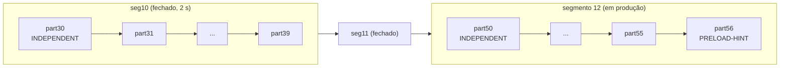
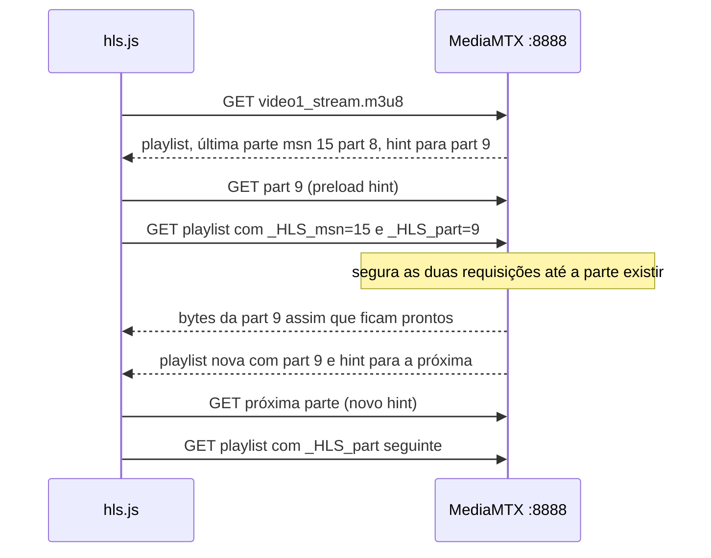

# LL-HLS (Low-Latency HLS)

No StreamLab, o modo **LL-HLS** do player busca o vídeo direto do MediaMTX na porta 8888, sem passar pelo
transcoder nem pelo edge. Este documento explica as extensões de baixa latência do HLS usando playlists reais
desse servidor. Leia antes [hls.md](hls.md), porque tudo daquilo continua valendo.

## Visão geral

O HLS clássico tem uma latência mínima estrutural: o player só baixa segmentos **fechados** e fica cerca de três
segmentos atrás da borda. Com segmentos de 2 s, são pelo menos ~6 s só no player.

O LL-HLS (anunciado pela Apple em 2019, revisado em 2020 e incorporado ao draft 8216bis) ataca isso com quatro
ideias:

| Ideia | Mecanismo | Tag ou parâmetro |
|---|---|---|
| Publicar antes de o segmento fechar | **partes** de ~200 ms, endereçáveis individualmente | `EXT-X-PART`, `EXT-X-PART-INF` |
| Eliminar o polling | **blocking playlist reload**: o servidor segura a resposta até a parte pedida existir | `_HLS_msn`, `_HLS_part`, `CAN-BLOCK-RELOAD` |
| Eliminar o round-trip da próxima parte | **preload hint**: o player pede a próxima parte antes de ela existir | `EXT-X-PRELOAD-HINT` |
| Playlists menores | **delta updates**: o servidor omite segmentos antigos que o player já conhece | `_HLS_skip`, `EXT-X-SKIP`, `CAN-SKIP-UNTIL` |

Mais um auxiliar: `EXT-X-RENDITION-REPORT`, para trocar de variante sem perder a borda.

A versão de 2019 usava *HTTP/2 server push*; a revisão de 2020 trocou o push pelos preload hints, que funcionam
com qualquer CDN que saiba segurar requisições.

## Como funciona

### Segmentos, partes e a playlist

Playlist de vídeo real do MediaMTX (`video1_stream.m3u8`, encurtada):

```
#EXTM3U
#EXT-X-VERSION:10
#EXT-X-TARGETDURATION:2
#EXT-X-SERVER-CONTROL:CAN-BLOCK-RELOAD=YES,PART-HOLD-BACK=0.50000,CAN-SKIP-UNTIL=12.00000
#EXT-X-PART-INF:PART-TARGET=0.20000
#EXT-X-MEDIA-SEQUENCE:5
#EXT-X-MAP:URI="10a5c365dad5_video1_init.mp4"
#EXT-X-GAP
#EXTINF:2.00000,
gap.mp4
...
#EXTINF:2.00000,
10a5c365dad5_video1_seg9.mp4
#EXT-X-PROGRAM-DATE-TIME:2026-11-17T16:52:19.828Z
#EXT-X-PART:DURATION=0.20000,URI="10a5c365dad5_video1_part30.mp4",INDEPENDENT=YES
#EXT-X-PART:DURATION=0.20000,URI="10a5c365dad5_video1_part31.mp4"
...
#EXT-X-PART:DURATION=0.20000,URI="10a5c365dad5_video1_part39.mp4"
#EXTINF:2.00000,
10a5c365dad5_video1_seg10.mp4
...
#EXTINF:2.00000,
10a5c365dad5_video1_seg11.mp4
#EXT-X-PART:DURATION=0.20000,URI="10a5c365dad5_video1_part50.mp4",INDEPENDENT=YES
#EXT-X-PART:DURATION=0.20000,URI="10a5c365dad5_video1_part51.mp4"
...
#EXT-X-PART:DURATION=0.20000,URI="10a5c365dad5_video1_part55.mp4"
#EXT-X-PRELOAD-HINT:TYPE=PART,URI="10a5c365dad5_video1_part56.mp4"
```

Repare na estrutura:

- `seg10` é listado **depois** das suas 10 partes (`part30` a `part39`): as partes vêm antes do segmento que elas
  compõem. Quando o segmento fecha, o servidor publica também a URI do segmento inteiro.
- Depois de `seg11` há partes **sem** `EXTINF`: esse é o segmento 12, ainda em produção (6 de 10 partes prontas).
- As partes só aparecem para os segmentos mais recentes. A especificação diz que partes com mais de três
  durações-alvo de distância da borda devem sair da playlist; para quem está atrasado, sobram os segmentos inteiros.
- A última linha diz qual será a **próxima** parte (`part56`), que ainda não existe.



### Blocking playlist reload

No HLS clássico o player faz polling e pode chegar logo depois de a playlist mudar (perdendo quase uma duração
inteira) ou logo antes (recebendo a mesma playlist). No LL-HLS ele pede **a playlist que ainda vai existir**:

```
GET video1_stream.m3u8?_HLS_msn=16&_HLS_part=0
```

"Responda quando a playlist contiver a parte 0 do segmento de *media sequence number* 16." O servidor segura a
requisição e responde assim que essa parte é publicada.



Regras do 8216bis que valem lembrar:

- `_HLS_part` exige `_HLS_msn`; sem `_HLS_part`, o servidor espera o segmento inteiro.
- Se o msn pedido estiver muito à frente (mais de dois segmentos além do último), o servidor responde **400**
  em vez de segurar a requisição.
- O servidor deve responder dentro de um prazo da ordem de três durações-alvo; se não conseguir (por exemplo, o
  encoder parou), devolve erro e o player tenta de novo.
- A resposta bloqueada deve trazer a playlist **inteira e atualizada**, não só a parte nova.

### Preload hint

`EXT-X-PRELOAD-HINT:TYPE=PART,URI="..."` anuncia o recurso que virá a seguir. O player faz o GET imediatamente e
o servidor segura a resposta até ter os bytes. Assim a parte começa a chegar no mesmo instante em que é criada,
sem esperar o player ler a playlist nova e só então pedir a parte (um round-trip a menos). `TYPE=MAP` serve para
um init novo; `BYTERANGE-START`/`BYTERANGE-LENGTH` permitem que a dica seja um pedaço de um arquivo maior.

### Rendition report

Com várias variantes, cada media playlist pode terminar com:

```
#EXT-X-RENDITION-REPORT:URI="../480p/index.m3u8",LAST-MSN=16,LAST-PART=3
```

Isso diz ao player em que ponto a outra variante está, para que a troca de qualidade já peça a playlist bloqueante
certa. **O MediaMTX do StreamLab não emite essa tag**: há uma única variante de vídeo (a do streamer, sem
transcodificação) mais um grupo de áudio, então o exemplo acima é ilustrativo.

### Delta updates

Com `CAN-SKIP-UNTIL=12` o servidor avisa que, se o player pedir `_HLS_skip=YES`, ele omite os segmentos mais
antigos que 12 s antes da borda. O valor deve ser pelo menos 6 × a duração-alvo (6 × 2 = 12, exatamente o mínimo).

Resposta real de `?_HLS_msn=16&_HLS_part=1&_HLS_skip=YES`:

```
#EXT-X-MEDIA-SEQUENCE:9
#EXT-X-MAP:URI="10a5c365dad5_video1_init.mp4"
#EXT-X-SKIP:SKIPPED-SEGMENTS=2
#EXTINF:2.00000,
10a5c365dad5_video1_seg11.mp4
...
```

Os segmentos 9 e 10 foram substituídos por `EXT-X-SKIP:SKIPPED-SEGMENTS=2`; o player usa a cópia que já tem.
Com uma janela de 7 segmentos a economia é pequena; ela importa em playlists com horas de DVR, recarregadas
cinco vezes por segundo. `_HLS_skip=v2` também omite `EXT-X-DATERANGE` antigos (`CAN-SKIP-DATERANGES`).

### Orçamento de latência

O alvo do player é `PART-HOLD-BACK`. A especificação exige que seja pelo menos 2 × `PART-TARGET` e recomenda pelo
menos 3 ×. O MediaMTX anuncia 0,5 s (2,5 × 0,2 s). Com `lowLatencyMode: true` e sem `liveSyncDuration*`
configurado (é o caso do `watch.js`), o hls.js 1.6.15 usa exatamente o `PART-HOLD-BACK` como alvo, e soma 1 s a
cada travamento (até uma duração-alvo).

Uma linha do tempo plausível para um quadro, em localhost (valores ilustrativos, não medidos quadro a quadro):

```mermaid
gantt
    title Caminho de um quadro no LL-HLS (ilustrativo)
    dateFormat x
    axisFormat %S.%L s
    section Streamer
    captura e encode x264 zerolatency :a1, 0, 60ms
    RTMP até o MediaMTX               :a2, after a1, 20ms
    section MediaMTX
    esperar a parte de 200 ms fechar  :b1, after a2, 200ms
    section Player
    preload hint entrega a parte      :c1, after b1, 20ms
    buffer alvo PART-HOLD-BACK        :c2, after c1, 500ms
    decodificar e exibir              :c3, after c2, 30ms
```



Na internet o termo dominante passa a ser a rede: RTT do ingest, RTT até o CDN e o buffer extra que o player
acumula depois de cada travamento. Valores típicos em produção ficam entre 2 e 4 s.

## Detalhes de baixo nível

### Tags e atributos

| Tag ou atributo | Significado | Valor no MediaMTX |
|---|---|---|
| `EXT-X-PART-INF:PART-TARGET` | duração-alvo das partes; nenhuma parte pode passar disso | 0.2 |
| `EXT-X-PART:DURATION` | duração desta parte | 0.2 |
| `EXT-X-PART:URI` | endereço da parte | `..._part30.mp4` |
| `EXT-X-PART:INDEPENDENT=YES` | a parte começa com keyframe (ponto de entrada) | na primeira parte de cada segmento |
| `EXT-X-PART:BYTERANGE` | parte como faixa de bytes de um arquivo maior | não usado |
| `EXT-X-PART:GAP=YES` | parte ausente | não observado |
| `EXT-X-SERVER-CONTROL:CAN-BLOCK-RELOAD` | o servidor aceita `_HLS_msn`/`_HLS_part` | YES |
| `PART-HOLD-BACK` | distância mínima da borda para começar em modo baixa latência | 0.5 |
| `HOLD-BACK` | o mesmo para o modo normal; padrão 3 × duração-alvo | omitido (padrão 6 s) |
| `CAN-SKIP-UNTIL` | horizonte dos delta updates | 12 |
| `EXT-X-PRELOAD-HINT` | próximo recurso, ainda não disponível | `TYPE=PART` |
| `EXT-X-RENDITION-REPORT` | estado das outras variantes | não emitido |
| `EXT-X-SKIP:SKIPPED-SEGMENTS` | quantos segmentos foram omitidos | aparece com `_HLS_skip=YES` |
| `EXT-X-GAP` | segmento ausente | `gap.mp4` após o muxer reiniciar |

### O que tem dentro de uma parte

As partes do MediaMTX são fragmentos fMP4 (um `moof` + um `mdat`). Lista real de caixas:

Uma parte (`..._part420.mp4`, 84880 bytes):

```
moof [160]
  mfhd [16] seq=420
  traf [136]
    tfhd [16] track_ID=1 flags=0x020000
    tfdt [20] baseMediaDecodeTime=5731021890
    trun [92] flags=0x000701 sample_count=6
mdat [84720]
```

O segmento inteiro (`..._seg48.mp4`, 761923 bytes), só o primeiro nível:

```
moof [160]   (mfhd seq=410)
mdat [91348]
moof [160]   (mfhd seq=411)
mdat [76697]
moof [160]   (mfhd seq=412)
mdat [73350]
...          (10 pares moof + mdat no total)
```

Cada parte tem **6 amostras** (6 quadros a 30 fps = 200 ms), e o segmento inteiro é a concatenação das 10
partes. Ou seja, partes LL-HLS são *chunks CMAF*; veja [cmaf-fmp4.md](cmaf-fmp4.md).

### Por que HTTP/2 em produção

O player LL-HLS mantém várias requisições abertas ao mesmo tempo: a playlist bloqueante de vídeo, a de áudio, a
parte do preload hint de vídeo, a de áudio, às vezes a playlist de outra variante. Com HTTP/1.1:

- navegadores limitam cerca de 6 conexões por origem, e requisições bloqueadas ocupam conexões inteiras;
- cada conexão nova custa handshake TCP + TLS, o que é proibitivo a cada 200 ms.

Com HTTP/2 tudo vira *streams* multiplexados numa única conexão TLS, com cabeçalhos comprimidos. A Apple exige
HTTP/2 para LL-HLS nos dispositivos dela, e navegadores só falam HTTP/2 sobre TLS. É por isso que o
`mediamtx.yml` padrão avisa: `hlsEncryption` (HTTPS) "is required for Low-Latency HLS to function correctly on
Apple devices". No StreamLab o LL-HLS roda em HTTP/1.1 sem TLS, o que funciona no hls.js em localhost, mas não é
uma configuração de produção. HTTP/3 (QUIC) resolve também o *head-of-line blocking* do TCP.

### O redirect `cookieCheck` do MediaMTX

O primeiro `curl` sem `-L` mostra:

```
$ curl -s -D - -o /dev/null localhost:8888/live/demo/index.m3u8
HTTP/1.1 302 Found
Location: /live/demo/index.m3u8?cookieCheck=1
Server: mediamtx
Set-Cookie: cookieCheck=1; HttpOnly; Secure; SameSite=None; Partitioned
```

O que observamos no MediaMTX 1.21.4:

- **Cliente que guarda cookies** (`curl -c jar -b jar`, navegadores): a multivariant playlist chega com URIs
  limpas (`video1_stream.m3u8`) e a sessão de leitura fica no cookie `hlsSession=<uuid>`.
- **Cliente sem cookies** (`curl -sL` simples): depois do redirect a playlist chega com a sessão na URL,
  `video1_stream.m3u8?session=a331b44a-...`.

Ou seja, o redirect serve para descobrir se o cliente aceita cookies e escolher onde guardar o identificador de
sessão, que o MediaMTX usa para contar leitores e associar as requisições à mesma sessão. Não encontramos
documentação formal desse mecanismo; a descrição acima é baseada no comportamento observado. Consequências:

- `curl` sem `-L` recebe um corpo vazio; use `-L` e, de preferência, um cookie jar;
- a sessão expira depois de um tempo sem requisições; um `curl` feito muito tempo depois com o cookie antigo
  devolveu a página HTML do player do MediaMTX em vez do arquivo;
- num CDN na frente do MediaMTX, a URL com `?session=` precisa de cuidado na chave de cache (há a opção
  `hlsCDNSecret` para identificar requisições que vêm de um CDN).

## Na prática no StreamLab

```bash
J=$(mktemp)   # cookie jar
# 1) multivariant playlist (siga o redirect e guarde o cookie)
curl -sL -c $J -b $J localhost:8888/live/demo/index.m3u8

# 2) media playlist de vídeo: partes, preload hint, server control
curl -s -c $J -b $J localhost:8888/live/demo/video1_stream.m3u8

# 3) blocking reload: pede um msn que ainda não existe e mede quanto o servidor segurou
P=$(curl -s -b $J localhost:8888/live/demo/video1_stream.m3u8)
SEQ=$(echo "$P" | sed -n 's/#EXT-X-MEDIA-SEQUENCE://p')
N=$(echo "$P" | grep -c '^#EXTINF')
curl -s -o /dev/null -w 'segurou %{time_total}s\n' -b $J \
  "localhost:8888/live/demo/video1_stream.m3u8?_HLS_msn=$((SEQ+N+1))&_HLS_part=0"

# 4) delta update
curl -s -b $J "localhost:8888/live/demo/video1_stream.m3u8?_HLS_msn=$((SEQ+N))&_HLS_skip=YES" | grep SKIP
```

Execução real do passo 3: `segurou 0.793799s`, ou seja, o MediaMTX segurou a requisição por quase 0,8 s até a
parte existir e respondeu 200 com a playlist nova.

No player (`/watch/demo?mode=llhls`):

- *Stats para nerds*: `alvo de latência` = 0.5 s (o `PART-HOLD-BACK`), latência real em torno de 1 s em localhost;
- aba *Requisições*: dezenas de partes pequenas (dezenas de KB) em vez de segmentos de centenas de KB; o
  `X-Cache` aparece como "origem" porque não há edge;
- o seletor de qualidade fica desabilitado: só existe a variante do streamer.

No Grafana: *Latência ao vivo (p50) por modo* separando `llhls` de `hls`, e *Rebuffering ratio*, que tende a
subir no LL-HLS quando a rede oscila (o buffer é pequeno por definição).

## Armadilhas comuns

- **Cache que ignora a query string.** O edge do StreamLab usa `proxy_cache_key $scheme$host$uri` (bom para
  CMCD). Para LL-HLS isso seria fatal: `?_HLS_msn=16&_HLS_part=0` e `?_HLS_msn=16&_HLS_part=1` são playlists
  diferentes. Em LL-HLS a chave precisa incluir `_HLS_msn`, `_HLS_part` e `_HLS_skip` (e excluir CMCD). É um dos
  motivos de o LL-HLS do StreamLab não passar pelo edge.
- **CDN sem suporte a requisições bloqueadas.** Um CDN com timeout curto para o origin ou que não faz coalescing
  de requisições penduradas multiplica a carga no origin. Exige suporte explícito do CDN.
- **`PART-HOLD-BACK` agressivo.** 0,5 s é ótimo em localhost e frágil na internet; qualquer oscilação vira
  rebuffer. Produção costuma usar 3 × `PART-TARGET` ou mais e deixar o player ajustar (`liveSyncDuration`,
  `maxLiveSyncPlaybackRate` para acelerar levemente e recuperar a latência).
- **Keyframes longos.** O segmento só fecha num keyframe e só a primeira parte é `INDEPENDENT`. Com GOP de 10 s, o
  player só consegue **começar** a cada 10 s, mesmo com partes de 200 ms.
- **Muxer sob demanda.** Com `hlsAlwaysRemux: false` (padrão), o MediaMTX só cria o muxer quando alguém pede, e o
  fecha após `hlsMuxerCloseAfter` (60 s) sem leitores. O primeiro espectador espera o muxer acumular segmentos, e
  as playlists podem conter `EXT-X-GAP` logo depois de um reinício (vimos isso na playlist acima).
- **HTTP/1.1 em produção.** Funciona em teste e degrada com várias abas ou variantes; use HTTP/2 com TLS.
- **Relógio.** `PROGRAM-DATE-TIME` vem do relógio do servidor; para medir latência glass-to-glass compare com um
  relógio gravado no vídeo (o demo grava a hora UTC no quadro).

## Referências

- draft-pantos-hls-rfc8216bis (inclui LL-HLS): https://datatracker.ietf.org/doc/draft-pantos-hls-rfc8216bis/
- Apple, Enabling Low-Latency HTTP Live Streaming: https://developer.apple.com/documentation/http-live-streaming/enabling-low-latency-http-live-streaming-hls
- Apple, HLS Authoring Specification (seção de LL-HLS): https://developer.apple.com/documentation/http-live-streaming/hls-authoring-specification-for-apple-devices
- MediaMTX, documentação e `mediamtx.yml` de referência: https://github.com/bluenviron/mediamtx
- hls.js, opções `lowLatencyMode`, `liveSyncDuration`, `maxLiveSyncPlaybackRate`: https://github.com/video-dev/hls.js/blob/master/docs/API.md
- RFC 9113, HTTP/2: https://www.rfc-editor.org/rfc/rfc9113
