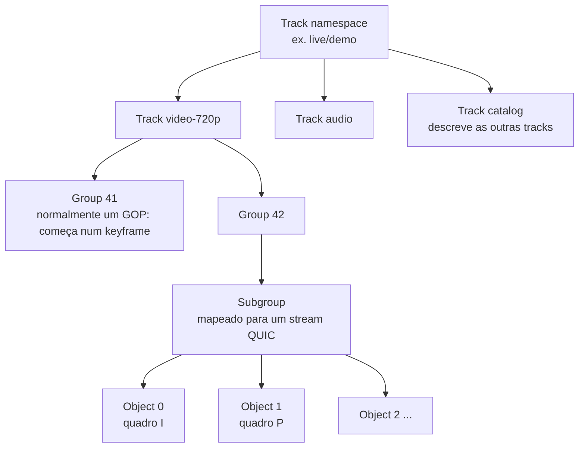
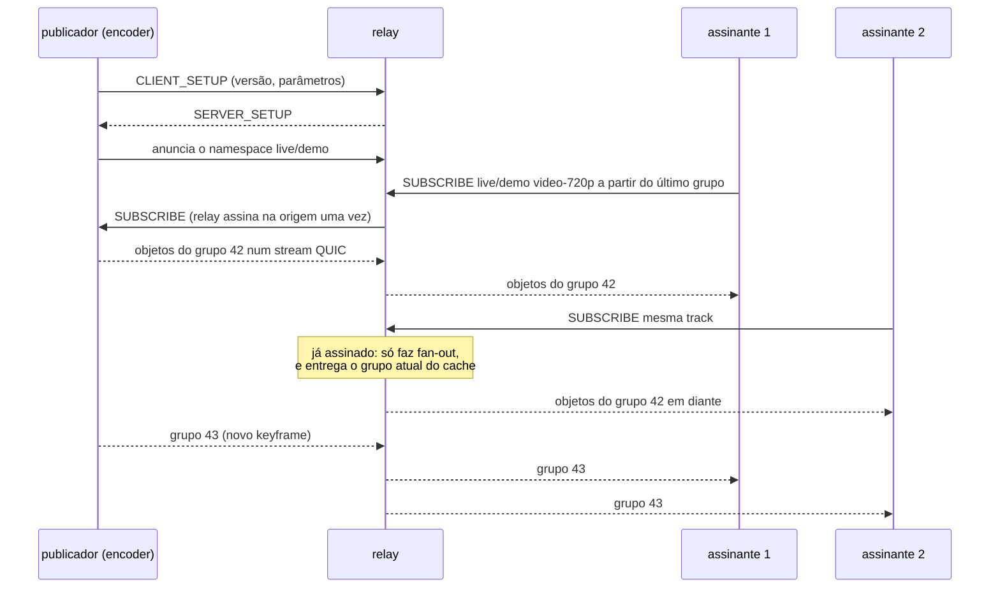
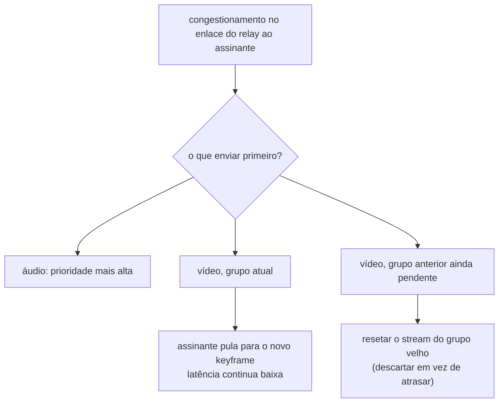
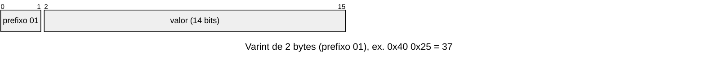

# MoQ (Media over QUIC)

MoQ é a tentativa do IETF de criar um protocolo de mídia que tenha a latência do WebRTC e a escala (cache, relays,
fan-out) do HLS/DASH. **É trabalho em andamento**: os documentos são *Internet-Drafts*, mudam de versão a cada
poucos meses, nomes de mensagens já foram trocados mais de uma vez, e implementações de versões diferentes
geralmente não conversam entre si. Leia este documento como uma explicação do modelo, não como referência de
bytes no fio.

## Visão geral

O problema que o MoQ tenta resolver:

| | HLS / DASH | WebRTC | MoQ (objetivo) |
|---|---|---|---|
| Latência típica | 2 a 30 s | < 1 s | < 1 s até alguns segundos, escolhido pelo assinante |
| Transporte | HTTP sobre TCP (ou QUIC no HTTP/3) | RTP/SRTP sobre UDP, ICE, DTLS | QUIC ou WebTransport |
| Escala | enorme: CDN de arquivos | cara: SFUs com estado por espectador | relays genéricos, fan-out e cache |
| Sob congestionamento | o player troca de qualidade e espera (rebuffer) | descarta pacotes, pede keyframe | relays e transporte descartam o que é menos importante |
| Unidade | segmento (segundos) | pacote RTP (ms) | objeto (um quadro ou um grupo de quadros) |

A ideia central é **publish/subscribe** de mídia sobre QUIC: o publicador anuncia *tracks*, assinantes se inscrevem,
e **relays** no meio fazem fan-out e cache sem entender o codec, como um CDN, mas entregando objetos assim que
existem, em vez de esperar um segmento fechar.

## Como funciona

### Por que QUIC e WebTransport

- **Streams independentes**: QUIC (RFC 9000) multiplexa muitos *streams* numa conexão, e a perda de um pacote só
  atrasa o stream ao qual ele pertence. No TCP, um pacote perdido trava tudo que vem depois (*head-of-line
  blocking*). O MoQ coloca grupos diferentes em streams diferentes, então um grupo velho atrasado não bloqueia o novo.
- **Cancelamento barato**: um stream pode ser resetado individualmente. Descartar um grupo de vídeo atrasado é só
  fechar o stream dele.
- **Datagramas** (RFC 9221) para dados que não valem retransmissão.
- **TLS 1.3 embutido**, handshake 1-RTT (0-RTT em reconexão) e migração de conexão (trocar de Wi-Fi para 4G sem
  reconectar).
- **WebTransport** (sobre HTTP/3) é a API que expõe streams e datagramas QUIC para o navegador. Com WebCodecs para
  codificar e decodificar, dá para fazer publicador e player MoQ inteiros em JavaScript, sem MSE.
- Clientes nativos podem usar **QUIC direto**, sem a camada HTTP/3.

### Modelo de dados: tracks, groups, objects



| Conceito | Significado | Analogia com HLS |
|---|---|---|
| **Track** | sequência de mídia identificada por *namespace* + nome | uma variante (media playlist) |
| **Group** | ponto de entrada: um assinante pode começar no início de qualquer grupo | um segmento que começa com keyframe |
| **Subgroup** | subdivisão de um grupo, entregue em um stream QUIC (permite camadas, ex. SVC) | — |
| **Object** | a unidade endereçável: um quadro, ou alguns, com cabeçalho mínimo | uma amostra dentro do `mdat`, ou uma parte LL-HLS |
| **Catalog** | track especial que lista as outras (codecs, resoluções, bitrates) | a master playlist |

O **formato dos objetos** não é definido pelo protocolo de transporte (MOQT). Há drafts separados para isso: um
container leve (LOC, *Low Overhead Media Container*, que carrega a saída do WebCodecs quase crua), um formato de
catálogo e um formato de streaming que junta tudo. Os nomes e o escopo desses drafts mudaram ao longo do tempo
(o que se chamava WARP foi reorganizado), e também é possível carregar fragmentos CMAF como objetos.

### Publish/subscribe e relays



Os relays são **agnósticos de mídia**: eles leem só os cabeçalhos MoQ (track, grupo, objeto, prioridade) e nunca
decodificam vídeo. Por isso podem ser operados por CDNs genéricas, encadeados em árvore (origem, relays regionais,
relays de borda) e fazer cache de grupos recentes para quem chega atrasado.

Além de `SUBSCRIBE` (receber o que vier a partir de agora), os drafts definem um `FETCH` para buscar objetos
passados (DVR, recuperar o início do grupo atual). Nomes de mensagens como `ANNOUNCE`, `SUBSCRIBE_ANNOUNCES` e
`PUBLISH_NAMESPACE` variam conforme a versão do draft; confira a versão implementada pelo seu cliente e servidor.

### Prioridade e descarte

Esta é a parte que diferencia MoQ de "HLS sobre QUIC". Cada assinatura e cada objeto carregam prioridades
(do publicador e do assinante) e uma **ordem de grupos** (mais novo primeiro ou mais velho primeiro). Quando a
banda não é suficiente:



No HLS, rede ruim vira **mais latência** ou **rebuffer** (o player espera o segmento). No MoQ, a aplicação pode
escolher **perder** o grupo velho e saltar para o novo, mantendo a latência. Um assinante que quer qualidade (um
gravador, por exemplo) pode pedir ordem crescente e aceitar atraso; um espectador ao vivo pede o mais novo primeiro.

### Estado da padronização

- O grupo de trabalho **moq** do IETF foi criado em 2022.
- O documento principal é **draft-ietf-moq-transport** (MOQT). Ele já passou de uma dezena de revisões, e cada
  versão negocia seu próprio número no `SETUP`; clientes e servidores de versões diferentes normalmente falham no
  handshake.
- Há drafts paralelos para container (LOC), catálogo e formato de streaming, com nomes que mudaram ao longo do tempo.
- Existem implementações de várias organizações (CDNs, fabricantes de players, projetos open source como
  `moq-rs`/moq.dev e o MediaMTX) e eventos de interoperabilidade, mas também variantes simplificadas fora do
  processo do IETF (como o "moq-lite" do moq.dev). "Suporta MoQ" pode significar coisas diferentes.
- Até a data deste documento, não há RFC publicada para o MOQT. Confira o *datatracker* para o estado atual.

## Detalhes de baixo nível

- **ALPN e versão**: sobre QUIC nativo, a conexão usa um identificador ALPN específico do MoQ; sobre WebTransport,
  a sessão é aberta por um `CONNECT` estendido do HTTP/3. A versão do draft é negociada nas mensagens de setup.
  Os valores exatos dependem da revisão.
- **Stream de controle**: um stream bidirecional carrega as mensagens de controle (setup, anúncios, assinaturas).
- **Streams de dados**: cada subgrupo vai num stream unidirecional cujo cabeçalho identifica a track (por um alias
  numérico negociado na assinatura), o grupo e o subgrupo; em seguida vêm os objetos, cada um com ID e tamanho.
- **Datagramas**: um objeto pequeno pode ir num datagrama QUIC, sem retransmissão.
- **Codificação**: inteiros de tamanho variável (*varint* do QUIC, RFC 9000 seção 16) em quase todos os campos.

Os dois bits mais significativos do primeiro byte de um varint dizem o tamanho total:

| Prefixo | Bytes | Bits de valor | Maior valor |
|---|---|---|---|
| `00` | 1 | 6 | 63 |
| `01` | 2 | 14 | 16383 |
| `10` | 4 | 30 | 1073741823 |
| `11` | 8 | 62 | 4611686018427387903 |



O layout exato dos cabeçalhos de objeto mudou entre versões do draft; por isso não reproduzimos aqui.

## Na prática no StreamLab

O MediaMTX 1.21.4 traz um servidor MoQ **experimental**, desligado no projeto (`moq: no` em
[`mediamtx/mediamtx.yml`](../../mediamtx/mediamtx.yml)). As opções, conforme o `mediamtx.yml` de referência que vem
dentro da imagem (`docker run --rm --entrypoint cat bluenviron/mediamtx:1.21.4-ffmpeg /mediamtx.yml`):

| Chave | Padrão | O que é |
|---|---|---|
| `moq` | `true` no arquivo de referência (o StreamLab usa `no`) | liga o servidor MoQ |
| `moqHTTP2Address` | `:8892` (TCP) | listener HTTP/2; hospeda um cliente web |
| `moqHTTP3Address` | `:8892` (UDP) | listener HTTP/3; endpoint WebTransport |
| `moqQUICAddress` | `:8893` (UDP) | MoQ sobre QUIC nativo |
| `moqServerKey` / `moqServerCert` | `auto.key` / `auto.crt` | certificado TLS; `auto` gera um autoassinado |
| `moqAllowOrigins` | `["*"]` | CORS |

Para experimentar (alterando seus arquivos locais; estes documentos não mudam a configuração do projeto):

1. Em `mediamtx/mediamtx.yml`, troque `moq: no` por `moq: yes` (e, se quiser, defina os endereços acima explicitamente).
2. Em `docker-compose.yml`, no serviço `mediamtx`, publique as portas:
   ```yaml
       ports:
         - "8892:8892"        # MoQ: HTTP/2 (cliente web)
         - "8892:8892/udp"    # MoQ: HTTP/3 / WebTransport
         - "8893:8893/udp"    # MoQ: QUIC nativo
   ```
3. `docker compose up -d mediamtx` e confira os logs: `docker compose logs mediamtx | grep -i moq`.
4. Um publicador RTMP (o `demo-streamer`) continua funcionando: o MediaMTX converte entre protocolos, então o mesmo
   caminho `live/demo` fica disponível para leitores MoQ.

O que não prometemos:

- **Compatibilidade com clientes específicos.** Um cliente MoQ só funciona se implementar a mesma versão (ou
  variante) do draft que o MediaMTX. Verifique nas notas de versão do MediaMTX qual revisão é suportada antes de
  testar com `moq-rs`, players de CDN ou outros.
- **Certificado aceito pelo navegador.** WebTransport exige TLS válido. Um certificado autoassinado normalmente é
  rejeitado; as alternativas são um certificado de uma CA confiável para o host, ou a opção
  `serverCertificateHashes` da API WebTransport, que só aceita certificados de curta validade com requisitos
  específicos. Não testamos esse fluxo neste projeto.
- **Autenticação.** O MediaMTX usa o mesmo `authMethod: http` para todos os protocolos; leitura é liberada pelo hub
  ("assistir é público" em `hub/api.go`), mas o comportamento exato de publicação via MoQ não foi testado aqui.
- **Métricas.** O dashboard do Grafana e os beacons de QoE do player não conhecem MoQ; nada do que for visto por
  esse caminho aparece nos painéis.

## Armadilhas comuns

- **Tratar MoQ como pronto para produção.** Use para aprender e prototipar; planeje para mudanças de versão.
- **Misturar versões de draft.** O sintoma típico é a conexão QUIC abrir e o setup MoQ falhar imediatamente.
- **Esquecer o UDP.** QUIC é UDP: firewalls corporativos que bloqueiam UDP 443 (ou as portas 8892/8893) quebram
  tudo. Produção costuma ter fallback para HLS/DASH.
- **Grupos grandes demais.** O grupo é o ponto de entrada; com GOP de 10 s, um assinante novo espera até 10 s ou
  recebe o grupo atual do cache (mais latência). Mantenha keyframes a cada 1 a 2 s, como no resto do StreamLab.
- **Esperar ABR automático.** O protocolo de transporte não escolhe qualidade; o player precisa assinar tracks de
  bitrates diferentes e trocar entre elas, usando o catálogo.
- **Esquecer o catálogo.** Sem ele, o assinante não sabe quais tracks existem, nem os codecs.

## Referências

- IETF, grupo de trabalho moq: https://datatracker.ietf.org/wg/moq/about/
- draft-ietf-moq-transport (versão mais recente): https://datatracker.ietf.org/doc/draft-ietf-moq-transport/
- Documentos do grupo (LOC, catálogo, formato de streaming): https://datatracker.ietf.org/wg/moq/documents/
- RFC 9000, QUIC: https://www.rfc-editor.org/rfc/rfc9000
- RFC 9221, datagramas no QUIC: https://www.rfc-editor.org/rfc/rfc9221
- RFC 9114, HTTP/3: https://www.rfc-editor.org/rfc/rfc9114
- W3C WebTransport: https://www.w3.org/TR/webtransport/
- W3C WebCodecs: https://www.w3.org/TR/webcodecs/
- moq.dev / moq-rs: https://github.com/kixelated/moq
- MediaMTX: https://github.com/bluenviron/mediamtx
