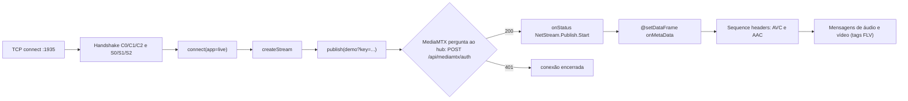
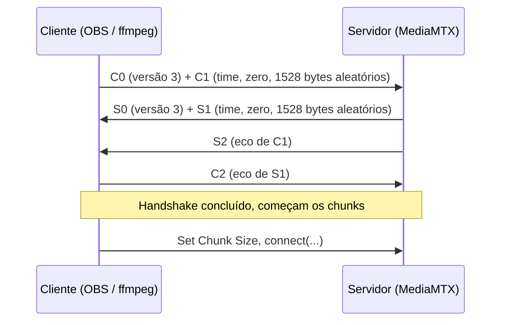
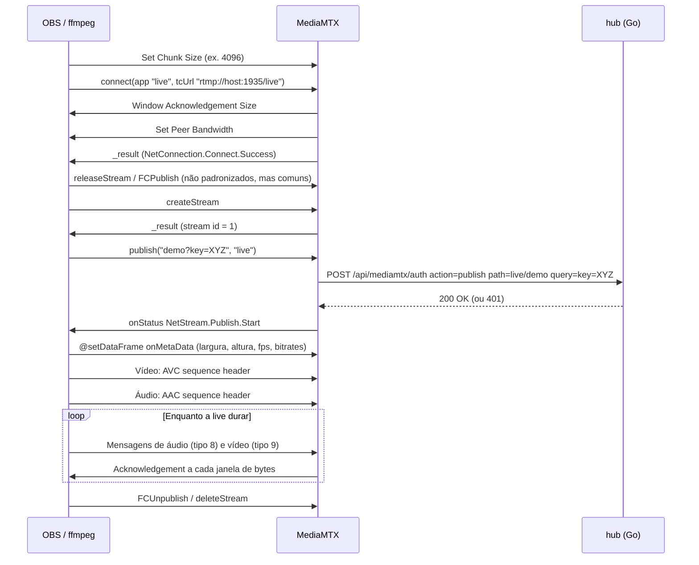
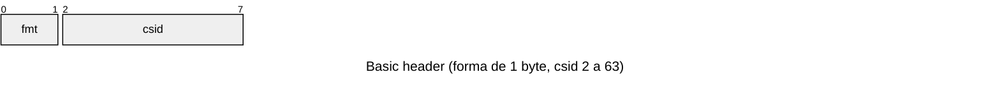
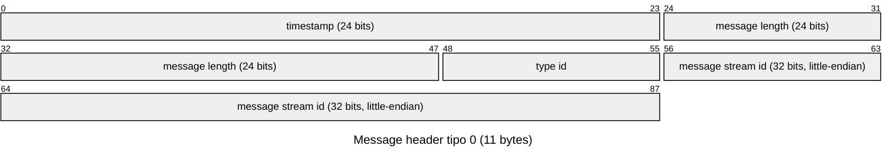
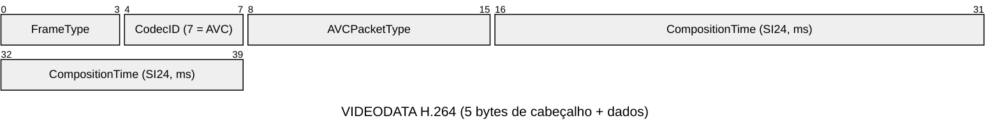
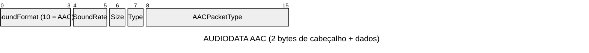
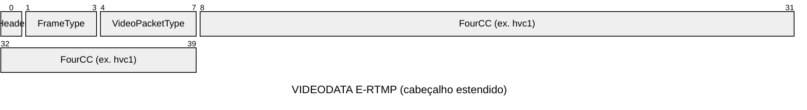
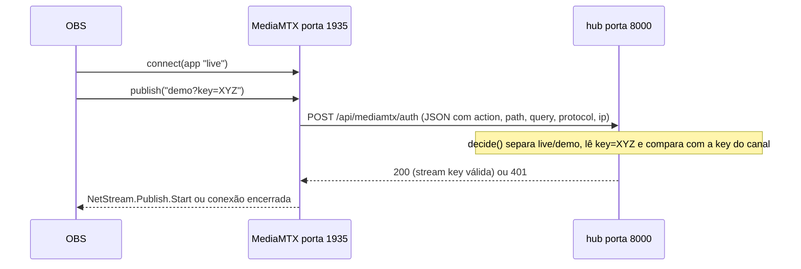

# RTMP e Enhanced RTMP (E-RTMP)

## Visão geral

O **RTMP** (Real-Time Messaging Protocol) nasceu na Macromedia/Adobe por volta de 2002 para o Flash Player.
O Flash morreu, mas o RTMP sobreviveu como o protocolo de **ingest** mais universal que existe: OBS, FFmpeg,
encoders de hardware, câmeras e celulares sabem "falar RTMP", e praticamente toda plataforma (Twitch, YouTube,
Kick, Facebook) aceita RTMP na porta **1935/TCP**.

Características principais:

| Aspecto | RTMP |
|---|---|
| Transporte | TCP (porta padrão 1935); RTMPS = RTMP dentro de TLS (normalmente porta 443) |
| Modelo | Conexão persistente, mensagens multiplexadas em *chunks* |
| Serialização de comandos | AMF0 (às vezes AMF3) |
| Formato da mídia | Corpo das *tags* FLV (áudio = tipo 8, vídeo = tipo 9, dados = tipo 18) |
| Codecs clássicos | H.264 + AAC (também MP3, Speex, Sorenson, VP6 em clientes antigos) |
| Codecs no E-RTMP | HEVC, AV1, VP9 (vídeo), Opus, FLAC, AC-3/E-AC-3 (áudio) e multitrack |
| Latência típica de ingest | Baixa (centenas de ms) enquanto a rede está boa |
| Ponto fraco | TCP: perda de pacote provoca *head-of-line blocking* e acúmulo de atraso |

No StreamLab o RTMP é recebido pelo **MediaMTX** (`rtmpAddress: :1935` em `mediamtx/mediamtx.yml`). O
`demo-streamer` publica por RTMP, e é o caminho padrão sugerido para o OBS no Estúdio.

## Como funciona

Uma sessão de publicação tem quatro fases: conexão TCP, *handshake* RTMP, troca de comandos (connect,
createStream, publish) e, por fim, o fluxo contínuo de mensagens de áudio, vídeo e metadados.



### Handshake

O handshake tem três pacotes de cada lado. `C0`/`S0` têm 1 byte (a versão, sempre `3` no RTMP sem criptografia);
`C1`/`S1` e `C2`/`S2` têm 1536 bytes cada.



Regras da especificação: o cliente só envia `C2` depois de receber `S1`; o servidor só envia `S2` depois de receber
`C1`; nenhum dos lados manda outros dados antes de receber o eco (`C2`/`S2`). Na prática quase todo cliente manda
`C0+C1` juntos e quase todo servidor responde `S0+S1+S2` juntos.

| Campo de C1/S1 | Tamanho | Conteúdo |
|---|---|---|
| time | 4 bytes | Epoch do remetente (pode ser 0) |
| zero | 4 bytes | Zeros (na especificação "simples") |
| random | 1528 bytes | Bytes arbitrários |

| Campo de C2/S2 | Tamanho | Conteúdo |
|---|---|---|
| time | 4 bytes | Cópia do `time` recebido em S1 (ou C1) |
| time2 | 4 bytes | Momento em que o pacote do outro lado foi lido |
| random echo | 1528 bytes | Cópia dos bytes aleatórios recebidos |

Existe também um handshake "complexo" (não documentado na especificação de 2012), usado pelo Flash Player, em que
C1/S1 carregam um *digest* HMAC-SHA256 em posição variável. Ele era exigido para RTMPE e para alguns CDNs antigos;
servidores modernos como o MediaMTX aceitam o handshake simples e encoders atuais funcionam com ele.

### Comandos de publicação



`releaseStream`, `FCPublish` e `FCUnpublish` vêm do Flash Media Server/CDNs da Akamai e não estão na especificação,
mas OBS e FFmpeg os enviam por compatibilidade; servidores costumam respondê-los ou ignorá-los.

## Detalhes de baixo nível

### Chunk stream

Mensagens RTMP (um quadro de vídeo, um comando) podem ser grandes. Para multiplexar áudio, vídeo e controle na mesma
conexão TCP sem que um quadro gigante bloqueie o áudio, cada mensagem é cortada em **chunks** de no máximo
*chunk size* bytes de payload. O padrão é **128 bytes**; quase todo cliente aumenta logo após o handshake com
**Set Chunk Size** (o OBS usa 4096; o valor exato varia por cliente). Cada lado anuncia o *seu* chunk size de envio
de forma independente.

Cada chunk é formado por: **basic header** + **message header** + (opcional) **extended timestamp** + payload.

#### Basic header



| Primeiro byte (6 bits de csid) | Forma | csid resultante |
|---|---|---|
| 2 a 63 | 1 byte | o próprio valor |
| 0 | 2 bytes | 64 + segundo byte (64 a 319) |
| 1 | 3 bytes | 64 + byte2 + byte3 × 256 (64 a 65599) |

O **csid** (chunk stream id) identifica o "canal lógico" de chunks. O csid **2** é reservado para mensagens de
controle de protocolo de baixo nível. Os outros são escolhidos pelo cliente (o FFmpeg, por exemplo, usa canais
separados para comandos, vídeo e áudio).

#### Message header (tipos 0 a 3)

O campo `fmt` do basic header diz quanto do message header vem no chunk; o resto é herdado do chunk anterior do
mesmo csid. Isso economiza bytes em fluxos regulares.

| fmt | Tamanho | Campos presentes | Quando usar |
|---|---|---|---|
| 0 | 11 bytes | timestamp (3), message length (3), message type id (1), message stream id (4, little-endian) | Início do csid ou timestamp voltando no tempo |
| 1 | 7 bytes | timestamp delta (3), message length (3), message type id (1) | Mesma stream, tamanho ou tipo diferentes |
| 2 | 3 bytes | timestamp delta (3) | Mesma stream, mesmo tamanho e tipo |
| 3 | 0 bytes | nada | Continuação de uma mensagem já começada, ou repetição exata |



Se o timestamp (ou delta) não couber em 24 bits, o campo leva `0xFFFFFF` e um **extended timestamp** de 4 bytes vem
logo depois do message header. Timestamps RTMP são em **milissegundos** e dão a volta em 2^32 ms (cerca de 49,7 dias).

Exemplo: um quadro de vídeo de 10.000 bytes com chunk size 4096 vira 3 chunks no mesmo csid: o primeiro com `fmt=0`
(ou 1), os dois seguintes com `fmt=3` (só o basic header de 1 byte). Entre eles o lado que envia pode intercalar
chunks de áudio de outro csid.

### Mensagens

| Type id | Nome | Uso |
|---|---|---|
| 1 | Set Chunk Size | Novo tamanho máximo de payload por chunk (bit 31 deve ser 0) |
| 2 | Abort Message | Descarta a mensagem parcial de um csid |
| 3 | Acknowledgement | "Já recebi N bytes" (número de sequência em bytes) |
| 4 | User Control Message | Eventos: Stream Begin, Stream EOF, Ping Request/Response, SetBufferLength... |
| 5 | Window Acknowledgement Size | De quantos em quantos bytes o outro lado deve mandar Acknowledgement |
| 6 | Set Peer Bandwidth | Limita a banda de saída do outro lado (tipo 0 hard, 1 soft, 2 dynamic) |
| 8 | Audio | Corpo de tag FLV de áudio |
| 9 | Video | Corpo de tag FLV de vídeo |
| 15 / 18 | Data (AMF3 / AMF0) | Metadados: `@setDataFrame`, `onMetaData`, `onTextData`, `onCuePoint` |
| 16 / 19 | Shared Object (AMF3 / AMF0) | Herança do Flash, praticamente sem uso hoje |
| 17 / 20 | Command (AMF3 / AMF0) | `connect`, `createStream`, `publish`, `play`, `onStatus`, `_result`, `_error`... |
| 22 | Aggregate | Várias mensagens FLV em uma (usado por alguns servidores) |

Os tipos 1, 2, 3, 5 e 6 são "protocol control messages" e viajam no csid 2 com message stream id 0.

### AMF0

AMF0 (Action Message Format) é a serialização dos comandos. Cada valor tem 1 byte de marcador seguido do dado,
sempre em **big-endian**.

| Marcador | Tipo | Codificação |
|---|---|---|
| `0x00` | Number | double IEEE-754 de 8 bytes |
| `0x01` | Boolean | 1 byte |
| `0x02` | String | comprimento de 2 bytes + UTF-8 |
| `0x03` | Object | pares (nome sem marcador, valor) terminados por `0x00 0x00 0x09` |
| `0x05` | Null | sem dados |
| `0x06` | Undefined | sem dados |
| `0x08` | ECMA Array | contagem de 4 bytes + pares, terminado como Object |
| `0x0A` | Strict Array | contagem de 4 bytes + valores |
| `0x0B` | Date | double (ms) + 2 bytes de fuso |
| `0x0C` | Long String | comprimento de 4 bytes + UTF-8 |

Um comando é uma sequência de valores AMF0: nome (String), *transaction id* (Number), objeto de comando
(Object ou Null) e argumentos. Por exemplo, o `publish` enviado pelo OBS é algo como:

| Valor | Tipo AMF0 | Conteúdo |
|---|---|---|
| 1 | String | `"publish"` |
| 2 | Number | transaction id (ex. 5) |
| 3 | Null | sem objeto de comando |
| 4 | String | nome da stream: `"demo?key=XYZ"` |
| 5 | String | tipo de publicação: `"live"` (também existem `"record"` e `"append"`) |

O servidor responde com `onStatus` (mensagem de comando na mesma message stream) cujo objeto contém
`level: "status"`, `code: "NetStream.Publish.Start"` e `description`. Em caso de erro, códigos como
`NetStream.Publish.BadName` ou simplesmente o fechamento da conexão.

### Áudio e vídeo em tags FLV

O payload de uma mensagem RTMP de áudio ou vídeo é exatamente o **corpo** de uma tag FLV (sem o cabeçalho de 11 bytes
da tag e sem o `PreviousTagSize`). O timestamp da mensagem RTMP é o DTS em ms.

#### Vídeo H.264 (FLV clássico)



| Campo | Valores |
|---|---|
| FrameType | 1 = keyframe, 2 = inter frame, 5 = info/comando |
| CodecID | 7 = AVC (H.264); antigos: 2 = Sorenson H.263, 4 = VP6 |
| AVCPacketType | 0 = sequence header, 1 = NALUs, 2 = end of sequence |
| CompositionTime | PTS - DTS em ms (diferente de zero quando há B-frames) |

Com `AVCPacketType = 0`, o corpo é o **AVCDecoderConfigurationRecord** (ISO/IEC 14496-15), enviado uma vez no
início e de novo se SPS/PPS mudarem:

| Campo | Bits | Observação |
|---|---|---|
| configurationVersion | 8 | sempre 1 |
| AVCProfileIndication | 8 | ex. 77 = Main, 100 = High |
| profile_compatibility | 8 | flags de restrição |
| AVCLevelIndication | 8 | ex. 31 = nível 3.1 |
| reservado + lengthSizeMinusOne | 6 + 2 | quase sempre 3, ou seja, prefixos de 4 bytes |
| reservado + numOfSequenceParameterSets | 3 + 5 | normalmente 1 |
| sequenceParameterSetLength + SPS | 16 + n | NAL do SPS |
| numOfPictureParameterSets | 8 | normalmente 1 |
| pictureParameterSetLength + PPS | 16 + n | NAL do PPS |

Com `AVCPacketType = 1`, o corpo contém uma ou mais **NALUs no formato AVCC**: cada uma prefixada pelo seu tamanho
(4 bytes, conforme `lengthSizeMinusOne`), e **não** com *start codes* `00 00 00 01` (Annex B), que é o formato do
MPEG-TS/SRT. Um keyframe normalmente carrega uma NALU IDR (tipo 5), às vezes precedida de SEI (tipo 6).
Converter entre AVCC e Annex B é uma das tarefas do servidor ao repassar a mídia para SRT, RTSP ou HLS.

#### Áudio AAC



Para AAC o primeiro byte é praticamente sempre `0xAF` (AAC, "44 kHz", 16 bits, estéreo): para AAC os campos de taxa
e canais do FLV são ignorados, e os valores reais vêm do **AudioSpecificConfig**. `AACPacketType = 0` carrega o
AudioSpecificConfig (ISO/IEC 14496-3); `1` carrega um *raw AAC frame* (sem cabeçalho ADTS).

| Campo do AudioSpecificConfig | Bits | Exemplo (AAC-LC, 48 kHz, estéreo) |
|---|---|---|
| audioObjectType | 5 | 2 = AAC-LC |
| samplingFrequencyIndex | 4 | 3 = 48000 Hz (4 = 44100 Hz) |
| channelConfiguration | 4 | 2 = estéreo |
| GASpecificConfig | 3+ | frameLengthFlag, dependsOnCoreCoder, extensionFlag (0, 0, 0) |

O exemplo acima resulta nos bytes `0x11 0x90` (AAC-LC 44,1 kHz estéreo seria `0x12 0x10`). O `demo-streamer` envia
AAC a 48 kHz estéreo, e é isso que o MediaMTX mostra como `MPEG-4 Audio` com `sampleRate: 48000`.

### Enhanced RTMP (E-RTMP)

O FLV clássico tem 4 bits para o codec e nenhum valor oficial para HEVC, AV1 ou VP9. Durante anos cada empresa usou
um id diferente (o mais comum para HEVC era `CodecID = 12`), sem interoperabilidade. O **Enhanced RTMP**, mantido pela
Veovera Software Organization com participação de Adobe, Google/YouTube, Twitch/Amazon, OBS e FFmpeg, resolve isso
de forma retrocompatível.

**Cabeçalho de vídeo estendido.** Se o bit mais alto do primeiro byte (`IsExHeader`) for 1, o resto do byte muda de
significado e um **FourCC** de 4 bytes identifica o codec:



| VideoPacketType | Significado |
|---|---|
| 0 SequenceStart | Registro de configuração do codec (HEVCDecoderConfigurationRecord, AV1CodecConfigurationRecord, VPCodecConfigurationRecord) |
| 1 CodedFrames | Quadros com CompositionTime (SI24) |
| 2 SequenceEnd | Fim de sequência |
| 3 CodedFramesX | Quadros sem CompositionTime (assume 0, economiza 3 bytes) |
| 4 Metadata | Metadados AMF, por exemplo `colorInfo` para HDR |
| 5 MPEG2TSSequenceStart | Configuração em formato MPEG-2 TS (previsto para AV1) |
| 6 Multitrack | O payload carrega várias trilhas (v2) |
| 7 ModEx | Extensão de modificadores, ex. offset de timestamp em nanossegundos (v2) |

| FourCC | Codec |
|---|---|
| `avc1` | H.264 (permite usar H.264 no formato estendido, inclusive em multitrack) |
| `hvc1` | HEVC / H.265 |
| `av01` | AV1 |
| `vp09` | VP9 |
| `vp08` | VP8 (v2) |

**Áudio estendido (v2).** `SoundFormat = 9` sinaliza o cabeçalho estendido de áudio, também com FourCC: `Opus`,
`fLaC`, `ac-3`, `ec-3`, `.mp3`, `mp4a`.

**Negociação de capacidades.** No `connect`, o cliente anuncia o que entende (`fourCcList`, e na v2 os mapas
`videoFourCcInfoMap`/`audioFourCcInfoMap` com flags de decodificar/codificar/encaminhar) e o servidor responde no
`_result`. Clientes e servidores antigos simplesmente ignoram essas propriedades.

**Multitrack (v2).** Uma mensagem pode carregar uma trilha (`OneTrack`), várias trilhas do mesmo codec
(`ManyTracks`) ou várias trilhas de codecs diferentes (`ManyTracksManyCodecs`), cada uma com um `trackId`. É a
base do *Enhanced Broadcasting* da Twitch: o OBS codifica a escada ABR na GPU do streamer e envia todas as
qualidades em uma única conexão RTMP, poupando a transcodificação no servidor.

**Reconexão (v2).** O servidor pode enviar `onStatus` com `code: "NetConnection.Connect.ReconnectRequest"`
(opcionalmente com um novo `tcUrl`) para pedir que o cliente reconecte, útil para manutenção e balanceamento de
ingest sem derrubar a live de forma abrupta. O comportamento exato do cliente depende da implementação.

> A versão 1 da especificação (2023) introduziu o cabeçalho estendido de vídeo, HEVC/AV1/VP9 e HDR. A versão 2 (2024)
> trouxe multitrack, áudio estendido, ModEx e reconexão. Confirme na especificação qual versão cada cliente
> implementa: o suporte em OBS, FFmpeg e servidores chegou em momentos diferentes. Para saber quais codecs o
> MediaMTX 1.21 aceita via RTMP, veja a tabela de protocolos e codecs no README do MediaMTX.

### RTMPS

RTMPS é o mesmo RTMP dentro de uma sessão **TLS**: o handshake TLS acontece primeiro, depois o handshake RTMP
normal. Não confunda com **RTMPE** (criptografia proprietária da Adobe, quebrada e obsoleta) nem com **RTMPT**
(RTMP encapsulado em HTTP). Plataformas como Facebook exigem RTMPS na porta 443; a Twitch e o YouTube oferecem as duas
opções. O MediaMTX suporta RTMPS (opções `rtmpEncryption`, `rtmpsAddress`, `rtmpServerKey`, `rtmpServerCert`), mas o
StreamLab deixa desligado para simplificar o laboratório.

### Limites do RTMP

- **Head-of-line blocking do TCP.** Se um segmento TCP se perde, todos os bytes seguintes ficam retidos no kernel do
  receptor até a retransmissão chegar, mesmo que sejam de outra trilha. Com perda e RTT altos, a janela de
  congestionamento do TCP encolhe, a vazão cai abaixo do bitrate do encoder, o buffer de saída do OBS cresce e ele
  começa a descartar quadros ("frames perdidos por rede").
- **Sem controle de latência.** O TCP entrega tudo, mesmo atrasado. Não existe o conceito de "este pacote já não
  serve mais", ao contrário do SRT com TSBPD e too-late drop.
- **Um único fluxo TCP.** Não há caminhos alternativos nem *bonding* nativo.
- **Formato engessado** antes do E-RTMP (só H.264/AAC de forma padronizada).
- **Sem criptografia** fora do RTMPS.

## Na prática no StreamLab

### Como a stream key chega ao servidor

No OBS você preenche **Servidor** = `rtmp://localhost:1935/live` e **Chave** = `<canal>?key=<stream key>` (o
Estúdio em `http://localhost:8000/studio` monta exatamente isso). O OBS envia `connect` com `app = "live"` e
`publish` com o nome `"<canal>?key=<stream key>"`. O MediaMTX junta os dois em `path = live/<canal>` e
`query = key=<stream key>`, e então chama o hub:



A lógica está em `hub/api.go` (`mediamtxAuth` e `decide`): para `action = publish`, o hub aceita a chave vinda do
parâmetro `key` da query, da senha (`password`) ou de um token Bearer.

### Comandos

```bash
# Publicar um sinal de teste (troque <canal> e <key> pelos do Estúdio)
ffmpeg -re -f lavfi -i testsrc2=size=1280x720:rate=30 -f lavfi -i sine=frequency=440:sample_rate=48000 \
  -c:v libx264 -preset veryfast -tune zerolatency -b:v 3000k -g 60 -keyint_min 60 -sc_threshold 0 \
  -c:a aac -b:a 128k -ar 48000 -ac 2 \
  -f flv "rtmp://localhost:1935/live/<canal>?key=<key>"

# Publicar em HEVC via E-RTMP (exige FFmpeg 6.1+ com suporte a E-RTMP; verifique na sua build)
ffmpeg -re -f lavfi -i testsrc2=size=1280x720:rate=30 -c:v libx265 -preset veryfast -b:v 2000k \
  -f flv "rtmp://localhost:1935/live/<canal>?key=<key>"

# Ler (assistir é público, não precisa de key)
ffprobe -hide_banner rtmp://localhost:1935/live/demo
ffplay -fflags nobuffer -flags low_delay rtmp://localhost:1935/live/demo

# Ver o diálogo RTMP no log do FFmpeg: handshake, app/fname, Window Ack Size,
# chunk size anunciado pelo MediaMTX, createStream e play
ffprobe -loglevel debug rtmp://localhost:1935/live/demo 2>&1 | grep 'rtmp @'

# Capturar o tráfego e abrir no Wireshark (filtro "rtmpt" decodifica RTMP)
sudo tcpdump -i lo -w /tmp/rtmp.pcap 'tcp port 1935'
```

### Onde olhar

| O quê | Onde |
|---|---|
| Conexão aceita ou recusada | `docker compose logs -f mediamtx` (linhas `[RTMP] [conn ...] is publishing to path 'live/demo'`) |
| Decisão da stream key | `docker compose logs -f hub` (linhas `auth ... result=allow/deny reason=...`) |
| Conexões RTMP ativas | Prometheus: `rtmp_conns{state="publish"}` e `rtmp_conns_bytes_received` |
| Bitrate de ingest | `rate(rtmp_conns_bytes_received[30s]) * 8` |
| Tentativas negadas | `streamlab_auth_requests_total{action="publish",result="deny"}` |
| Detalhe da conexão (API interna) | `docker compose exec hub wget -qO- http://mediamtx:9997/v3/rtmpconns/list` |
| Codecs e resolução recebidos | `docker compose exec hub wget -qO- http://mediamtx:9997/v3/paths/list` (campo `tracks2`) |

## Armadilhas comuns

- **Key no lugar errado.** No OBS a URL do servidor termina em `/live` e a chave é `canal?key=...`. Colocar
  `live/canal` no servidor ou esquecer o `?key=` produz path errado ou `stream key inválida` no log do hub.
- **Caracteres especiais na key** precisam de *URL encoding* quando vão na query (`&`, `?`, `#`, espaço).
- **Intervalo de keyframe.** Sem `-g`/`keyint` fixo (2 s é o recomendado), o HLS do transcoder e o LL-HLS do
  MediaMTX ficam com segmentos irregulares e o WebRTC demora para mostrar a primeira imagem.
- **B-frames e CompositionTime.** Se o encoder usar B-frames, o CompositionTime é obrigatório; players WebRTC não
  suportam B-frames em H.264, por isso o perfil `baseline`/`-tune zerolatency` (que desliga B-frames) é mais seguro.
- **Banda insuficiente.** No TCP isso não aparece como "perda", aparece como atraso crescente e quadros descartados no
  encoder. Compare o bitrate configurado com `rate(rtmp_conns_bytes_received[30s])*8`.
- **HEVC/AV1 em RTMP antigo.** Clientes sem E-RTMP que enviam HEVC com `CodecID = 12` não são interoperáveis; prefira
  E-RTMP (OBS 30+ / FFmpeg recente) ou SRT.
- **Firewall/NAT corporativo** costuma bloquear 1935; RTMPS na 443 resolve em produção.

## Referências

- Adobe, *RTMP Specification 1.0* (2012): https://rtmp.veriskope.com/docs/spec/
  (cópia em PDF: https://rtmp.veriskope.com/pdf/rtmp_specification_1.0.pdf)
- Adobe, *Action Message Format AMF0*: https://rtmp.veriskope.com/pdf/amf0-file-format-specification.pdf
- Adobe, *Video File Format Specification v10.1* (FLV/F4V, inclui VIDEODATA/AUDIODATA): https://rtmp.veriskope.com/pdf/video_file_format_spec_v10_1.pdf
- Veovera, *Enhanced RTMP* (v1 e v2): https://github.com/veovera/enhanced-rtmp
- ISO/IEC 14496-15 (AVCDecoderConfigurationRecord) e ISO/IEC 14496-3 (AudioSpecificConfig): https://www.iso.org/standard/89118.html , https://www.iso.org/standard/76383.html
- MediaMTX (protocolos, codecs suportados, autenticação HTTP): https://github.com/bluenviron/mediamtx
- FFmpeg, protocolo `rtmp` e muxer `flv`: https://ffmpeg.org/ffmpeg-protocols.html#rtmp
