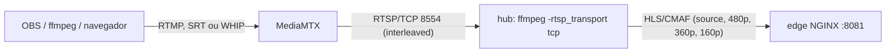
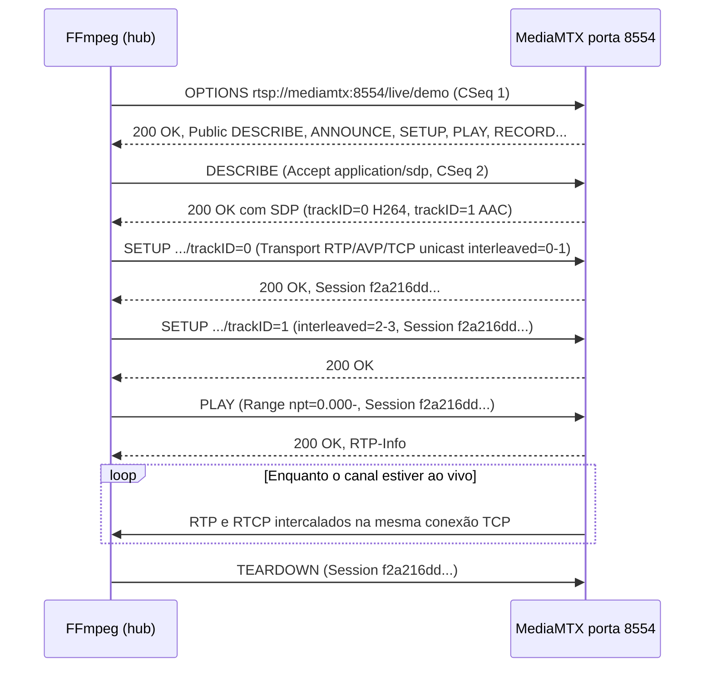
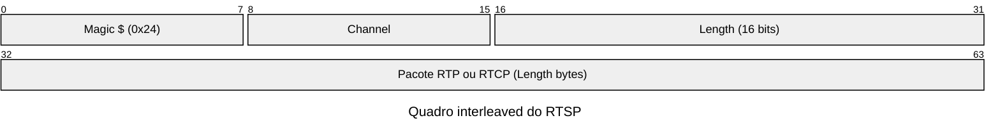

# RTSP (Real Time Streaming Protocol)

## Visão geral

O **RTSP** é um protocolo de **controle** de mídia, padronizado em 1998 (RFC 2326, versão 1.0) e revisado em 2016
(RFC 7826, versão 2.0, pouco adotada e não retrocompatível). Ele funciona como um "controle remoto" para streams:
o texto lembra muito HTTP (`OPTIONS`, `DESCRIBE`, `SETUP`, `PLAY`, `TEARDOWN`, cabeçalhos, códigos de status), mas
a mídia em si viaja em **RTP/RTCP**, por UDP ou intercalada na própria conexão TCP.

É o protocolo das **câmeras IP**, NVRs e sistemas de vigilância, e é muito usado como "barramento interno" entre
servidores de mídia e ferramentas como FFmpeg e GStreamer.

| Aspecto | RTSP 1.0 |
|---|---|
| Porta padrão | 554/TCP (no StreamLab: **8554**, só na rede interna do compose) |
| Sinalização | Texto, estilo HTTP, com `CSeq` (sequência) e `Session` |
| Descrição da mídia | SDP (resposta do `DESCRIBE`) |
| Mídia | RTP/RTCP sobre UDP (unicast ou multicast) ou **interleaved** na conexão TCP |
| Publicar | `ANNOUNCE` + `SETUP` + `RECORD` |
| Ler | `DESCRIBE` + `SETUP` + `PLAY` |

No StreamLab, o hub **lê** cada canal ao vivo do MediaMTX por RTSP (`MEDIAMTX_RTSP=rtsp://mediamtx:8554`) para
alimentar o FFmpeg que gera a escada ABR em HLS (`hub/transcoder.go`). A mídia que entrou por RTMP, SRT ou WHIP é
reempacotada pelo MediaMTX em RTP sem transcodificação.

## Como funciona



### Troca de mensagens (leitura)

A sequência abaixo é exatamente o que o FFmpeg do transcoder faz ao abrir `rtsp://mediamtx:8554/live/demo`
(capturado com `-loglevel trace`):



| Método | Função |
|---|---|
| `OPTIONS` | Lista os métodos suportados (também usado como *keep-alive*) |
| `DESCRIBE` | Pede a descrição da mídia; a resposta é um SDP |
| `SETUP` | Configura o transporte de **uma** trilha (`a=control` do SDP); a primeira resposta cria a `Session` |
| `PLAY` | Começa a enviar a mídia (com `Range`; a resposta traz `RTP-Info` com seq e rtptime iniciais) |
| `PAUSE` | Pausa (faz sentido em VOD, não em ao vivo) |
| `TEARDOWN` | Encerra a sessão |
| `GET_PARAMETER` / `SET_PARAMETER` | Parâmetros e *keep-alive* |
| `ANNOUNCE` + `RECORD` | Publicar: o cliente envia o SDP e depois a mídia |

Autenticação segue o modelo HTTP: `401 Unauthorized` com `WWW-Authenticate` (Basic ou Digest) e o cliente repete o
pedido com `Authorization`. No StreamLab, a leitura é pública (`action = read` sempre é aceita pelo hub).

## Detalhes de baixo nível

### O SDP do DESCRIBE

Resposta real do MediaMTX para o canal `demo`:

```text
v=0
o=- 0 0 IN IP4 127.0.0.1
s=
c=IN IP4 0.0.0.0
t=0 0
m=video 0 RTP/AVP 96
a=control:trackID=0
a=rtpmap:96 H264/90000
a=fmtp:96 packetization-mode=1; profile-level-id=4D401F; sprop-parameter-sets=Z01AH9oBQBbsBEAAAAMAQAAADyPGDKg=,aO88gA==
m=audio 0 RTP/AVP 96
a=control:trackID=1
a=rtpmap:96 mpeg4-generic/48000/2
a=fmtp:96 config=1190; indexdeltalength=3; indexlength=3; mode=AAC-hbr; profile-level-id=1; sizelength=13; streamtype=5
```

| Linha | Significado |
|---|---|
| `m=video 0 RTP/AVP 96` | Trilha de vídeo; porta 0 porque o transporte é definido no `SETUP` |
| `a=control:trackID=0` | URL relativa usada no `SETUP` dessa trilha |
| `profile-level-id=4D401F` | H.264 Main (0x4D = 77), nível 3.1 (0x1F = 31) |
| `sprop-parameter-sets=...` | SPS e PPS em Base64: o decodificador já começa sabendo a resolução |
| `mpeg4-generic/48000/2` | AAC (RFC 3640) a 48 kHz, estéreo |
| `config=1190` | O AudioSpecificConfig em hexadecimal (`0x11 0x90` = AAC-LC, 48 kHz, 2 canais), o mesmo que chegou no sequence header do RTMP |
| `mode=AAC-hbr; sizelength=13; indexlength=3` | Formato dos cabeçalhos AU do RTP para AAC |

### Transporte: UDP vs TCP interleaved

**UDP** (`Transport: RTP/AVP;unicast;client_port=5000-5001`): cada trilha usa um par de portas (RTP par, RTCP
ímpar) em cada lado. Baixo overhead, mas pacotes perdidos não voltam, exige portas abertas e não atravessa NAT
facilmente.

**TCP interleaved** (`Transport: RTP/AVP/TCP;unicast;interleaved=0-1`): os pacotes RTP e RTCP viajam **dentro da
própria conexão RTSP**, cada um precedido de um cabeçalho de 4 bytes (RFC 2326, seção 10.12):



| Canal | Conteúdo (no StreamLab) |
|---|---|
| 0 | RTP do vídeo (trackID=0) |
| 1 | RTCP do vídeo |
| 2 | RTP do áudio (trackID=1) |
| 3 | RTCP do áudio |

Respostas RTSP em texto e quadros binários `$` podem se alternar na mesma conexão; o leitor distingue pelo primeiro
byte.

| | UDP | TCP interleaved |
|---|---|---|
| Perda de pacote | Vira artefato na imagem | Não acontece (TCP retransmite) |
| Portas | 2 por trilha, em cada lado | Só a conexão RTSP |
| NAT/firewall/Docker | Complicado | Simples |
| Latência sob perda | Constante | Pode crescer (head-of-line blocking) |
| Overhead | Menor | 4 bytes por pacote + TCP |

### Por que o transcoder usa `-rtsp_transport tcp`

1. **O servidor só aceita TCP.** O `mediamtx.yml` do projeto define `rtspTransports: [tcp]`. Se o FFmpeg tentar UDP,
   o `SETUP` é recusado:

   ```text
   [rtsp @ ...] method SETUP failed: 461Unsupported Transport
   rtsp://mediamtx:8554/live/demo: Protocol not supported
   ```

2. **Entrada sem perdas.** Um keyframe 720p pode ter dezenas de pacotes RTP enviados em rajada; com UDP, um *buffer*
   de socket cheio (CPU do container ocupada com o encode das renditions) descarta pacotes em silêncio. Qualquer perda
   na entrada se propagaria para **todas** as qualidades geradas. Com TCP, a rede interna do Docker praticamente não
   tem perda e o custo do *head-of-line blocking* é desprezível.
3. **Uma conexão só, sem portas extras.** Nada de pares de portas UDP por trilha nem preocupação com NAT entre
   containers.

Em resumo: na rede interna, onde latência e perda são mínimas, a confiabilidade do TCP vale mais que a pequena
vantagem de latência do UDP. Fora dela (câmeras na internet, Wi-Fi ruim), a escolha pode ser outra.

## Na prática no StreamLab

A porta 8554 **não** é publicada para o host no `docker-compose.yml`, então os testes rodam de dentro do container
`hub` (que já tem `ffmpeg` e `ffprobe`) ou de um container na rede `streamlab_default`.

```bash
# Inspecionar as trilhas do canal demo
docker compose exec hub ffprobe -hide_banner -rtsp_transport tcp rtsp://mediamtx:8554/live/demo

# Ver o diálogo RTSP completo (OPTIONS, DESCRIBE, SETUP, PLAY) e o SDP
docker compose exec hub ffprobe -hide_banner -loglevel trace -rtsp_transport tcp rtsp://mediamtx:8554/live/demo 2>&1 \
  | grep -A8 -E "Sending:|SDP:" | grep -v 'ret=1'

# Confirmar que UDP é recusado (461 Unsupported Transport)
docker compose exec hub ffprobe -hide_banner -v error -rtsp_transport udp rtsp://mediamtx:8554/live/demo

# Ler 10 s do canal e gravar em MP4 sem re-encode (o arquivo fica dentro do container)
docker compose exec hub ffmpeg -rtsp_transport tcp -i rtsp://mediamtx:8554/live/demo -t 10 -c copy /tmp/demo.mp4

# A partir de outro container na mesma rede
docker run --rm --network streamlab_default --entrypoint ffprobe bluenviron/mediamtx:1.21.4-ffmpeg \
  -hide_banner -rtsp_transport tcp rtsp://mediamtx:8554/live/demo
```

Para usar RTSP a partir do host (VLC, por exemplo), seria preciso publicar a porta adicionando `"8554:8554"` ao
serviço `mediamtx` no compose.

### Onde olhar

| O quê | Onde |
|---|---|
| Sessões do transcoder | `docker compose logs -f mediamtx` (linhas `[RTSP] [session ...] is reading from path 'live/demo', with TCP, 2 tracks (H264, MPEG-4 Audio)`) |
| Erros do FFmpeg ao ler | `docker compose logs -f hub` (linhas `ffmpeg ... msg=...` e `ffmpeg saiu, reiniciando`) |
| Sessões RTSP ativas | Prometheus: `rtsp_sessions{state="read"}` |
| Bytes enviados ao transcoder | `rate(rtsp_sessions_bytes_sent[30s]) * 8` |
| Pacotes descartados na saída | `rtsp_sessions_outbound_rtp_packets_discarded` |
| Saúde do transcoder | `streamlab_transcoder_up`, `streamlab_transcoder_speed_ratio`, `streamlab_transcoder_restarts_total` |
| Detalhe da sessão (API interna) | `docker compose exec hub wget -qO- http://mediamtx:9997/v3/rtspsessions/list` |

## Armadilhas comuns

- **Esquecer `-rtsp_transport tcp`** com um servidor que só aceita TCP: erro 461. Com servidores que aceitam os dois,
  o FFmpeg tenta UDP primeiro e o resultado depende da rede (pode funcionar na LAN e falhar atrás de NAT).
- **Canal que caiu.** Se o publicador cai, o path deixa de existir e o `DESCRIBE` falha (tipicamente 404). O hub não
  depende disso: a cada 2 s ele consulta a API do MediaMTX e para o FFmpeg dos canais que saíram do ar; o *backoff*
  de reinício só entra em ação quando o FFmpeg morre com o canal ainda ao vivo.
- **URL de controle.** Alguns servidores usam `a=control` absoluto, outros relativo; clientes caseiros erram ao montar
  a URL do `SETUP`. FFmpeg e GStreamer resolvem isso corretamente.
- **Sessão expirando.** Servidores fecham sessões sem *keep-alive* (`timeout=` no cabeçalho `Session`). No modo TCP
  a própria conexão aberta costuma bastar, mas clientes UDP precisam mandar `OPTIONS`/`GET_PARAMETER` periodicamente.
- **RTSP não é para navegador.** Nenhum navegador toca RTSP; para a web, converta para WebRTC ou HLS (o que o
  MediaMTX faz).

## Referências

- RFC 2326, *Real Time Streaming Protocol (RTSP)* 1.0 (interleaved na seção 10.12): https://www.rfc-editor.org/rfc/rfc2326
- RFC 7826, *Real-Time Streaming Protocol Version 2.0*: https://www.rfc-editor.org/rfc/rfc7826
- RFC 8866, *SDP*: https://www.rfc-editor.org/rfc/rfc8866
- RFC 3550, *RTP/RTCP*: https://www.rfc-editor.org/rfc/rfc3550
- RFC 6184, *RTP Payload Format for H.264*: https://www.rfc-editor.org/rfc/rfc6184
- RFC 3640, *RTP Payload Format for MPEG-4 Elementary Streams* (AAC `mpeg4-generic`): https://www.rfc-editor.org/rfc/rfc3640
- FFmpeg, protocolo `rtsp` (`-rtsp_transport`): https://ffmpeg.org/ffmpeg-protocols.html#rtsp
- MediaMTX (`rtspTransports`, API de sessões RTSP): https://github.com/bluenviron/mediamtx
