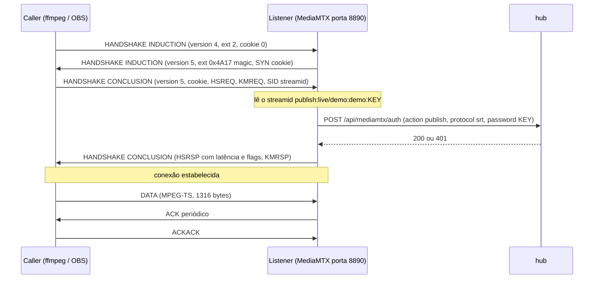
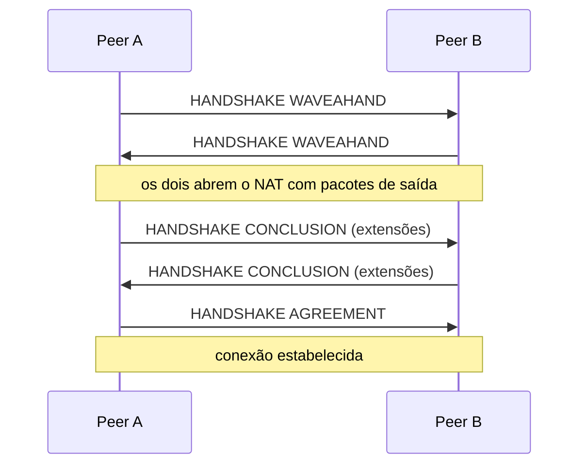
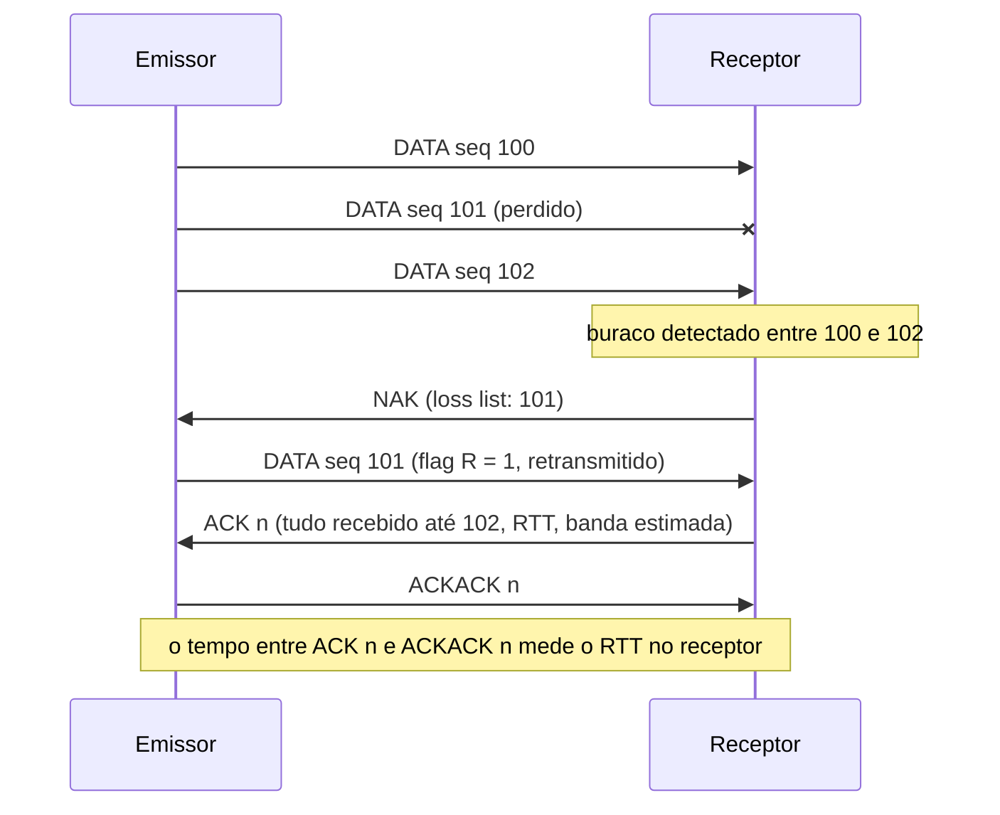
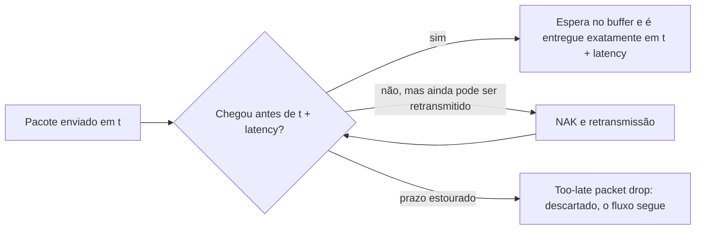
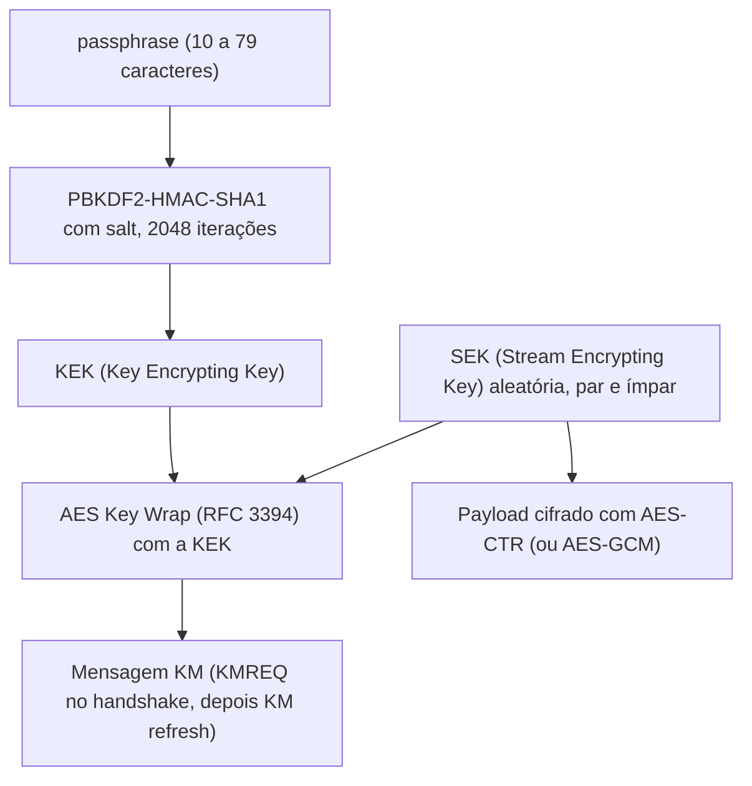
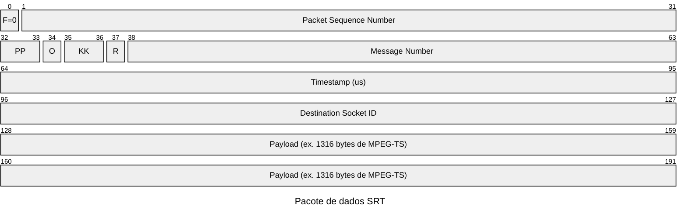
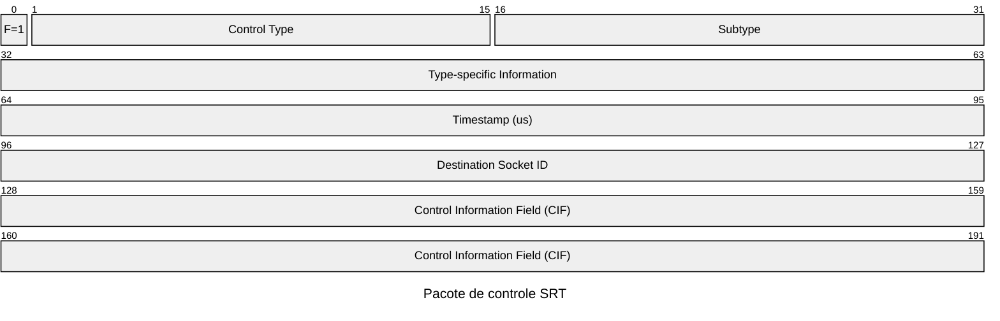

# SRT (Secure Reliable Transport)

## Visão geral

O **SRT** foi criado pela Haivision e aberto em 2017 (biblioteca `libsrt`, licença MPL-2.0). Ele descende do
**UDT** (UDP-based Data Transfer) e foi desenhado para levar vídeo ao vivo por redes imperfeitas, como internet
pública, 4G/5G e links de satélite, com três ideias centrais:

1. **UDP + retransmissão seletiva (ARQ):** só o que se perdeu é reenviado, e uma perda não trava o resto do fluxo
   (sem o *head-of-line blocking* do TCP/RTMP).
2. **Latência fixa e configurável (TSBPD):** o receptor entrega cada pacote exatamente `latency` ms depois do
   momento em que ele foi enviado. Esse tempo é o "orçamento" para recuperar perdas; o que não chegar a tempo é
   descartado (*too-late packet drop*), e o vídeo continua.
3. **Criptografia AES** embutida, com chave derivada de uma *passphrase*.

O SRT é agnóstico ao conteúdo, mas na prática quase sempre transporta **MPEG-TS**. É o padrão de fato para
contribuição em broadcast e um ótimo ingest para streamers em redes ruins.

| Aspecto | SRT |
|---|---|
| Transporte | UDP (no StreamLab: porta **8890/udp**) |
| Confiabilidade | ARQ (ACK, NAK, retransmissão) limitada pelo tempo (TSBPD) |
| Latência | Configurável, padrão 120 ms |
| Criptografia | AES-128/192/256 (CTR; GCM a partir da libsrt 1.5.2) |
| Payload típico | MPEG-TS, 7 pacotes de 188 bytes por datagrama (1316 bytes) |
| Modos de conexão | caller, listener, rendezvous |
| Identificação da stream | `streamid` (até 512 caracteres) enviado no handshake |

No StreamLab, o MediaMTX escuta SRT em `srtAddress: :8890` e usa o `streamid` para saber o path, a ação
(publicar ou ler) e as credenciais, que são validadas pelo hub.

## Como funciona

### Modos de conexão

| Modo | Papel | Uso típico |
|---|---|---|
| **caller** | Inicia a conexão para um IP:porta (como um cliente) | Encoder (OBS, ffmpeg) publicando no servidor |
| **listener** | Espera conexões numa porta (como um servidor) | MediaMTX na 8890 |
| **rendezvous** | Os dois lados "chamam" um ao outro ao mesmo tempo na mesma porta | Atravessar NAT/firewall dos dois lados sem servidor intermediário |

### Handshake caller-listener (HSv5)

O handshake acontece em duas rodadas. A primeira (**induction**) serve para o listener entregar um **SYN cookie**
(proteção contra *flood* de conexões falsas, sem guardar estado). A segunda (**conclusion**) negocia de fato a
conexão: versão, latência, criptografia e `streamid`, carregados em **extensões** do handshake.



O valor `version 4` na primeira mensagem do caller é proposital: mantém compatibilidade com o UDT e com versões
antigas do SRT. O listener responde `version 5` e o "número mágico" `0x4A17` no campo de extensão, sinalizando que
entende HSv5.

Extensões mais comuns no CONCLUSION:

| Extensão | Código | Conteúdo |
|---|---|---|
| SRT_CMD_HSREQ / HSRSP | 1 / 2 | Versão do SRT, flags (TSBPD, TLPKTDROP, NAK periódico, rexmit), latência do emissor e do receptor |
| SRT_CMD_KMREQ / KMRSP | 3 / 4 | Material de chave (SEK cifrada com a KEK), se houver criptografia |
| SRT_CMD_SID | 5 | O `streamid` |
| SRT_CMD_CONGESTION | 6 | Tipo de controle de congestionamento (`live` ou `file`) |
| SRT_CMD_FILTER | 7 | Filtro de pacotes (ex. FEC) |
| SRT_CMD_GROUP | 8 | *Connection bonding* (grupos de conexões redundantes) |

A latência efetiva de cada direção é o **maior** valor entre o que o emissor propõe e o que o receptor pede.

### Rendezvous



No HSv5 o papel de quem "inicia" a negociação de extensões é decidido comparando os cookies dos dois lados. O
MediaMTX não usa rendezvous; ele é sempre listener.

### Recuperação de perdas: ACK, NAK, ACKACK



- **ACK "cheio"** a cada 10 ms (intervalo de sincronização SYN), com o último número de sequência recebido em ordem e
  estatísticas: RTT, variância do RTT, buffer livre, taxa de recepção e capacidade estimada do link. Há também
  **light ACKs** (só o número de sequência) a cada 64 pacotes em fluxos muito rápidos.
- **NAK** é enviado assim que o receptor detecta um buraco e, com *periodic NAK* ligado (padrão no modo live),
  repetido periodicamente enquanto a perda persistir. A lista de perdas é comprimida em intervalos.
- **ACKACK** confirma o ACK e permite ao **receptor** medir o RTT (o emissor mede pelo campo RTT do ACK).

Esse é o **ARQ** (Automatic Repeat reQuest) do SRT: retransmite só o necessário, mas exige **banda de sobra**. A
libsrt reserva por padrão um *overhead* para retransmissões (`oheadbw`, 25% acima da taxa de entrada quando o
limite de banda é relativo); com `maxbw = -1` (o que o MediaMTX reporta em `mbpsMaxBW`) não há teto explícito.

### TSBPD e latência

**TSBPD** (Timestamp-Based Packet Delivery): cada pacote leva um timestamp em microssegundos relativo ao início da
conexão. O receptor reconstrói o relógio do emissor e só entrega o pacote para a aplicação no instante
`tempo_base + timestamp + latency`. Resultado: o atraso de ponta a ponta fica **constante**, o *jitter* da rede é
absorvido, e o demultiplexador MPEG-TS recebe um fluxo com o mesmo ritmo com que foi produzido.



A latência precisa caber, no mínimo, algumas idas e voltas de retransmissão. A regra prática mais citada é
**latency de 2,5 a 4 vezes o RTT** em redes com pouca perda, nunca abaixo do padrão de 120 ms. O guia de
implantação da Haivision recomenda multiplicadores maiores conforme a taxa de perda cresce (da ordem de 3 a 4 vezes
para perda de até 1%, chegando a multiplicadores bem maiores em links com perda alta); consulte a tabela do guia nas
referências em vez de confiar num número fixo.

| RTT do link | latency sugerida (4x RTT, mínimo 120 ms) |
|---|---|
| 5 ms (LAN) | 120 ms |
| 40 ms (mesmo país) | 160 ms |
| 150 ms (intercontinental) | 600 ms |
| 300 ms (4G ruim, satélite) | 1200 ms ou mais |

### Too-late packet drop (TLPKTDROP)

Ligado por padrão no modo live. Do lado do **receptor**, um pacote que não chegou até o seu horário de entrega é dado
como perdido e "pulado"; do lado do **emissor**, pacotes que já não teriam como chegar a tempo são descartados do
buffer de envio em vez de retransmitidos. Aparece nas métricas como `pktRcvDrop` / `pktSndDrop`. Para o espectador,
isso vira artefatos de imagem (macroblocos) ou um pequeno salto, mas a latência não cresce, ao contrário do RTMP.

### Criptografia



- O tamanho da chave é escolhido com `pbkeylen` (16, 24 ou 32 bytes, ou seja, AES-128/192/256).
- O campo **KK** de cada pacote de dados diz se ele foi cifrado com a chave **par** ou **ímpar**. Isso permite trocar
  a SEK periodicamente (*key refresh*) sem interromper o fluxo: a nova chave é anunciada antes de entrar em uso.
  Na libsrt, os padrões são refresh a cada 2^24 pacotes e pré-anúncio 2^12 pacotes antes (`km_refreshrate`,
  `km_preannounce`).
- Só o payload é cifrado; os cabeçalhos SRT seguem em claro.
- Se a passphrase não bate, o handshake falha ou os pacotes chegam como "undecrypt" (`pktRcvUndecrypt`).
- O MediaMTX permite exigir passphrase por path (`srtPublishPassphrase`, `srtReadPassphrase`); o StreamLab não usa,
  e a segurança do ingest SRT aqui vem só da stream key no `streamid` (que trafega **em claro** no handshake).

## Detalhes de baixo nível

### Cabeçalho comum (16 bytes)

Todo pacote SRT começa com 128 bits. O primeiro bit (**F**) separa dados (0) de controle (1).



| Campo | Bits | Significado |
|---|---|---|
| F | 1 | 0 = dados |
| Packet Sequence Number | 31 | Número sequencial do pacote (usado em ACK/NAK) |
| PP | 2 | Posição na mensagem: `10` primeiro, `00` meio, `01` último, `11` mensagem num pacote só |
| O | 1 | Entrega em ordem exigida (relevante no modo mensagem) |
| KK | 2 | Criptografia: `00` sem, `01` chave par, `10` chave ímpar |
| R | 1 | 1 = este pacote é uma retransmissão |
| Message Number | 26 | Número da mensagem (agrupa pacotes de uma mesma mensagem) |
| Timestamp | 32 | Microssegundos desde o início da conexão (base do TSBPD) |
| Destination Socket ID | 32 | Id do socket SRT de destino (multiplexa várias conexões na mesma porta UDP) |



| Control Type | Nome | Função |
|---|---|---|
| `0x0000` | HANDSHAKE | Estabelecimento da conexão (CIF com versão, MTU, janela, tipo, cookie, extensões) |
| `0x0001` | KEEPALIVE | Mantém a conexão quando não há dados |
| `0x0002` | ACK | Confirmação + estatísticas (RTT, banda, buffer); o *ACK number* vai no Type-specific Information |
| `0x0003` | NAK | Lista de pacotes perdidos |
| `0x0004` | Congestion Warning | Legado do UDT |
| `0x0005` | SHUTDOWN | Encerramento |
| `0x0006` | ACKACK | Confirma um ACK (mede RTT) |
| `0x0007` | DROPREQ | Emissor avisa que desistiu de uma mensagem |
| `0x0008` | PEERERROR | Erro no peer |
| `0x7FFF` | Extensão (user-defined) | Usado para KM refresh, HSREQ legado etc., com o Subtype indicando qual |

Campos do CIF do HANDSHAKE (em ordem): Version (32), Encryption Field (16), Extension Field (16), Initial Packet
Sequence Number (32), MTU (32, padrão 1500), Maximum Flow Window Size (32), Handshake Type (32: `1` INDUCTION,
`0` WAVEAHAND, `0xFFFFFFFF` CONCLUSION, `0xFFFFFFFE` AGREEMENT), SRT Socket ID (32), SYN Cookie (32), Peer IP
Address (128) e, no CONCLUSION, as extensões (tipo 16 bits, tamanho 16 bits em palavras de 4 bytes, conteúdo).

Campos do CIF de um ACK cheio: último número de sequência confirmado, RTT (us), variância do RTT (us), buffer
disponível (pacotes), taxa de recepção (pacotes/s), capacidade estimada do link (pacotes/s) e taxa de recepção
(bytes/s).

### streamid e o formato do MediaMTX

O `streamid` é uma string livre enviada pelo caller na extensão SID. A especificação sugere uma sintaxe de controle
de acesso (`#!::r=recurso,m=publish,u=usuario,...`), mas cada servidor interpreta como quiser. O MediaMTX usa:

| Formato | Exemplo |
|---|---|
| `action:pathname` | `read:live/demo` |
| `action:pathname:user:pass` | `publish:live/demo:demo:minha-key` |
| `action:pathname:user:pass:query` | `publish:live/demo:demo:minha-key:foo=bar` |

`action` é `publish` ou `read`. O MediaMTX repassa `user` e `pass` ao hub como `user` e `password` na requisição
de autenticação; o hub ignora o usuário e compara a **senha** com a stream key do canal (`hub/api.go`, função
`decide`). Por convenção o Estúdio usa o nome do canal como usuário. Versões recentes do MediaMTX também aceitam a
sintaxe `#!::` padrão; confira a documentação da sua versão antes de depender dela.

### Por que `pkt_size=1316`

Um pacote MPEG-TS tem **188 bytes**. Sete deles dão **1316 bytes**, que é o payload padrão do SRT no modo live:

| Camada | Bytes |
|---|---|
| 7 pacotes MPEG-TS | 1316 |
| Cabeçalho SRT | 16 |
| Cabeçalho UDP | 8 |
| Cabeçalho IPv4 | 20 |
| **Total** | **1360** (cabe no MTU 1500, sobra margem para túneis/VPN) |

O payload máximo do SRT com MTU 1500 é 1456 bytes, mas usar múltiplos de 188 evita que um pacote TS fique partido
entre dois datagramas: uma perda corrompe só os pacotes TS daquele datagrama. Por isso o `pkt_size=1316` aparece em
todos os comandos do Estúdio.

### Métricas da libsrt e onde elas aparecem

A libsrt expõe estatísticas por socket (`srt_bstats`). O MediaMTX as publica na API (`/v3/srtconns/list`, nomes
em camelCase) e no endpoint de métricas (`:9998`, coletado pelo Prometheus do projeto), com labels `id`, `path`,
`remoteAddr` e `state` (`publish` ou `read`).

| libsrt | API do MediaMTX | Prometheus | Leitura |
|---|---|---|---|
| `msRTT` | `msRTT` | `srt_conns_ms_rtt` | RTT suavizado em ms. Base para escolher a latency |
| `pktRcvLoss` | `packetsReceivedLoss` | `srt_conns_packets_received_loss` | Pacotes que o receptor detectou como perdidos (contador) |
| (calculado) | `packetsReceivedLossRate` | `srt_conns_packets_received_loss_rate` | Taxa de perda calculada pelo MediaMTX; confira a unidade na documentação da API da sua versão |
| `pktRetrans` | `packetsRetrans` | `srt_conns_packets_retrans` | Pacotes retransmitidos **pelo emissor** (no ingest o emissor é o OBS/ffmpeg) |
| `pktRcvRetrans` | `packetsReceivedRetrans` | `srt_conns_packets_received_retrans` | Retransmissões recebidas pelo MediaMTX (o lado útil no ingest) |
| `pktRcvDrop` | `packetsReceivedDrop` | `srt_conns_packets_received_drop` | Descartados por chegarem tarde (too-late drop): perda **irrecuperável** |
| `pktRcvBelated` | `packetsReceivedBelated` | `srt_conns_packets_received_belated` | Chegaram depois do prazo |
| `pktRcvUndecrypt` | `packetsReceivedUndecrypt` | `srt_conns_packets_received_undecrypt` | Falha de decriptação (passphrase errada) |
| `mbpsBandwidth` | `mbpsLinkCapacity` | `srt_conns_mbps_link_capacity` | Capacidade estimada do link (estimativa por pares de pacotes, pode oscilar bastante) |
| `mbpsRecvRate` | `mbpsReceiveRate` | `srt_conns_mbps_receive_rate` | Taxa recebida (bitrate do ingest) |
| `msRcvTsbPdDelay` | `msReceiveTsbPdDelay` | `srt_conns_ms_receive_tsb_pd_delay` | Latência TSBPD negociada (120 por padrão) |
| `msRcvBuf` | `msReceiveBuf` | `srt_conns_ms_receive_buf` | Quanto de mídia está no buffer de recepção |

O dashboard do Grafana do projeto já plota `srt_conns_ms_rtt` e `srt_conns_packets_received_loss_rate`.

Interpretação rápida:

- `received_loss` subindo e `received_drop` parado: a rede perde, mas o ARQ está dando conta. Tudo bem.
- `received_drop` subindo: a latência é curta demais para o RTT/perda atuais, ou falta banda para retransmitir.
  Aumente `latency` ou reduza o bitrate.
- `ms_rtt` alto e instável: escolha a latência pelo RTT de pior caso, não pela média.

## Na prática no StreamLab

### Publicar

```bash
# Sinal de teste em MPEG-TS sobre SRT (troque <canal> e <key>)
ffmpeg -re -f lavfi -i testsrc2=size=1280x720:rate=30 -f lavfi -i sine=frequency=440:sample_rate=48000 \
  -c:v libx264 -preset veryfast -tune zerolatency -b:v 3000k -g 60 -keyint_min 60 -sc_threshold 0 \
  -c:a aac -b:a 128k -ar 48000 -ac 2 \
  -f mpegts "srt://localhost:8890?streamid=publish:live/<canal>:<canal>:<key>&pkt_size=1316"

# Mesma coisa com 500 ms de latência. ATENÇÃO: no ffmpeg o parâmetro latency é em MICROSSEGUNDOS
ffmpeg ... -f mpegts "srt://localhost:8890?streamid=publish:live/<canal>:<canal>:<key>&pkt_size=1316&latency=500000"
```

No **OBS**: Configurações, Transmissão, Serviço "Personalizado", Servidor
`srt://localhost:8890?streamid=publish:live/<canal>:<canal>:<key>&pkt_size=1316` e chave em branco (o OBS
usa FFmpeg/libsrt por baixo, então `latency` também é em microssegundos ali).

### Ler

```bash
# Inspecionar a stream que está entrando (assistir é público)
ffprobe -hide_banner "srt://localhost:8890?streamid=read:live/demo"

# Assistir com baixa latência
ffplay -fflags nobuffer -flags low_delay "srt://localhost:8890?streamid=read:live/demo"

# Com srt-live-transmit (latência em MILISSEGUNDOS aqui), imprimindo estatísticas a cada 1000 pacotes
# (veja "srt-live-transmit -h" para a sintaxe exata das opções na sua versão)
srt-live-transmit -stats-report-frequency 1000 "srt://localhost:8890?streamid=read:live/demo&latency=200" file://con > /dev/null
```

### Simular uma rede ruim

```bash
# 5% de perda e 50 ms de atraso no loopback (afeta TODO o tráfego local; remova depois)
sudo tc qdisc add dev lo root netem loss 5% delay 50ms
# ... publique por SRT e por RTMP e compare no Grafana ...
sudo tc qdisc del dev lo root
```

Com SRT você deve ver `srt_conns_packets_received_loss` e `srt_conns_packets_received_retrans` subindo com a
imagem estável; com RTMP, a mesma perda vira atraso crescente e quadros descartados no encoder.

### Onde olhar

| O quê | Onde |
|---|---|
| Conexão e handshake | `docker compose logs -f mediamtx` (linhas `[SRT] [conn ...]`) |
| Stream key aceita ou recusada | `docker compose logs -f hub` (linhas `auth ... protocol=srt`) |
| Estatísticas completas da conexão | `docker compose exec hub wget -qO- http://mediamtx:9997/v3/srtconns/list` |
| RTT | Prometheus: `srt_conns_ms_rtt{state="publish"}` |
| Perda e retransmissão | `increase(srt_conns_packets_received_loss[1m])`, `increase(srt_conns_packets_received_retrans[1m])` |
| Perda irrecuperável | `increase(srt_conns_packets_received_drop[1m])` |
| Bitrate de ingest | `srt_conns_mbps_receive_rate{state="publish"}` |
| Conexões ativas | `sum(srt_conns{state="publish"})` (painel do Grafana) |

A API e as métricas do MediaMTX só respondem na rede interna do compose (o hub autoriza `api`/`metrics` apenas de
IPs privados), por isso os comandos acima rodam de dentro do container `hub`.

## Armadilhas comuns

- **Unidade da latência.** FFmpeg/OBS: microssegundos (`latency=200000` = 200 ms). `srt-live-transmit` e a maioria
  dos equipamentos: milissegundos. Um `latency=200` no ffmpeg vira 200 us, e na prática vale o valor do outro lado
  (o maior vence), mas confunde muito.
- **Esquecer a porta UDP.** O compose publica `8890:8890/udp`. Firewalls que só liberam TCP derrubam o SRT em silêncio
  (o handshake simplesmente não volta).
- **`streamid` sem URL encoding.** Se a key tiver `&`, `=` ou `:`, ela quebra o parsing da URL ou do formato do
  MediaMTX. Prefira keys alfanuméricas ou codifique.
- **`pkt_size` errado.** Valores que não são múltiplos de 188 ou maiores que 1456 causam erro ou fragmentação.
- **Latência curta demais.** O sintoma é `received_drop` subindo e imagem quebrando, mesmo com banda sobrando.
- **Banda no limite.** O ARQ precisa de folga; se o bitrate do encoder já ocupa todo o uplink, as retransmissões
  competem com os dados novos e tudo piora.
- **streamid trafega em claro.** Mesmo com passphrase, o `streamid` (com a stream key) vai sem criptografia no
  handshake. Em produção, use passphrase e trate a key como identificador rotacionável.
- **Achar que SRT dá latência baixa "de graça".** A latência total inclui encoder, `latency` do SRT, transcodificação
  e o protocolo de entrega (HLS). O SRT só controla o trecho de contribuição.

## Referências

- IETF, *The SRT Protocol* (draft-sharabayko-srt): https://datatracker.ietf.org/doc/draft-sharabayko-srt/
- Haivision, especificação e documentação da libsrt: https://github.com/Haivision/srt/tree/master/docs
- libsrt, opções de socket (latency, pbkeylen, km_refreshrate, maxbw, oheadbw): https://github.com/Haivision/srt/blob/master/docs/API/API-socket-options.md
- libsrt, estatísticas (`msRTT`, `pktRcvLoss`, `mbpsBandwidth`...): https://github.com/Haivision/srt/blob/master/docs/API/statistics.md
- libsrt, sintaxe recomendada do streamid (`#!::`): https://github.com/Haivision/srt/blob/master/docs/features/access-control.md
- Haivision, *SRT Protocol Technical Overview* e *SRT Deployment Guide* (tabela de multiplicadores de RTT): https://www.haivision.com/resources/streaming-video-definitions/srt/
- RFC 3394, *AES Key Wrap Algorithm*: https://www.rfc-editor.org/rfc/rfc3394
- RFC 8018, *PKCS #5* (PBKDF2): https://www.rfc-editor.org/rfc/rfc8018
- ISO/IEC 13818-1, *MPEG-2 Transport Stream*: https://www.iso.org/standard/87619.html
- MediaMTX, SRT e formato do streamid: https://github.com/bluenviron/mediamtx
- FFmpeg, protocolo `srt`: https://ffmpeg.org/ffmpeg-protocols.html#srt
