# WebRTC, WHIP e WHEP

## Visão geral

**WebRTC** é o conjunto de padrões (IETF + W3C) que permite a um navegador enviar e receber áudio e vídeo em tempo
real, com latência abaixo de 1 segundo, sem plugin. Ele não é um protocolo único, e sim uma pilha:

| Camada | Protocolo | Função |
|---|---|---|
| Sinalização | **não padronizada** pelo WebRTC; aqui: **WHIP/WHEP** (HTTP) | Trocar a oferta e a resposta SDP |
| Descrição da sessão | **SDP** (RFC 8866, modelo offer/answer RFC 3264, JSEP RFC 8829) | Codecs, trilhas, credenciais ICE, fingerprint DTLS |
| Conectividade | **ICE** (RFC 8445) + **STUN** (RFC 8489) + **TURN** (RFC 8656) | Achar um caminho UDP/TCP entre os dois lados, atravessando NAT |
| Segurança | **DTLS** (RFC 9147) + **DTLS-SRTP** (RFC 5764) | Autenticar os peers e derivar chaves |
| Mídia | **SRTP** (RFC 3711) sobre **RTP** (RFC 3550) | Transportar os quadros codificados |
| Controle | **RTCP** (RFC 3550, 4585, 5104) | Relatórios, NACK, PLI/FIR, feedback de banda |
| Dados | SCTP sobre DTLS (RFC 8831) | DataChannels (não usados pelo StreamLab) |

Como a sinalização ficou de fora do padrão, cada plataforma inventava a sua (WebSocket, JSON proprietário). O
**WHIP** (WebRTC-HTTP Ingestion Protocol, **RFC 9725**) e o **WHEP** (WebRTC-HTTP Egress Protocol) resolvem isso
para streaming: um único `POST` HTTP com a oferta SDP, e a resposta é a answer SDP. Com isso, OBS, FFmpeg,
GStreamer e navegadores conseguem publicar e assistir em qualquer servidor compatível, como o MediaMTX.

No StreamLab:

| Uso | Quem | URL |
|---|---|---|
| Publicar do navegador (WHIP) | Estúdio, `hub/web/studio.js` | `POST http://localhost:8889/live/<canal>/whip` |
| Assistir em tempo real (WHEP) | Player, `hub/web/watch.js` (modo WebRTC) | `POST http://localhost:8889/live/<canal>/whep` |
| Mídia (ICE/SRTP) | MediaMTX | `8189/udp` (e `8189/tcp` como fallback) |

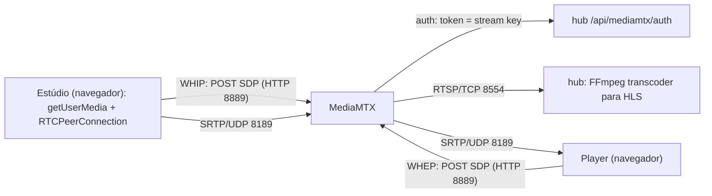

## Como funciona

### Sessão WHIP (publicar)

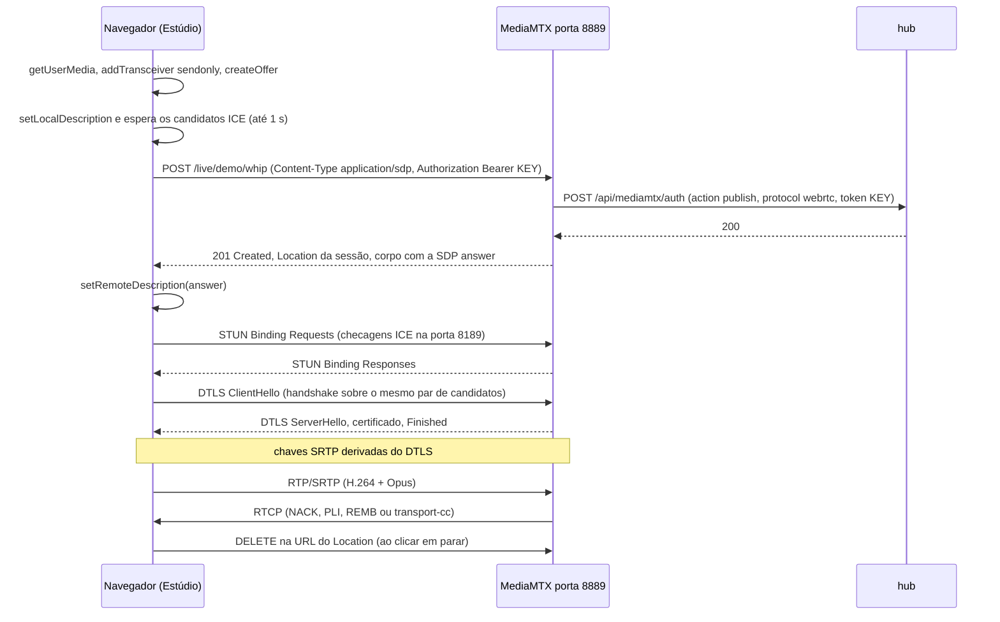

### Sessão WHEP (assistir)

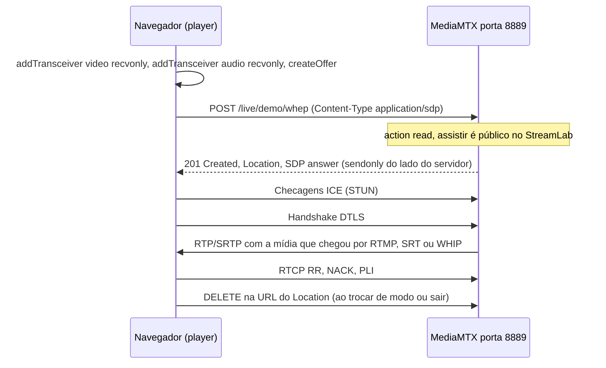

O MediaMTX só **reempacota** a mídia em RTP, sem transcodificar. Por isso o codec precisa ser compatível com o
navegador: H.264 (sem B-frames), VP8, VP9 ou AV1 no vídeo, Opus ou G.711 no áudio. Uma live publicada por RTMP com
AAC (como o canal `demo`) chega ao WebRTC **sem áudio**. O log do MediaMTX deixa isso explícito:

```text
WAR [WebRTC] [session 00603695] skipping track 2 (MPEG-4 Audio)
INF [WebRTC] [session 00603695] peer connection established, local candidate: host/udp/127.0.0.1/8189, remote candidate: prflx/udp/172.21.0.1/53927
INF [WebRTC] [session 00603695] is reading from path 'live/demo', 1 track (H264)
```

Repare também no candidato remoto `prflx`: o navegador chega ao container através do NAT do Docker
(`172.21.0.1`), um endereço que ele nunca anunciou na SDP e que o MediaMTX descobriu durante as checagens ICE.

## Detalhes de baixo nível

### SDP: offer e answer

Uma SDP é texto, uma linha por atributo. Exemplo enxuto de uma oferta de WHEP (só recebe) gerada por um navegador:

```text
v=0
o=- 4611731400430051336 2 IN IP4 127.0.0.1
s=-
t=0 0
a=group:BUNDLE 0 1
a=extmap-allow-mixed
a=msid-semantic: WMS
m=video 9 UDP/TLS/RTP/SAVPF 96 97 102 103
c=IN IP4 0.0.0.0
a=rtcp:9 IN IP4 0.0.0.0
a=candidate:1 1 udp 2122260223 192.168.0.10 54321 typ host
a=ice-ufrag:abcd
a=ice-pwd:0123456789abcdefghijklmn
a=ice-options:trickle
a=fingerprint:sha-256 7B:8A:...:F1
a=setup:actpass
a=mid:0
a=extmap:3 http://www.ietf.org/id/draft-holmer-rmcat-transport-wide-cc-extensions-01
a=recvonly
a=rtcp-mux
a=rtpmap:96 VP8/90000
a=rtcp-fb:96 nack
a=rtcp-fb:96 nack pli
a=rtcp-fb:96 transport-cc
a=rtpmap:102 H264/90000
a=fmtp:102 level-asymmetry-allowed=1;packetization-mode=1;profile-level-id=42e01f
m=audio 9 UDP/TLS/RTP/SAVPF 111
a=mid:1
a=recvonly
a=rtpmap:111 opus/48000/2
a=fmtp:111 minptime=10;useinbandfec=1
```

| Linha | Significado |
|---|---|
| `m=video 9 UDP/TLS/RTP/SAVPF 96 97 ...` | Uma "media section": tipo, porta (9 = descartável, quem manda é o ICE), perfil (RTP seguro com feedback sobre DTLS) e a lista de *payload types* em ordem de preferência |
| `a=rtpmap:102 H264/90000` | Payload type 102 = H.264 com relógio de 90 kHz |
| `a=fmtp:102 ...` | Parâmetros do codec: `packetization-mode=1` (permite FU-A/STAP-A), `profile-level-id=42e01f` (Constrained Baseline, nível 3.1) |
| `a=rtcp-fb:102 nack pli` | Feedbacks RTCP aceitos para esse codec |
| `a=mid:0` | Identificador da media section (casa com o BUNDLE e com a extensão RTP `mid`) |
| `a=group:BUNDLE 0 1` | Todas as media sections compartilham **um** transporte (uma porta, uma sessão ICE/DTLS) |
| `a=rtcp-mux` | RTP e RTCP na mesma porta |
| `a=ice-ufrag` / `a=ice-pwd` | Credenciais das checagens STUN do ICE |
| `a=candidate:...` | Um endereço candidato (veja ICE abaixo) |
| `a=fingerprint:sha-256 ...` | Hash do certificado DTLS; o certificado apresentado no handshake precisa bater com ele |
| `a=setup:actpass` | Papel DTLS: quem oferece diz `actpass`; quem responde escolhe `active` (cliente DTLS) ou `passive` (servidor DTLS) |
| `a=sendonly` / `recvonly` / `sendrecv` | Direção da mídia nessa section |
| `a=extmap:N URI` | Extensões de cabeçalho RTP negociadas (transport-cc, abs-send-time, mid, rid...) |

A answer do servidor repete as media sections na mesma ordem, escolhe **um** codec por section (ou um subconjunto),
traz suas próprias credenciais ICE, candidatos, fingerprint e `a=setup`. O inspetor "Playlist / SDP" do player do
StreamLab mostra a answer real do MediaMTX com explicações de cada linha.

### ICE: atravessando NAT

Cada lado reúne **candidatos** (endereços onde pode receber pacotes), troca-os pela sinalização e testa pares
(local, remoto) com **STUN Binding Requests** autenticados com `ice-ufrag`/`ice-pwd` (`MESSAGE-INTEGRITY`). O primeiro
par que funciona, segundo as prioridades, é **nomeado** (`USE-CANDIDATE`) e passa a carregar DTLS e mídia.

| Tipo | Como é obtido | Exemplo |
|---|---|---|
| `host` | Endereço da própria interface | `192.168.0.10:54321`, ou um nome `.local` (mDNS) no navegador, que esconde o IP real |
| `srflx` (server reflexive) | Perguntando a um servidor **STUN** "com que IP:porta você me vê?" | O IP público do roteador doméstico |
| `prflx` (peer reflexive) | Descoberto durante as checagens, quando chega um STUN de um endereço não anunciado | Comum quando há NAT entre os peers |
| `relay` | Alocado num servidor **TURN**, que repassa todos os pacotes | Último recurso quando o UDP direto é bloqueado |

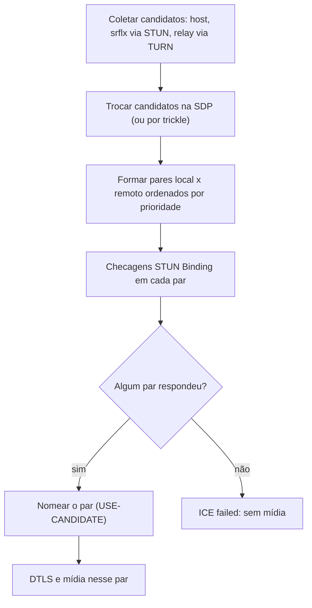

**ICE full vs ICE-lite.** Um agente *full* coleta candidatos, faz checagens e pode controlar a nomeação. Um agente
*lite* (`a=ice-lite` na SDP) apenas tem candidatos `host` e responde às checagens; é comum em servidores com IP
público, porque é mais simples e barato. Para saber se a sua versão do MediaMTX responde como lite, procure
`a=ice-lite` na answer exibida pelo inspetor do player.

**Consent freshness** (RFC 7675): durante a sessão, o navegador continua mandando STUN periodicamente; se o outro lado
para de responder por cerca de 30 segundos, a conexão é considerada perdida.

### DTLS-SRTP

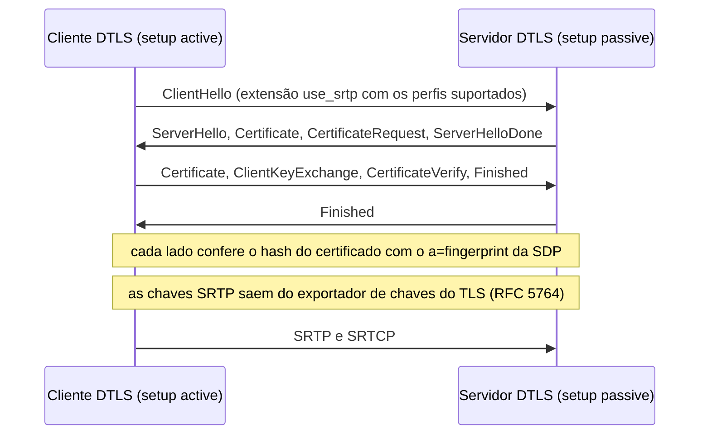

- Os certificados são autoassinados e efêmeros; a confiança vem do **fingerprint** que viajou na sinalização (por
  isso a sinalização precisa ser HTTPS em produção).
- Perfis SRTP comuns: `SRTP_AES128_CM_HMAC_SHA1_80` e `SRTP_AEAD_AES_128_GCM`.
- STUN, DTLS e SRTP compartilham a mesma porta; o receptor separa pelo primeiro byte (RFC 7983): 0 a 3 = STUN,
  20 a 63 = DTLS, 128 a 191 = RTP/RTCP.
- O handshake mostrado acima é o de DTLS 1.2; navegadores modernos já negociam DTLS 1.3 quando os dois lados suportam.

### RTP

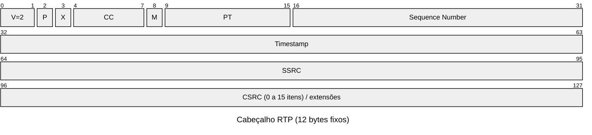

| Campo | Significado |
|---|---|
| V | Versão, sempre 2 |
| P | Há bytes de *padding* no fim |
| X | Há extensão de cabeçalho (no WebRTC, quase sempre: transport-cc, mid, abs-send-time) |
| CC | Quantidade de CSRCs (fontes misturadas, usado por mixers/MCU) |
| M | Marker: no vídeo, marca o **último pacote de um quadro** |
| PT | Payload type (casa com `a=rtpmap`) |
| Sequence Number | +1 a cada pacote; detecta perda e reordenação (NACK usa esse número) |
| Timestamp | Instante de amostragem no relógio do codec: **90 kHz** para vídeo, **48 kHz** para Opus. Todos os pacotes de um mesmo quadro têm o mesmo timestamp; a 30 fps ele avança 3000 por quadro |
| SSRC | Identificador aleatório da fonte (uma trilha); RTX e simulcast usam SSRCs próprios |

O RTP não carrega relógio absoluto: a sincronização entre áudio e vídeo (*lip sync*) usa o mapeamento
timestamp RTP para NTP enviado nos **Sender Reports** do RTCP.

### Empacotamento H.264 (RFC 6184)

Um quadro H.264 pode ter dezenas de KB, e o pacote RTP precisa caber no MTU (o navegador mira cerca de 1200 bytes de
payload). O RFC 6184 define três formas de levar NALUs:

| Tipo de NAL no payload | Nome | Uso |
|---|---|---|
| 1 a 23 | Single NAL unit | Uma NALU inteira, quando cabe |
| 24 | **STAP-A** | Agrega várias NALUs pequenas num pacote, cada uma precedida de 16 bits de tamanho. Típico: SPS + PPS + (IDR, se couber) |
| 28 | **FU-A** | Fragmenta uma NALU grande em vários pacotes |

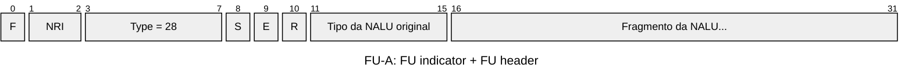

`S` = 1 no primeiro fragmento, `E` = 1 no último. O cabeçalho original da NALU é reconstruído juntando `F` e `NRI`
do indicador com o tipo do FU header. `packetization-mode=1` na SDP é o que autoriza STAP-A e FU-A (o modo 0 só
aceita NALUs únicas). Outros codecs têm seus próprios formatos: VP8 (RFC 7741), VP9 (RFC 9628), AV1 (spec da AOM),
Opus (RFC 7587), H.265 (RFC 7798).

### RTCP

| PT | Tipo | Função |
|---|---|---|
| 200 | SR (Sender Report) | Do emissor: relógio NTP + timestamp RTP correspondente, pacotes e bytes enviados |
| 201 | RR (Receiver Report) | Do receptor: fração perdida, perdas acumuladas, maior sequência, **jitter**, dados para calcular RTT |
| 202 | SDES | Descrição da fonte (CNAME) |
| 203 | BYE | Fonte saindo |
| 205 FMT 1 | **Generic NACK** | "Perdi os pacotes de sequência X, X+1..." O emissor retransmite (via RTX, RFC 4588) |
| 205 FMT 15 | **transport-cc** feedback | Horário de chegada de cada pacote (por número de sequência de transporte) para o controle de congestionamento do emissor |
| 206 FMT 1 | **PLI** (Picture Loss Indication) | "Não consigo decodificar, mande um keyframe" |
| 206 FMT 4 | **FIR** (Full Intra Request) | Pedido explícito de keyframe (usado por MCUs/SFUs ao entrar alguém novo) |
| 206 FMT 15 | **REMB** | Receptor anuncia a banda máxima estimada (modelo antigo, receptor estima) |

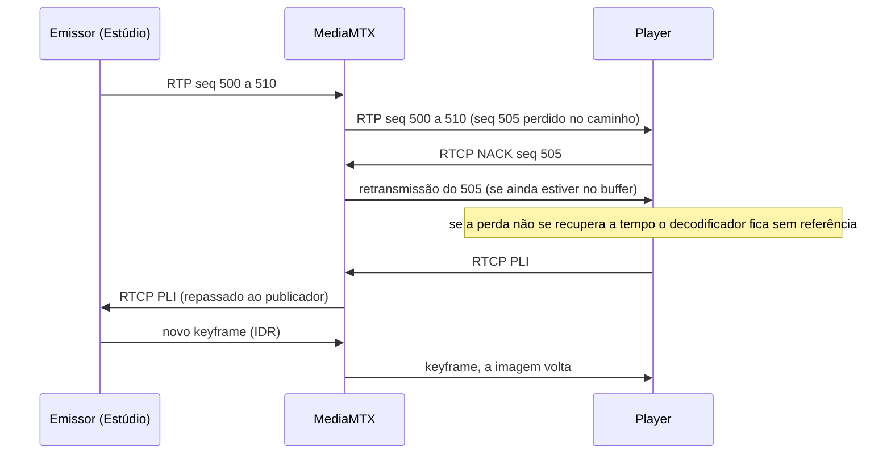

### Controle de congestionamento (GCC)

O WebRTC não usa o controle de congestionamento do TCP: ele **ajusta o bitrate do encoder** em tempo real. O
algoritmo do libwebrtc (Chrome, e portanto a maioria dos navegadores) é o **Google Congestion Control**:

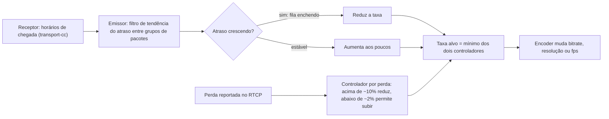

- Na versão moderna (*send-side BWE*), o receptor só devolve os horários de chegada (transport-cc) e o **emissor**
  estima a banda. Na versão antiga, o **receptor** estimava e mandava o resultado via REMB.
- Os limiares de perda (cerca de 2% e 10%) são os do rascunho do GCC; a implementação atual do libwebrtc evoluiu e os
  números exatos podem variar.
- No Estúdio, `qualityLimitationReason` em `getStats()` mostra se o encoder está limitado por `bandwidth` (GCC) ou
  `cpu`.

### Jitter buffer

Pacotes chegam com atrasos variáveis (jitter) e fora de ordem. O receptor os segura num **jitter buffer** adaptativo
até ter o quadro completo e decodificável, equilibrando latência contra travamentos. No áudio, o NetEQ do libwebrtc
também estica ou comprime o som e oculta perdas. O atraso médio do buffer aparece em `getStats()` como
`jitterBufferDelay / jitterBufferEmittedCount`, que o player do StreamLab usa para estimar a latência.

### Simulcast e SVC

| Técnica | Como funciona | Quem decide |
|---|---|---|
| **Simulcast** | O emissor codifica 2 ou 3 versões independentes (ex. 720p, 360p, 180p), cada uma com seu SSRC e um `rid` (`a=simulcast`, `a=rid` na SDP) | O SFU escolhe qual repassar a cada espectador |
| **SVC** (Scalable Video Coding) | Um único fluxo em camadas temporais e/ou espaciais (VP9, AV1; modos como `L1T3`, `L3T3`) | O SFU descarta camadas para quem tem menos banda |

É o equivalente da escada ABR do HLS no mundo WebRTC. O Estúdio do StreamLab manda uma única codificação
(`encodings: [{ maxBitrate: 2_500_000 }]`), e a escada ABR fica a cargo do transcoder do hub para o HLS.

### SFU vs MCU

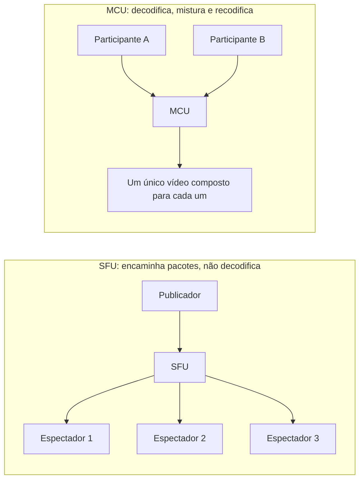

| | SFU (Selective Forwarding Unit) | MCU (Multipoint Control Unit) |
|---|---|---|
| CPU no servidor | Baixa (só roteia RTP/RTCP) | Alta (decodifica e recodifica) |
| Latência extra | Mínima | Encode/decode adicionais |
| Banda do cliente | Recebe um fluxo por fonte | Recebe um fluxo só |
| Exemplos | MediaMTX (para WebRTC), LiveKit, mediasoup, Janus | Composição em servidor, gateways de vídeo conferência legados |

Para escalar a milhares de espectadores, SFUs são encadeados em **cascata** (origin, relays regionais), porque cada
espectador WebRTC é uma sessão com estado (ICE, DTLS, controle de congestionamento) no servidor.

### WHIP (RFC 9725) e WHEP

| Operação | Requisição | Resposta |
|---|---|---|
| Criar sessão | `POST <endpoint>` com `Content-Type: application/sdp` e a oferta no corpo; autenticação opcional com `Authorization: Bearer <token>` | `201 Created`, `Content-Type: application/sdp`, cabeçalho `Location` com a URL da sessão, a answer no corpo; opcionalmente `ETag` e `Link: <...>; rel="ice-server"` com servidores STUN/TURN |
| Trickle ICE | `PATCH <sessão>` com `Content-Type: application/trickle-ice-sdpfrag` (RFC 8840) e `If-Match: <etag>` | `204 No Content` |
| ICE restart | `PATCH <sessão>` com novas credenciais `ice-ufrag`/`ice-pwd` | `200 OK` com o fragmento SDP do servidor e novo `ETag` |
| Encerrar | `DELETE <sessão>` | `200 OK` |
| Descobrir | `OPTIONS <endpoint>` (CORS e `Accept-Post`) | `204` com cabeçalhos |

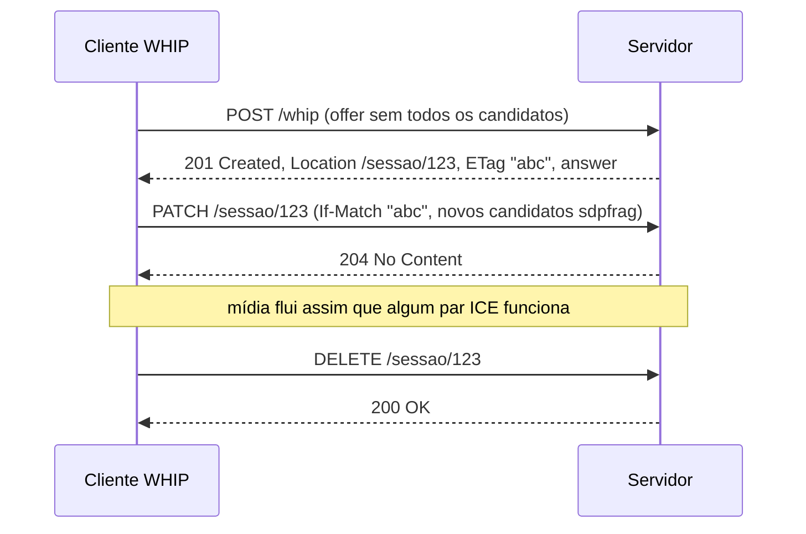

- O **WHIP** foi publicado como **RFC 9725** em 2025. O **WHEP** segue o mesmo desenho e estava em processo de
  padronização no grupo WISH do IETF (`draft-ietf-wish-whep`); confira na referência se já virou RFC.
- Não há renegociação: para mudar codecs ou trilhas, cria-se uma nova sessão.
- O token Bearer é só uma convenção de autenticação; o protocolo não define o formato. No StreamLab ele é a stream key.
- O endpoint WHEP do MediaMTX responde ao `OPTIONS` assim (saída real do projeto):

```text
HTTP/1.1 204 No Content
Accept-Post: application/sdp
Access-Control-Allow-Headers: Authorization, Content-Type, If-Match
Access-Control-Allow-Methods: OPTIONS, GET, POST, PATCH, DELETE
Access-Control-Expose-Headers: Accept-Post, Link
```

## Na prática no StreamLab

### O que o Estúdio faz (`hub/web/studio.js`)

1. `getUserMedia` (câmera, 1280x720 a 30 fps) ou `getDisplayMedia` (tela), com áudio.
2. Um `addTransceiver(track, { direction: 'sendonly' })` por trilha.
3. **Prefere H.264** com `setCodecPreferences`: o transcoder e o HLS lidam com H.264 sem dor (VP8 seria a escolha
   padrão de vários navegadores).
4. Limita o vídeo com `sender.setParameters({ encodings: [{ maxBitrate: 2_500_000 }] })`.
5. Cria a oferta, espera o *ICE gathering* terminar (até 1 s) para mandar **todos os candidatos num só POST** (não usa
   trickle/PATCH).
6. `POST {webrtc}/<canal>/whip` com `Authorization: Bearer <stream key>`. O MediaMTX repassa o token ao hub, que o
   compara com a key do canal (`decide` em `hub/api.go`). `401` vira a mensagem "stream key errada?".
7. Guarda o `Location` (resolvido contra a URL do endpoint) e aplica a answer.
8. A cada segundo lê `getStats()`: codec, resolução, fps, bitrate, `keyFramesEncoded`, `qualityLimitationReason`,
   `nackCount`, `pliCount` (do `outbound-rtp`) e o RTT do par de candidatos nomeado.
9. Ao parar: `DELETE` na URL da sessão, `pc.close()` e encerra as trilhas.

Do lado do servidor, quando a origem é `webRTCSession`, o hub **sempre recodifica** também a qualidade "source"
(`hub/transcoder.go`, função `supervise`): navegadores geram keyframes só quando pedidos (PLI) ou raramente, então
copiar o vídeo produziria segmentos HLS de tamanho irregular. O áudio Opus vira AAC no transcoder.

### O que o player faz (`hub/web/watch.js`, modo WebRTC)

1. `addTransceiver('video', { direction: 'recvonly' })` e o mesmo para áudio.
2. Oferta, espera o gathering (até 1 s), `POST {webrtc}/<canal>/whep` sem autenticação (ler é público).
3. Guarda `Location` para o `DELETE` e aplica a answer; `ontrack` liga o `MediaStream` ao `<video>`.
4. Se `connectionState` vira `failed`, envia um beacon de QoE (`kind: 'ice'`) e tenta de novo em 3 s.
5. A cada segundo, `getStats()`: bitrate, fps, jitter, `packetsLost`, resolução, codec, RTT e a latência estimada:

   `latência ≈ jitterBufferDelay / jitterBufferEmittedCount + RTT / 2`

   É uma estimativa só da parte de rede e buffer; não inclui captura, encoder nem o caminho do ingest. Para medir
   *glass-to-glass*, compare o relógio queimado na imagem do `demo-streamer` com o relógio da página.
6. A aba "Playlist / SDP" mostra a answer do MediaMTX com explicação linha a linha. A oferta fica em
   `window.lastSdp.offer` depois que essa aba é aberta (no console: `copy(window.lastSdp.offer)`).

### `webrtcAdditionalHosts` e `WEBRTC_HOST`

O MediaMTX roda num container com IP interno (algo como `172.x.y.z`), inalcançável pelo navegador. Os candidatos
`host` que ele anunciaria por conta própria não funcionariam. `webrtcAdditionalHosts` adiciona candidatos com os
IPs/nomes informados e a porta `8189`, que o compose publica em UDP e TCP.

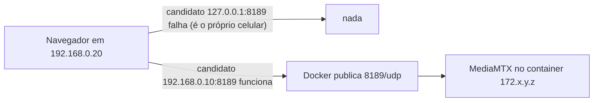

- Padrão: `127.0.0.1`, que só funciona com o navegador na **mesma máquina**.
- Para assistir de outro dispositivo da rede: `WEBRTC_HOST=192.168.0.10 docker compose up -d` (o compose transforma
  em `MTX_WEBRTCADDITIONALHOSTS`, que sobrescreve o valor do `mediamtx.yml`). Aceita lista separada por vírgula.
- Num servidor na internet: o IP público ou um nome DNS, e ainda assim um **TURN** para clientes atrás de firewalls
  restritivos.

### Comandos

```bash
# Descobrir o endpoint (CORS, métodos aceitos)
curl -si -X OPTIONS http://localhost:8889/live/demo/whep

# Fazer o POST de WHEP "na mão" com uma oferta copiada do navegador (copy(window.lastSdp.offer) e salve em offer.sdp).
# A resposta mostra 201, Location e a answer. A mídia não vai fluir (o curl não faz ICE/DTLS) e a sessão expira.
curl -si -X POST -H 'Content-Type: application/sdp' --data-binary @offer.sdp http://localhost:8889/live/demo/whep

# Encerrar uma sessão pelo Location devolvido
curl -si -X DELETE "http://localhost:8889/live/demo/whep/<id-da-sessao>"

# Publicar via WHIP pela linha de comando (FFmpeg 8.0+ com o muxer whip; confira com: ffmpeg -h muxer=whip)
ffmpeg -re -f lavfi -i testsrc2=size=1280x720:rate=30 -f lavfi -i sine=frequency=440:sample_rate=48000 \
  -c:v libx264 -profile:v baseline -bf 0 -g 60 -b:v 2500k -c:a libopus -ar 48000 -ac 2 \
  -f whip -authorization "<key>" "http://localhost:8889/live/<canal>/whip"

# Sessões WebRTC ativas, com bytes, perdas e jitter (API interna, via container do hub)
docker compose exec hub wget -qO- http://mediamtx:9997/v3/webrtcsessions/list
```

### Onde olhar

| O quê | Onde |
|---|---|
| Estado ICE/DTLS, candidatos, gráficos de bitrate, NACK/PLI | `chrome://webrtc-internals` (Chrome/Edge) ou `about:webrtc` (Firefox) |
| Sessões criadas/fechadas e trilhas negociadas | `docker compose logs -f mediamtx` (linhas `[WebRTC] [session ...]`) |
| Stream key do WHIP | `docker compose logs -f hub` (linhas `auth ... protocol=webrtc`) |
| Publicadores e espectadores | Prometheus: `webrtc_sessions{state="publish"}` e `webrtc_sessions{state="read"}` |
| Perda e jitter | `webrtc_sessions_rtp_packets_lost`, `webrtc_sessions_rtp_packets_jitter` |
| Latência/QoE do player | `streamlab_player_latency_seconds{mode="webrtc"}` e demais métricas `streamlab_player_*` (confira os labels em `hub/qoe.go`) |

## Armadilhas comuns

- **Página "conecta" mas não aparece vídeo**: quase sempre ICE. Veja em `webrtc-internals` se algum par de
  candidatos teve sucesso; confira `WEBRTC_HOST` e se `8189/udp` está liberada no firewall.
- **Estúdio não pede câmera em outro dispositivo**: `getUserMedia` exige *secure context* (HTTPS ou `localhost`).
  Acessar `http://192.168.0.10:8000/studio` de outro aparelho não libera câmera; use HTTPS (proxy reverso) ou
  publique a partir da própria máquina.
- **Codec incompatível**: H.264 com B-frames, HEVC sem suporte no navegador ou áudio AAC não tocam via WebRTC.
  Publique com `-bf 0`/perfil baseline e, se quiser áudio no WebRTC, Opus.
- **Primeira imagem demora**: o player só decodifica a partir de um keyframe. Com GOP de 2 s a espera é de até 2 s;
  com GOPs longos, mais. O PLI ajuda quando a origem é WebRTC, mas não quando é RTMP/SRT (o encoder não ouve RTCP).
- **Mixed content**: página em HTTPS chamando WHEP em `http://` é bloqueada pelo navegador.
- **Esquecer o DELETE**: sem ele, a sessão fica viva no servidor até o ICE expirar, contando como espectador.
- **Escala**: cada espectador WebRTC consome CPU e memória no servidor. Para muitos espectadores, HLS/LL-HLS por
  CDN continua sendo a opção barata.

## Referências

- RFC 9725, *WebRTC-HTTP Ingestion Protocol (WHIP)*: https://www.rfc-editor.org/rfc/rfc9725
- IETF WISH, *WebRTC-HTTP Egress Protocol (WHEP)*: https://datatracker.ietf.org/doc/draft-ietf-wish-whep/
- RFC 8825, *Overview: Real-Time Protocols for Browser-Based Applications*: https://www.rfc-editor.org/rfc/rfc8825
- RFC 8829, *JSEP*: https://www.rfc-editor.org/rfc/rfc8829 ; RFC 8866, *SDP*: https://www.rfc-editor.org/rfc/rfc8866 ; RFC 3264, *Offer/Answer*: https://www.rfc-editor.org/rfc/rfc3264
- RFC 8843, *BUNDLE*: https://www.rfc-editor.org/rfc/rfc8843
- RFC 8445, *ICE*: https://www.rfc-editor.org/rfc/rfc8445 ; RFC 8838 / 8840, *Trickle ICE*: https://www.rfc-editor.org/rfc/rfc8838 , https://www.rfc-editor.org/rfc/rfc8840
- RFC 8489, *STUN*: https://www.rfc-editor.org/rfc/rfc8489 ; RFC 8656, *TURN*: https://www.rfc-editor.org/rfc/rfc8656 ; RFC 7675, *Consent Freshness*: https://www.rfc-editor.org/rfc/rfc7675
- RFC 5764, *DTLS-SRTP*: https://www.rfc-editor.org/rfc/rfc5764 ; RFC 3711, *SRTP*: https://www.rfc-editor.org/rfc/rfc3711 ; RFC 7983, *Multiplexing*: https://www.rfc-editor.org/rfc/rfc7983
- RFC 3550, *RTP/RTCP*: https://www.rfc-editor.org/rfc/rfc3550 ; RFC 4585, *RTP/AVPF (NACK, PLI)*: https://www.rfc-editor.org/rfc/rfc4585 ; RFC 5104 (FIR): https://www.rfc-editor.org/rfc/rfc5104 ; RFC 4588, *RTX*: https://www.rfc-editor.org/rfc/rfc4588
- RFC 6184, *RTP Payload Format for H.264*: https://www.rfc-editor.org/rfc/rfc6184 ; RFC 7587, *Opus*: https://www.rfc-editor.org/rfc/rfc7587
- *Google Congestion Control* (draft-ietf-rmcat-gcc): https://datatracker.ietf.org/doc/draft-ietf-rmcat-gcc/ ; *Transport-wide CC*: https://datatracker.ietf.org/doc/draft-holmer-rmcat-transport-wide-cc-extensions/ ; *REMB*: https://datatracker.ietf.org/doc/draft-alvestrand-rmcat-remb/
- RFC 8853, *Simulcast*: https://www.rfc-editor.org/rfc/rfc8853 ; W3C *Scalable Video Coding (SVC) Extension*: https://www.w3.org/TR/webrtc-svc/
- W3C, *WebRTC 1.0* e *Identifiers for WebRTC's Statistics API*: https://www.w3.org/TR/webrtc/ , https://www.w3.org/TR/webrtc-stats/
- MediaMTX (WebRTC, `webrtcAdditionalHosts`): https://github.com/bluenviron/mediamtx
- FFmpeg, muxer `whip`: https://ffmpeg.org/ffmpeg-formats.html#whip
